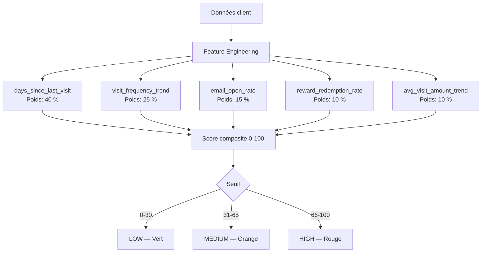
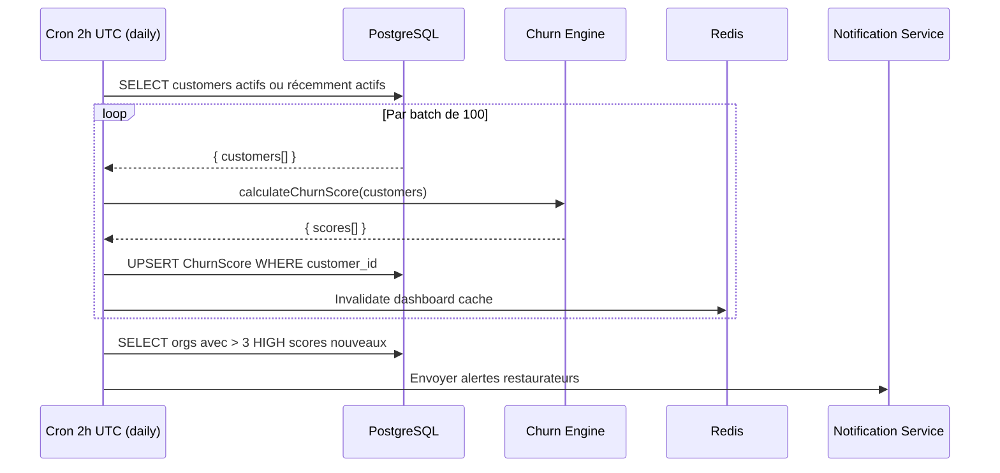
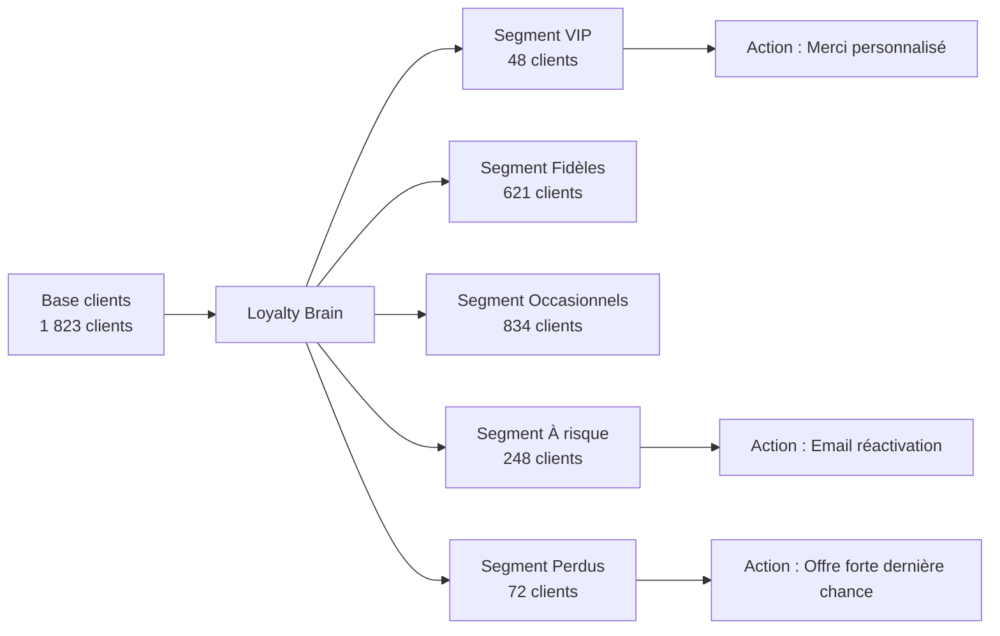
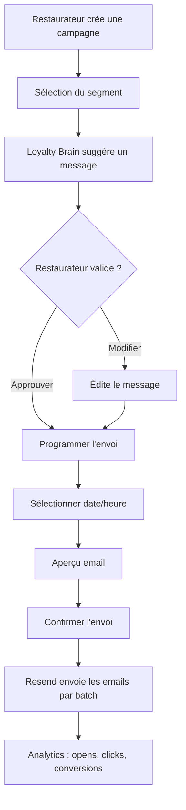
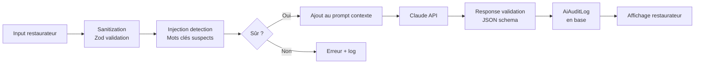
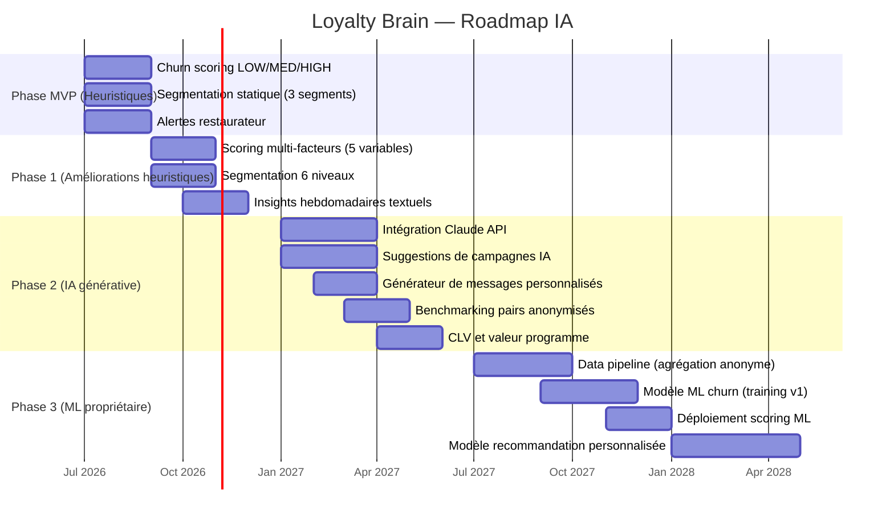

# LOYALTY BRAIN — Architecture IA de LoyaltyFlowAI

> **Version :** 1.0.0 | **Date :** 2026-06-28
> **Scope :** Design complet du moteur IA — scoring churn, segmentation, prédictions, recommandations, campagnes automatisées, analytics IA
> **Lié à :** [DISCOVERY.md §2.6](../technical/DISCOVERY.md#26-module-ia--loyalty-brain) | [PRODUCT_BIBLE.md §15](../product/PRODUCT_BIBLE.md) | [CUSTOMER_LIFECYCLE.md](../customer/CUSTOMER_LIFECYCLE.md)

---

## Table des matières

1. [Vision du Loyalty Brain](#1-vision-du-loyalty-brain)
2. [Architecture à 3 niveaux](#2-architecture-à-3-niveaux)
3. [Module 1 — Churn Scoring](#3-module-1--churn-scoring)
4. [Module 2 — Segmentation intelligente](#4-module-2--segmentation-intelligente)
5. [Module 3 — Moteur de recommandations](#5-module-3--moteur-de-recommandations)
6. [Module 4 — Campagnes automatisées](#6-module-4--campagnes-automatisées)
7. [Module 5 — Analytics IA](#7-module-5--analytics-ia)
8. [Intégration Claude API](#8-intégration-claude-api)
9. [Roadmap IA par phase](#9-roadmap-ia-par-phase)
10. [Considérations éthiques et RGPD](#10-considérations-éthiques-et-rgpd)

---

## 1. Vision du Loyalty Brain

### Le problème que l'IA résout

Un restaurateur indépendant gère en moyenne **500-2 000 clients fidélité**. Sans outil d'analyse, il est aveugle :

- Il ne sait pas qui est sur le point de partir
- Il ne sait pas à qui envoyer une offre (et donc l'envoie à tout le monde = spam)
- Il ne sait pas si son programme de fidélité fonctionne vraiment
- Il n'a pas le temps de lire des tableaux de bord complexes

### La promesse du Loyalty Brain

> _"Loyalty Brain fait ce qu'un data analyst ferait en 4 heures, en 4 secondes — et le traduit en actions concrètes pour le restaurateur."_

**Ce que le restaurateur voit :**

- "3 clients risquent de ne plus revenir. Voici un message à leur envoyer."
- "Votre programme fonctionne mieux le vendredi. Envisagez une promo jeudi soir."
- "Marie est votre meilleure cliente — offrez-lui quelque chose ce mois-ci."

**Ce que l'IA fait en coulisses :**

- Calcule le risque de churn de chaque client
- Segmente la base clients automatiquement
- Génère des suggestions contextuelles via Claude
- Ordonnance les actions par priorité et ROI estimé

---

## 2. Architecture à 3 niveaux

```mermaid
graph TD
    subgraph "Niveau 1 — MVP (Heuristiques)"
        A1[Churn Scoring\nRègles métier] --> A2[Score LOW/MEDIUM/HIGH]
        A3[Segmentation\nbasique] --> A4[Actif / À risque / Inactif]
        A5[Alertes\nthreshold] --> A6[Notification restaurateur]
    end

    subgraph "Niveau 2 — Phase 2 (IA Générative)"
        B1[Contexte client\n+ programme] --> B2[Claude API]
        B2 --> B3[Suggestions textuelles\nactionnables]
        B4[Analyse tendances] --> B5[Insights hebdomadaires]
        B6[Générateur de campagnes] --> B7[Campagne email ciblée]
    end

    subgraph "Niveau 3 — Phase 3 (ML Propriétaire)"
        C1[Données agrégées\n> 1M transactions] --> C2[Entraînement ML\nclassification churn]
        C2 --> C3[Modèle prédictif\n(probabilité numérique)]
        C3 --> C4[Score 0-100\nfacteurs explicatifs]
        C4 --> C5[Recommandations\npersonnalisées]
    end

    A2 --> B3
    A4 --> B6
    B3 --> C5
```

---

## 3. Module 1 — Churn Scoring

### MVP — Algorithme heuristique

**Principe :** Simple, rapide, explicable. Basé sur une seule variable principale en MVP : `days_since_last_visit`.

```typescript
// packages/utils/src/churn.ts
type ChurnLevel = 'LOW' | 'MEDIUM' | 'HIGH'

interface ChurnInput {
  lastVisitAt: Date
  totalVisits: number
  averageVisitIntervalDays?: number
}

interface ChurnScore {
  level: ChurnLevel
  riskPercentage: number
  daysSinceLastVisit: number
  explanation: string
}

function calculateChurnScore(input: ChurnInput): ChurnScore {
  const daysSince = differenceInDays(new Date(), input.lastVisitAt)

  if (daysSince < 30) {
    return {
      level: 'LOW',
      riskPercentage: 15,
      daysSinceLastVisit: daysSince,
      explanation: 'Client actif récemment',
    }
  }
  if (daysSince < 60) {
    return {
      level: 'MEDIUM',
      riskPercentage: 45,
      daysSinceLastVisit: daysSince,
      explanation: `Inactif depuis ${daysSince} jours — à surveiller`,
    }
  }
  return {
    level: 'HIGH',
    riskPercentage: 75,
    daysSinceLastVisit: daysSince,
    explanation: `Inactif depuis ${daysSince} jours — intervention recommandée`,
  }
}
```

### Phase 2 — Scoring multi-facteurs



### Phase 3 — ML Classification

```
Modèle : Gradient Boosting (XGBoost ou LightGBM)
Task : Binary classification (churned = 1 dans les 90 jours suivants)
Features :
  - Toutes les features Phase 2
  - Saisonnalité (mois, jour de la semaine)
  - Historique de récompenses
  - Comportement email (opens, clicks)
  - Comparaison avec cohortes similaires

Training :
  - Dataset : > 100 000 clients avec 12 mois d'historique
  - Split : 70/15/15 (train/val/test)
  - Validation : AUC-ROC > 0.80
  - Réentraînement : mensuel

Outputs :
  - Probabilité de churn (0.0 - 1.0)
  - Features les plus importantes (SHAP values)
  - Action recommandée
```

### Cron job de scoring



---

## 4. Module 2 — Segmentation intelligente

### Segments automatiques (MVP)

| Segment         | Critère                          | Action recommandée                     |
| --------------- | -------------------------------- | -------------------------------------- |
| **VIP**         | ≥ 12 visites/an + récompense × 3 | Attention particulière, offre surprise |
| **Fidèle**      | 4-11 visites/an, churn LOW       | Maintenir l'engagement                 |
| **Occasionnel** | 1-3 visites/an, churn LOW        | Augmenter la fréquence                 |
| **À risque**    | Churn MEDIUM                     | Campagne de réactivation douce         |
| **Perdu**       | Churn HIGH                       | Offre de réactivation forte            |
| **Nouveau**     | < 30 jours depuis inscription    | Séquence d'activation                  |

### Segmentation dynamique (Phase 2)



**Caractéristiques de la segmentation dynamique :**

- Recalculée chaque nuit (cron)
- Un client peut changer de segment à tout moment
- Le restaurateur peut créer des segments manuels personnalisés (Phase 2)
- Les segments servent de ciblage pour les campagnes email

---

## 5. Module 3 — Moteur de recommandations

### Recommandations actionnables (via Claude)

**Input envoyé à Claude :**

```json
{
  "context": {
    "restaurant": {
      "type": "brasserie",
      "clients_actifs": 1823,
      "programme": "10 tampons = 1 café"
    },
    "segment": {
      "nom": "À risque",
      "nb_clients": 248,
      "critère": "inactif 30-60 jours",
      "churn_moyen": "45 %"
    },
    "insights": {
      "jour_fort": "vendredi",
      "heure_forte": "12h-14h",
      "valeur_moy_panier": "18 €"
    }
  },
  "task": "suggestion_campagne"
}
```

**Output de Claude (exemple) :**

```json
{
  "suggestion": {
    "titre": "Campagne vendredi midi — Clients à risque",
    "message": "Bonjour {prénom} ! Ça fait un moment qu'on ne vous a pas vu au Bistrot. Ce vendredi midi, profitez d'un tampon bonus pour toute commande — on serait ravis de vous retrouver !",
    "moment_envoi": "Jeudi 18h (veille du vendredi)",
    "raison": "Vos clients à risque visitent surtout le vendredi. Envoyer la veille crée l'anticipation.",
    "roi_estimé": "Si 20 % des 248 clients reviennent, vous gagnez ~50 visites soit ~900 € de CA"
  }
}
```

### Types de recommandations

| Type                     | Déclencheur                        | Fréquence    |
| ------------------------ | ---------------------------------- | ------------ |
| Campagne de réactivation | > 10 clients MEDIUM ou HIGH        | Hebdomadaire |
| Offre VIP                | Client VIP sans récompense récente | Mensuel      |
| Alerte programme         | Taux de rédemption < 10 %          | Mensuel      |
| Optimisation règle       | Un seuil trop élevé détecté        | Trimestriel  |
| Bonne pratique           | Comparaison avec pairs anonymisés  | Mensuel      |

### Validation humaine obligatoire

**Toute recommandation IA nécessite une validation du restaurateur avant envoi.**

```
Suggestion IA → [ Approuver ] ou [ Modifier ] ou [ Ignorer ]

Raison : éviter l'automation aveugle et maintenir la confiance du restaurateur.
```

---

## 6. Module 4 — Campagnes automatisées

### Campagnes disponibles en MVP

| Campagne         | Déclencheur         | Audience                   | Canal          |
| ---------------- | ------------------- | -------------------------- | -------------- |
| Bienvenue        | Inscription         | Nouveau client             | Email          |
| Activation       | J+2 sans usage      | Inscrit non activé         | Email          |
| Rappel mensuel   | 1x/mois             | Tous actifs                | Email          |
| Récompense dispo | Seuil atteint       | Client ayant atteint seuil | Email + Widget |
| À risque (léger) | 45 jours inactif    | Churn MEDIUM               | Email          |
| Réactivation     | 60-75 jours inactif | Churn HIGH                 | Email          |

### Flow de campagne manuelle (Phase 2)



### Limites anti-spam intégrées

```
Règles intégrées (non-configurables) :
- Maximum 2 emails/semaine par client final
- Minimum 48h entre deux emails au même client
- Respect automatique des désabonnements
- Blacklist clients opt-out stockée en DB
```

---

## 7. Module 5 — Analytics IA

### Insights automatiques (hebdomadaires)

Chaque lundi, le Loyalty Brain génère un rapport hebdomadaire :

```
📊 Votre semaine du 16 au 22 juin

✅ Points forts :
· Votre meilleur jour : vendredi (32 visites)
· Taux d'activation en hausse : 68 % vs 61 % la semaine dernière

⚠️ Points d'attention :
· 3 nouveaux clients n'ont pas encore utilisé leur carte (envoyer un rappel ?)
· Le mardi soir est faible (2 visites) — pensez à une promo spécifique

🎯 Action recommandée cette semaine :
"Envoyez un email à vos 48 clients à risque — nous avons préparé un message."
[Voir la suggestion] →
```

### KPIs calculés par l'IA

| KPI                           | Formule                                    | Disponible |
| ----------------------------- | ------------------------------------------ | ---------- |
| Taux de rétention 30j         | Clients actifs J+30 / Inscrits J-30        | MVP        |
| Fréquence moyenne des visites | Total visites / clients actifs             | MVP        |
| Taux de churn mensuel         | Clients CHURNED / Total actifs             | MVP        |
| Taux de rédemption            | Récompenses utilisées / Récompenses créées | MVP        |
| Customer Lifetime Value (CLV) | Panier moyen × fréquence × durée estimée   | Phase 2    |
| Net Promoter Score proxy      | Fréquence de visite comme proxy NPS        | Phase 2    |
| Valeur du programme           | CA estimé généré par les clients fidélisés | Phase 2    |

### Comparaison avec pairs (benchmarking anonymisé)

Phase 2 — Les restaurants peuvent voir leur performance vs la médiane de restaurants similaires (type + taille) :

```
Votre taux de rétention : 65 %
Médiane restaurants similaires : 58 %

✅ Vous êtes au-dessus de la médiane !
```

---

## 8. Intégration Claude API

### Principes d'utilisation

**Modèle :** `claude-sonnet-4-6` (ratio qualité/coût optimal pour les suggestions)

**Cas d'usage API (Phase 2) :**

1. Génération de suggestions de campagne
2. Génération de messages de réactivation personnalisés
3. Analyse de tendances textuelles (résumé des insights)
4. Réponse à des questions du restaurateur en langage naturel ("Comment améliorer mon taux de rétention ?")

**Cas d'usage NON-API (règles locales) :**

- Churn scoring (trop fréquent, coût prohibitif)
- Segmentation automatique
- Calcul de KPIs

### Structure des prompts

```
[System prompt]
Tu es Loyalty Brain, l'assistant IA de LoyaltyFlowAI.
Tu aides les gérants de restaurants indépendants à fidéliser leurs clients.
Tes réponses sont en français, concrètes, et orientées action.
Tu ne donnes jamais de conseils juridiques ou financiers.
Tu utilises un ton bienveillant et positif.

[Context]
Restaurant : {name}, {type}, {city}
Programme : {program_type}, {threshold}, {reward}
Clients actifs : {count}
Segment ciblé : {segment_name} ({count} clients, critère: {criteria})
Tendances : {insights}

[Task]
Génère une suggestion de campagne email pour le segment "{segment_name}".
Format : JSON avec titre, message, moment_envoi, raison, roi_estimé.
```

### Guardrails et sécurité des prompts



**Règles anti-injection :**

- Tout input utilisateur injecté dans un prompt est escaped
- Longueur max des inputs : 500 caractères
- Mots clés déclencheurs refusés (ex : "ignore previous instructions")
- Tout appel Claude est loggé dans `AiAuditLog` avec le prompt et la réponse

### Coûts estimés Claude API

| Usage                | Tokens in | Tokens out | Coût/appel |
| -------------------- | --------- | ---------- | ---------- |
| Suggestion campagne  | ~800      | ~400       | ~0,012 €   |
| Message personnalisé | ~600      | ~200       | ~0,007 €   |
| Insight hebdo        | ~1 200    | ~600       | ~0,018 €   |

**Estimation Phase 2 (100 restaurants) :**

- 3 suggestions/restaurant/semaine = ~1 300 appels/semaine
- ~18 € / semaine = ~72 € / mois

---

## 9. Roadmap IA par phase



### Critères de passage Phase 2 → Phase 3

| Critère             | Seuil                                |
| ------------------- | ------------------------------------ |
| Volume de données   | > 1 000 000 transactions anonymisées |
| Restaurants actifs  | > 500 (diversité des cas)            |
| Qualité des données | < 5 % de valeurs manquantes          |
| Budget ML           | Justification ROI par l'équipe       |

---

## 10. Considérations éthiques et RGPD

### Transparence algorithmique

- Le restaurateur voit **pourquoi** un client est marqué à risque ("Inactif depuis 67 jours")
- Le score de churn est **explicable**, pas une boîte noire
- Les suggestions IA mentionnent explicitement qu'elles sont générées par IA

### Droits des personnes concernées (clients finaux)

| Droit RGPD                     | Application Loyalty Brain                                         |
| ------------------------------ | ----------------------------------------------------------------- |
| Droit d'accès (Art. 15)        | Le score de churn est inclus dans l'export RGPD                   |
| Droit à l'effacement (Art. 17) | Suppression du score de churn lors de l'anonymisation             |
| Droit d'opposition (Art. 21)   | Le client peut demander à ne pas être scoré                       |
| Profilage (Art. 22)            | Le scoring IA n'a pas d'effet juridique — pas de refus de service |

### Biais algorithmiques

**Biais potentiels identifiés :**

| Biais                 | Description                            | Mitigation                                  |
| --------------------- | -------------------------------------- | ------------------------------------------- |
| Biais de saisonnalité | Été = moins de visites ≠ churn         | Ajuster le scoring en haute/basse saison    |
| Biais de nouveauté    | Nouveau client = score HIGH par défaut | Segment "Nouveau" séparé du calcul churn    |
| Biais de médias       | Clients email opt-out = ignorés        | Score basé sur visites, pas ouverture email |

### Principe de minimisation

L'IA n'utilise **que les données nécessaires** à sa mission :

- Données comportementales de fidélité (visites, points)
- Pas de données démographiques (âge, sexe) — non collectées
- Pas de données de paiement (Stripe gère directement)
- Pas de croisement avec des données externes

---

_Le Loyalty Brain est le cœur différenciant de LoyaltyFlowAI. Sa valeur croît avec les données — chaque restaurant qui adopte la plateforme enrichit (anonymement) le modèle collectif._

_LoyaltyFlowAI — Confidentiel — © 2026_
