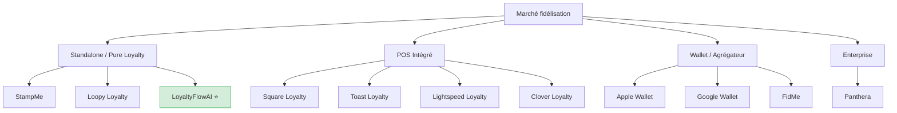
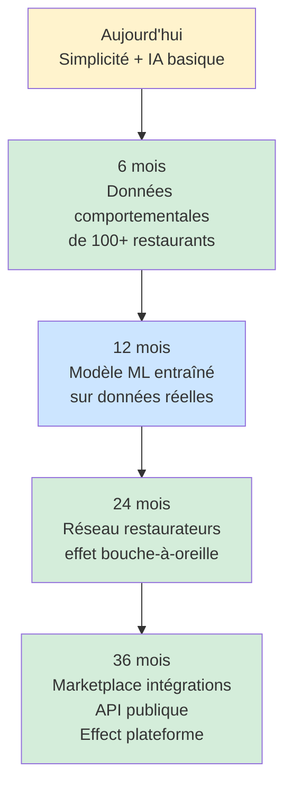
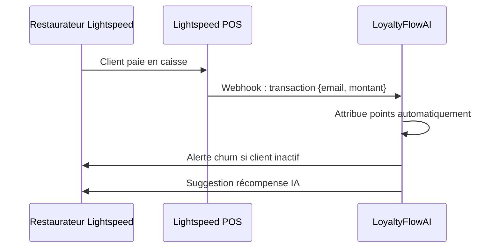

# COMPETITIVE ANALYSIS — LoyaltyFlowAI

> **Version :** 1.0.0 | **Date :** 2026-06-28
> **Lié à :** [PRODUCT_BIBLE.md §22](../product/PRODUCT_BIBLE.md#22-analyse-concurrentielle) | [GTM.md](./GTM.md) | [PRICING.md](./PRICING.md) | [MASTER_PLAN.md §8](../../MASTER_PLAN.md#8-positionnement)

---

## Table des matières

1. [Méthodologie](#1-méthodologie)
2. [Carte du marché](#2-carte-du-marché)
3. [Analyse individuelle par concurrent](#3-analyse-individuelle-par-concurrent)
   - [FidMe](#31-fidme)
   - [Loopy Loyalty](#32-loopy-loyalty)
   - [StampMe](#33-stampme)
   - [Lightspeed Loyalty](#34-lightspeed-loyalty)
   - [Toast Loyalty](#35-toast-loyalty)
   - [Square Loyalty](#36-square-loyalty)
   - [Clover Loyalty](#37-clover-loyalty)
   - [Panthera](#38-panthera)
   - [Apple Wallet Passes](#39-apple-wallet-passes)
   - [Google Wallet Loyalty](#310-google-wallet-loyalty)
4. [Matrice comparative globale](#4-matrice-comparative-globale)
5. [Analyse des prix](#5-analyse-des-prix)
6. [Gaps de marché identifiés](#6-gaps-de-marché-identifiés)
7. [Positionnement LoyaltyFlowAI](#7-positionnement-loyaltyflowai)
8. [Stratégie de différenciation](#8-stratégie-de-différenciation)
9. [Risques concurrentiels](#9-risques-concurrentiels)
10. [Opportunités de partenariat](#10-opportunités-de-partenariat)

---

## 1. Méthodologie

**Sources d'analyse :**

- Sites web et documentation publique des concurrents
- App stores (iOS / Android) — notes et avis
- G2, Capterra, Trustpilot — avis utilisateurs
- LinkedIn — taille équipe, croissance, recrutements
- Job postings — orientations stratégiques
- Communautés restaurateurs (Facebook, forums professionnels)

**Cadre d'évaluation (pour chaque concurrent) :**

- UX / Simplicité d'usage
- Modèle de prix
- Fonctionnalités clés
- Modèle business
- Forces
- Faiblesses
- Opportunités pour LoyaltyFlowAI
- Menaces que cela représente

---

## 2. Carte du marché

```
                    SIMPLICITÉ D'USAGE
                           ▲
                           │ StampMe ●  ● Loopy Loyalty
                           │
         Apple Wallet ●    │         ● LoyaltyFlowAI ★
         Google Wallet ●   │              (cible)
                           │
    PRIX BAS ──────────────┼───────────────────── PRIX ÉLEVÉ
                           │
               FidMe ●     │    Lightspeed ●
                           │    Square ●
               Clover ●    │    Toast ●
                           │
              Panthera ●   │
                           │
                           ▼
                    COMPLEXITÉ ÉLEVÉE
```

### Segmentation par focus marché



---

## 3. Analyse individuelle par concurrent

---

### 3.1 FidMe

**Type :** Application mobile consommateurs (wallet de fidélité multi-marques)
**Origine :** France 🇫🇷
**Fondée :** 2011
**Localisation :** Paris, France

#### Description

FidMe est l'application de référence de fidélisation en France, côté consommateur. C'est un **agrégateur** : les consommateurs centralisent toutes leurs cartes de fidélité dans l'app. Pour les marques/commerces, FidMe propose un accès à sa base de 4M+ utilisateurs.

#### Modèle économique

| Plan                     | Prix           | Description                                                |
| ------------------------ | -------------- | ---------------------------------------------------------- |
| Dématérialisation seule  | Gratuit        | Le commerce est référencé, les clients scannent leur carte |
| FidMe Business (Starter) | ~29-49 €/mois  | Tableau de bord basique, gestion de points                 |
| FidMe Business (Premium) | ~99-199 €/mois | Campagnes ciblées, analytics, notifications push           |
| FidMe Entreprise         | Sur devis      | Multi-établissements, API, white-label                     |

#### UX

| Dimension               | Note | Détail                                     |
| ----------------------- | ---- | ------------------------------------------ |
| Simplicité restaurateur | 3/5  | Dashboard web, pas mobile-first            |
| Simplicité client final | 5/5  | App native excellente, notée 4.5/5         |
| Onboarding              | 3/5  | Setup 1-2 heures, formulaire d'inscription |
| Analytics               | 2/5  | Basique, pas de prédiction                 |

#### Fonctionnalités

| Feature              | Disponible         |
| -------------------- | ------------------ |
| Programme de points  | ✅                 |
| Notifications push   | ✅ (plans payants) |
| Analytics de base    | ✅                 |
| Score de churn IA    | ❌                 |
| Suggestions IA       | ❌                 |
| Widget embarquable   | ❌                 |
| API publique         | ✅ (Enterprise)    |
| Multi-établissements | ✅                 |

#### Forces

- Base d'utilisateurs massive en France (4M+)
- Notoriété et confiance consommateur établies
- Distribution multi-marques (effet réseau)
- Application native iOS/Android de qualité
- Partenariats existants avec grandes enseignes

#### Faiblesses

- **Pas d'IA, pas de prédiction de churn**
- Focus chaînes/grandes marques — peu adapté aux indépendants
- Friction élevée : le client doit télécharger l'app FidMe
- Le restaurateur dépend d'un écosystème fermé
- Pas de widget web intégrable
- Données captées par FidMe, pas par le restaurateur
- UI dashboard vieillissante
- Complexité pour les petits commerces

#### Opportunités pour LoyaltyFlowAI

1. **Les restaurants indépendants évitent FidMe** car trop complexe et trop cher
2. **Le modèle "app à télécharger"** crée une friction que le widget web élimine
3. **FidMe capte les données** — LoyaltyFlowAI les laisse au restaurateur (valeur RGPD)
4. **Pas de churn prediction** → notre différenciation principale est non-adressée

#### Menaces

- Si FidMe lance une version "Indie" simple avec IA → menace sérieuse
- Base utilisateur existante = avantage réseau que nous n'avons pas

---

### 3.2 Loopy Loyalty

**Type :** Cartes de fidélité digitales (stamps)
**Origine :** Nouvelle-Zélande 🇳🇿 (global)
**Fondée :** 2012

#### Description

Loopy Loyalty permet aux petits commerces de créer des cartes de fidélité digitales (tampon virtuel). L'expérience est simple : le client reçoit une carte sur son smartphone via Apple/Google Wallet ou SMS. Le restaurateur scanne pour ajouter des tampons.

#### Modèle économique

| Plan    | Prix/mois | Limite                               |
| ------- | --------- | ------------------------------------ |
| Free    | 0 €       | 1 carte, 30 clients                  |
| Starter | 29 $      | 1 carte, 500 clients                 |
| Growth  | 59 $      | 3 cartes, 2 000 clients              |
| Premium | 99 $      | Cartes illimitées, clients illimités |

#### UX

| Dimension               | Note | Détail                        |
| ----------------------- | ---- | ----------------------------- |
| Simplicité restaurateur | 5/5  | Très simple, setup < 15 min   |
| Simplicité client final | 4/5  | Apple/Google Wallet, familier |
| Onboarding              | 5/5  | Wizardisé, très rapide        |
| Analytics               | 2/5  | Très basique (nb de tampons)  |

#### Forces

- **Onboarding le plus rapide du marché** (< 15 min)
- Intégration native Apple Wallet / Google Wallet → pas d'app à télécharger
- Prix très accessible
- Simple à expliquer aux clients
- 5 000+ commerces actifs

#### Faiblesses

- **Aucune IA, aucun churn scoring**
- Les "stamps" ne capturent pas les emails clients systématiquement
- **Pas de données comportementales** → impossible de segmenter
- Reporting quasi-inexistant
- Pas de widget web
- Pas de suggestions de récompenses intelligentes
- Modèle mental "tampon papier numérisé" = pas de vraie transformation

#### Opportunités pour LoyaltyFlowAI

1. **Clients Loopy insatisfaits de l'absence d'analytics** → migration vers LoyaltyFlowAI
2. **"Nous sommes ce que Loopy devient quand il grandit"** — message de migration clair
3. **Les données client manquent dans Loopy** → notre avantage #1

#### Menaces

- Loopy pourrait ajouter une couche IA/analytics
- Prix agressifs (29$) → pression sur notre entry point

---

### 3.3 StampMe

**Type :** Cartes de fidélité digitales (stamps)
**Origine :** Australie 🇦🇺 (global)
**Fondée :** 2013

#### Description

Concurrent direct de Loopy Loyalty. StampMe est un "tampon digital" permettant aux commerces de fidéliser sans papier. L'accent est mis sur la simplicité maximale.

#### Modèle économique

| Plan       | Prix/mois |
| ---------- | --------- |
| Free       | 0 €       |
| Starter    | ~15 $     |
| Business   | ~40 $     |
| Enterprise | Sur devis |

#### UX

| Dimension  | Note | Détail                                     |
| ---------- | ---- | ------------------------------------------ |
| Simplicité | 5/5  | Application la plus simple de la catégorie |
| Analytics  | 1/5  | Quasi-inexistant                           |

#### Forces / Faiblesses

**Forces :** Prix très bas, ultra-simple, application consommateur bien notée
**Faiblesses :** Aucune intelligence, aucune donnée comportementale, aucune prédiction, dashboard restaurateur très pauvre

#### Opportunités pour LoyaltyFlowAI

**Même que Loopy** : les utilisateurs StampMe cherchent à "grandir" et ont besoin d'outils plus puissants.

#### Positionnement LoyaltyFlowAI vs StampMe

> "StampMe numérise votre carte tampon. LoyaltyFlowAI vous dit pourquoi vos clients partent et comment les garder."

---

### 3.4 Lightspeed Loyalty

**Type :** Module de fidélité intégré à un POS restaurant
**Origine :** Canada 🇨🇦 (présent en France)
**Fondée :** 2005 (Lightspeed), module loyalty intégré

#### Description

Lightspeed est un système de caisse (POS) leader pour la restauration, retail et golf. Lightspeed Loyalty est un module optionnel qui ajoute des fonctionnalités de fidélisation native au POS.

#### Modèle économique

| Composant               | Prix estimé         |
| ----------------------- | ------------------- |
| POS Restaurant          | 119-299 €/mois      |
| Module Loyalty (add-on) | ~50-80 €/mois       |
| Installation/setup      | 0-200 €             |
| **Total avec Loyalty**  | **~170-380 €/mois** |

#### UX

| Dimension              | Note | Détail                    |
| ---------------------- | ---- | ------------------------- |
| Identification client  | 5/5  | Automatique via caisse    |
| Dashboard restaurateur | 3/5  | Intégré au POS, pas dédié |
| Client final           | 3/5  | Email + portal web        |
| Onboarding             | 2/5  | 1-3 jours avec setup POS  |

#### Fonctionnalités notables

- Attribution automatique de points à chaque transaction POS ✅
- Historique d'achats complet ✅
- Segments basiques ✅
- Analytics intégrées ✅
- **Churn prediction** : ❌
- **IA suggestions** : ❌
- **Widget web standalone** : ❌

#### Forces

- **Intégration POS native** = zéro friction pour l'attribution des points
- Présent en France avec support local
- Données transactionnelles complètes
- Ecosystème de partenaires bien établi

#### Faiblesses

- **Coût total élevé** (POS + loyalty = 170-380 €/mois)
- **Exclusif** : ne fonctionne que si le client utilise Lightspeed comme POS
- **Pas d'IA prédictive**
- Lock-in fort : changer de POS = perdre tout l'historique de fidélité
- Dashboard loyalty moins sophistiqué que les solutions dédiées

#### Opportunités pour LoyaltyFlowAI

1. **Les restaurants sans Lightspeed** (la majorité) ne peuvent pas accéder à leur module
2. **Opportunité de partenariat** : LoyaltyFlowAI peut s'intégrer via Lightspeed API
3. **Les restaurants qui changent de POS** perdent leur historique → migration vers solution standalone

#### Menaces

- Lightspeed pourrait enrichir son module loyalty avec IA
- Accord avec Lightspeed pour distribuer LoyaltyFlowAI = bonne chose ; ils lancent leur propre IA = mauvaise chose

---

### 3.5 Toast Loyalty

**Type :** Module de fidélité intégré à un POS restaurant spécialisé
**Origine :** États-Unis 🇺🇸 (peu présent en France)
**Fondée :** 2011

#### Description

Toast est le leader des POS pour restaurants aux États-Unis. Toast Loyalty est un module add-on qui permet aux restaurants utilisant Toast de lancer des programmes de points.

#### Modèle économique

| Composant       | Prix estimé             |
| --------------- | ----------------------- |
| Toast POS       | 0-165 $/mois + matériel |
| Toast Loyalty   | 50 $/mois               |
| Toast Marketing | 75 $/mois               |

#### Forces / Faiblesses

**Forces :** Intégration POS parfaite (Toast est #1 aux US), analytics robustes, ecosystem complet

**Faiblesses pour LoyaltyFlowAI :**

- **Quasi-inexistant en France** → pas de menace directe sur notre marché
- Complexité US-centric (reporting en USD, emails en anglais par défaut)
- Pas d'IA prédictive
- Prix total élevé

#### Opportunités pour LoyaltyFlowAI

**Toast n'est pas une menace en France.** Les restaurants français qui cherchent des alternatives à Toast (souvent après frustration avec les solutions US) sont une opportunité d'acquisition.

---

### 3.6 Square Loyalty

**Type :** Module de fidélité intégré à Square POS
**Origine :** États-Unis 🇺🇸 (présence limitée en France)
**Fondée :** 2009 (Square), loyalty module plus récent

#### Description

Square Loyalty est un add-on à Square POS. Il permet de créer des programmes de points simples avec identification par numéro de téléphone lors du paiement.

#### Modèle économique

| Plan           | Prix US                            |
| -------------- | ---------------------------------- |
| Square Loyalty | 45-105 $/mois selon volume clients |

#### Forces / Faiblesses

**Forces :** Identification via téléphone = zéro friction pour le client, intégration paiement parfaite

**Faiblesses pour notre marché :**

- **Disponibilité limitée en France** (Square a une présence faible en Europe)
- Pas d'IA
- Uniquement avec Square POS
- Reporting basique

#### Impact sur LoyaltyFlowAI

**Faible.** Square n'est pas un concurrent direct sur le marché français en 2026.

---

### 3.7 Clover Loyalty

**Type :** Module de fidélité intégré à Clover POS
**Origine :** États-Unis 🇺🇸
**Fondée :** 2010 (Clover)

#### Description

Clover est un système POS de Fiserv. Clover dispose d'une marketplace d'applications, dont des apps de fidélisation tierces.

#### Modèle économique

| Composant                 | Prix               |
| ------------------------- | ------------------ |
| Clover POS                | 14.95-84.95 $/mois |
| App fidélisation (tierce) | 5-30 $/mois        |

#### Forces / Faiblesses

**Forces :** Marketplace ouverte (opportunité d'intégration), prix hardware abordable

**Faiblesses :**

- **Peu présent en France**
- Fidélisation via apps tierces = expérience fragmentée
- Qualité variable des apps marketplace

#### Impact sur LoyaltyFlowAI

**Quasi-nul en France.** Potentiel de publication sur marketplace Clover en Phase 3.

---

### 3.8 Panthera

**Type :** Plateforme de fidélisation enterprise
**Origine :** France 🇫🇷
**Focus :** Grandes enseignes, retail, services

#### Description

Panthera est une plateforme de marketing relationnel et de fidélisation pour les grandes entreprises françaises. Elle propose une gestion complète des programmes de fidélité — points, tiers, coupons, campagnes — avec support dédié.

#### Modèle économique

| Segment              | Prix estimé          |
| -------------------- | -------------------- |
| Mid-market           | 500-2 000 €/mois     |
| Enterprise           | 2 000-10 000+ €/mois |
| Intégration initiale | 5 000-50 000 €       |

#### UX

| Dimension                | Note | Détail                      |
| ------------------------ | ---- | --------------------------- |
| Restaurateur indépendant | 1/5  | Non adapté (pas self-serve) |
| Manager CRM              | 4/5  | Dashboard riche             |
| Onboarding               | 1/5  | 3-6 mois avec équipe dédiée |

#### Forces

- Références clients solides (grandes enseignes françaises)
- Support et accompagnement dédié
- Fonctionnalités enterprise complètes
- Conformité RGPD native
- IA analytics basique

#### Faiblesses

- **Totalement inaccessible pour les indépendants** (prix, complexité)
- Pas self-serve
- Setup de 3-6 mois
- UX vieillissante
- Pas d'IA prédictive conversationnelle

#### Opportunités pour LoyaltyFlowAI

1. **Notre marché cible est leur angle mort** — ils ne s'y intéressent pas
2. **Message clair :** "La fidélisation Panthera pour les indépendants, en 30 minutes"
3. Les PME qui "outgrowent" LoyaltyFlowAI peuvent passer chez Panthera → pas de conflit direct

#### Menaces

- **Aucune.** Panthera ne descendra pas en marché SMB — trop coûteux pour eux.

---

### 3.9 Apple Wallet Passes

**Type :** Wallet numérique avec support cartes de fidélité
**Origine :** États-Unis 🇺🇸 (global)
**Présence :** Préinstallé sur tous les iPhones

#### Description

Apple Wallet permet aux entreprises de créer des "Passes" — cartes de fidélité, tickets, coupons — qui s'installent sur iPhone sans télécharger d'app. Les passes se mettent à jour en temps réel via notifications push.

**Pour créer un Pass Apple Wallet :** Il faut un compte Apple Developer (99 $/an) + implémentation technique ou une solution tierce (Loopy, PassKit, Walletly...).

#### Forces

- **Préinstallé sur 100 % des iPhones** → zéro friction d'installation
- Notifications push natives sans app
- NFC support → identification sans QR code possible
- Expérience client fluide et familière

#### Faiblesses

- **Pas un système de fidélité** — juste un contenant
- **iOS uniquement** (les utilisateurs Android doivent utiliser Google Wallet)
- Pas de dashboard restaurateur
- Pas d'analytics
- Implémentation technique requise

#### Rôle dans l'écosystème

Apple Wallet n'est **pas un concurrent** — c'est un canal de distribution. LoyaltyFlowAI **devrait s'y intégrer** en Phase 2 pour offrir une carte de fidélité digitale que les clients finaux ajoutent à leur Wallet.

#### Opportunité pour LoyaltyFlowAI

**Phase 2 — Feature "Wallet Integration" :**

- Le client final peut ajouter sa carte LoyaltyFlowAI à Apple/Google Wallet
- Les points se mettent à jour automatiquement
- Récompense débloquée = notification push sans app

---

### 3.10 Google Wallet Loyalty

**Type :** Wallet numérique Android avec support fidélité
**Origine :** États-Unis 🇺🇸 (global)
**Présence :** Android (70 % du marché mondial)

#### Description

Équivalent Google du Apple Wallet. Google Wallet Loyalty API permet aux entreprises d'émettre des cartes de fidélité digitales visibles dans le wallet Android.

#### Différences vs Apple Wallet

| Dimension             | Apple Wallet   | Google Wallet      |
| --------------------- | -------------- | ------------------ |
| Plateforme            | iOS uniquement | Android uniquement |
| Part de marché France | ~30-35 %       | ~60-65 %           |
| Intégration technique | PassKit        | Google Wallet API  |
| Maturité              | Très mature    | Mature             |

#### Opportunité pour LoyaltyFlowAI

**Identique à Apple Wallet** — complémentaire. En Phase 2, les deux doivent être supportés simultanément. En France, **Google Wallet est prioritaire** (majorité Android).

---

## 4. Matrice comparative globale

| Critère                     | FidMe   | Loopy   | StampMe | Lightspeed | Toast   | Square  | Clover  | Panthera | Apple W. | Google W. | **LoyaltyFlowAI** |
| --------------------------- | ------- | ------- | ------- | ---------- | ------- | ------- | ------- | -------- | -------- | --------- | ----------------- |
| **Focus restauration**      | Partiel | Partiel | Partiel | ✅         | ✅      | Partiel | Partiel | Partiel  | ❌       | ❌        | ✅                |
| **Disponible France**       | ✅      | ✅      | ✅      | ✅         | ❌      | Limité  | ❌      | ✅       | ✅       | ✅        | ✅                |
| **Prix accessible PME**     | Moyen   | ✅      | ✅      | ❌         | ❌      | Moyen   | Moyen   | ❌       | ✅       | ✅        | ✅                |
| **Standalone (pas POS)**    | ✅      | ✅      | ✅      | ❌         | ❌      | ❌      | ❌      | ✅       | N/A      | N/A       | ✅                |
| **Widget web**              | ❌      | ❌      | ❌      | ❌         | ❌      | ❌      | ❌      | Partiel  | ❌       | ❌        | ✅                |
| **Score churn IA**          | ❌      | ❌      | ❌      | ❌         | ❌      | ❌      | ❌      | Basique  | N/A      | N/A       | ✅                |
| **Suggestions IA**          | ❌      | ❌      | ❌      | ❌         | ❌      | ❌      | ❌      | Partiel  | N/A      | N/A       | ✅                |
| **Setup < 30 min**          | ❌      | ✅      | ✅      | ❌         | ❌      | Partiel | Partiel | ❌       | N/A      | N/A       | ✅                |
| **Données au restaurateur** | ❌      | ✅      | ✅      | ✅         | ✅      | ✅      | ✅      | ✅       | N/A      | N/A       | ✅                |
| **Analytics avancées**      | Partiel | ❌      | ❌      | Partiel    | Partiel | Partiel | ❌      | ✅       | N/A      | N/A       | ✅ (roadmap)      |
| **API publique**            | ✅      | ❌      | ❌      | ✅         | ✅      | ✅      | ✅      | ✅       | ✅       | ✅        | ✅ (Phase 3)      |
| **RGPD natif**              | ✅      | Partiel | Partiel | Partiel    | ❌      | ❌      | ❌      | ✅       | ✅       | ✅        | ✅                |

**Légende :** ✅ = Oui | ❌ = Non | Partiel = En partie

---

## 5. Analyse des prix

### Positionnement prix par segment

```
Prix mensuel
    │
300 │                                           ● Panthera (2K-10K)
    │
200 │
    │                        ● Lightspeed (~170-380)
150 │
    │
100 │ ● FidMe Premium    ● Toast/Square (~100-120)
    │
 50 │ ● FidMe Starter
    │                    ★ LoyaltyFlowAI Starter (49€)
    │ ● Loopy Premium    ★ LoyaltyFlowAI Growth (149€)
    │                    ★ LoyaltyFlowAI Pro (299€)
 30 │ ● Loopy Starter
    │ ● StampMe
    │
  0 │ ● Loopy Free ● StampMe Free ● Apple/Google Wallet (gratuit)
    └──────────────────────────────────────────────────────────────
       Pas d'IA      IA basique     IA avancée (nous)
```

### Rapport valeur/prix

| Concurrent                | Prix moyen    | IA     | Widget | Score V/P |
| ------------------------- | ------------- | ------ | ------ | --------- |
| StampMe                   | ~20 €/mois    | ❌     | ❌     | 2/5       |
| Loopy Loyalty             | ~45 €/mois    | ❌     | ❌     | 2/5       |
| FidMe                     | ~70 €/mois    | ❌     | ❌     | 3/5       |
| Square Loyalty            | ~70 €/mois    | ❌     | ❌     | 3/5       |
| Lightspeed                | ~250 €/mois   | ❌     | ❌     | 3/5       |
| **LoyaltyFlowAI Starter** | **49 €/mois** | **✅** | **✅** | **5/5**   |

---

## 6. Gaps de marché identifiés

### Gap 1 — IA prédictive pour indépendants (MAJEUR)

**Constat :** Aucun concurrent accessible (< 200 €/mois) n'offre de prédiction de churn ou de suggestions IA actionnables.

**Opportunité :** LoyaltyFlowAI est le **premier à démocratiser l'IA prédictive** pour les restaurants indépendants.

**Taille du gap :** ~125 000 restaurants indépendants français sans solution IA = marché vierge.

---

### Gap 2 — Widget web sans installation d'app (SIGNIFICATIF)

**Constat :** FidMe, Loopy et StampMe nécessitent soit l'installation d'une app, soit l'intégration Apple/Google Wallet. Aucun ne propose un widget web embarquable directement sur le site du restaurant.

**Opportunité :** Le widget JS élimine la friction "télécharger une app" — the biggest barrier in loyalty adoption.

---

### Gap 3 — Solution standalone française avec RGPD natif

**Constat :** Les solutions POS intégrées (Toast, Square) ne sont pas RGPD-first par design. Les solutions US-centric ne comprennent pas le marché français.

**Opportunité :** Un SaaS standalone, hébergé en EU, RGPD by design, en français, avec support local.

---

### Gap 4 — Données au service du restaurateur (et non du fournisseur)

**Constat :** FidMe capte les données clients au profit de son réseau. Les restaurants partagent leur base client avec un tiers.

**Opportunité :** LoyaltyFlowAI positionne les données comme propriété du restaurateur — différenciation RGPD forte.

---

## 7. Positionnement LoyaltyFlowAI

### Statement final

> _Pour les restaurants indépendants français qui veulent fidéliser intelligemment leurs clients, LoyaltyFlowAI est la plateforme de fidélisation IA qui combine la simplicité de Loopy Loyalty, l'intelligence de Salesforce, et un widget web qui ne nécessite aucune app — contrairement à FidMe qui capte les données, aux outils POS qui nécessitent un changement de caisse, et aux solutions enterprise inaccessibles._

### Message par concurrent

| Si le prospect vient de… | Notre message                                                                           |
| ------------------------ | --------------------------------------------------------------------------------------- |
| Carte tampon papier      | "Transformez votre carte tampon en intelligence client en 30 minutes."                  |
| Loopy / StampMe          | "Vous numérisez déjà. LoyaltyFlowAI vous dit maintenant qui va partir — et que faire."  |
| FidMe                    | "Reprenez le contrôle de vos données clients. Elles vous appartiennent."                |
| Lightspeed               | "Gardez votre caisse, ajoutez l'IA. LoyaltyFlowAI s'intègre à votre workflow existant." |
| Rien (non-consommateur)  | "Vos concurrents fidélisent. Vous perdez des clients sans le savoir."                   |

---

## 8. Stratégie de différenciation

### Différenciateurs défendables

| Différenciateur                         | Défendabilité                 | Durée             |
| --------------------------------------- | ----------------------------- | ----------------- |
| **IA churn prediction accessible**      | Haute (6-18 mois avant copie) | Court-moyen terme |
| **Widget web sans app**                 | Moyenne (facile à copier)     | Court terme       |
| **RGPD by design + données restaurant** | Haute (valeur réglementaire)  | Long terme        |
| **Focus restauration France**           | Haute (connaissance niche)    | Long terme        |
| **Données comportementales accumulées** | Très haute (moat data)        | Long terme        |

### Moat à construire



---

## 9. Risques concurrentiels

| Risque                                                  | Concurrent | Probabilité      | Impact   | Mitigation                            |
| ------------------------------------------------------- | ---------- | ---------------- | -------- | ------------------------------------- |
| FidMe lance une version "Indie" simple                  | FidMe      | Faible           | Élevé    | Vitesse, données propriétaires, niche |
| Lightspeed lance churn prediction IA                    | Lightspeed | Moyenne          | Élevé    | Partenariat avant compétition         |
| Loopy ajoute analytics avancées                         | Loopy      | Moyenne          | Moyen    | Marquer l'avance avec ML en Phase 2   |
| Concurrent VC-backed lance sur niche restaurants France | Inconnu    | Faible           | Élevé    | Données + distribution = moat         |
| Google/Apple lancent un système de fidélité intégré     | GAFA       | Faible (3-5 ans) | Critique | Être acquis avant ce scénario         |

---

## 10. Opportunités de partenariat

### Partenariats distribution (non-compétitifs)

| Partenaire                | Type                                        | Valeur                                       | Phase   |
| ------------------------- | ------------------------------------------- | -------------------------------------------- | ------- |
| **Lightspeed**            | Intégration POS → accès aux datas de caisse | Attribution automatique points sans friction | Phase 2 |
| **Zelty**                 | POS restaurant français                     | Marché FR, intégration natif                 | Phase 2 |
| **Sunday**                | Solution de paiement restaurant             | Identification client au moment du paiement  | Phase 2 |
| **TheFork (TripAdvisor)** | Réservation restaurant                      | Base de 50K+ restaurants en France           | Phase 3 |
| **Zenchef**               | Logiciel restaurant                         | Base restaurants français                    | Phase 3 |
| **UMIH / GHR**            | Groupements professionnels                  | Distribution à des milliers de membres       | Phase 2 |

### Partenariat technologique le plus stratégique : Lightspeed



Ce partenariat résout **QO-MVP-04** (attribution des visites physiques) — la question critique du cœur du produit.

---

_Document vivant — Mise à jour trimestrielle recommandée._
_LoyaltyFlowAI — Confidentiel — © 2026_
