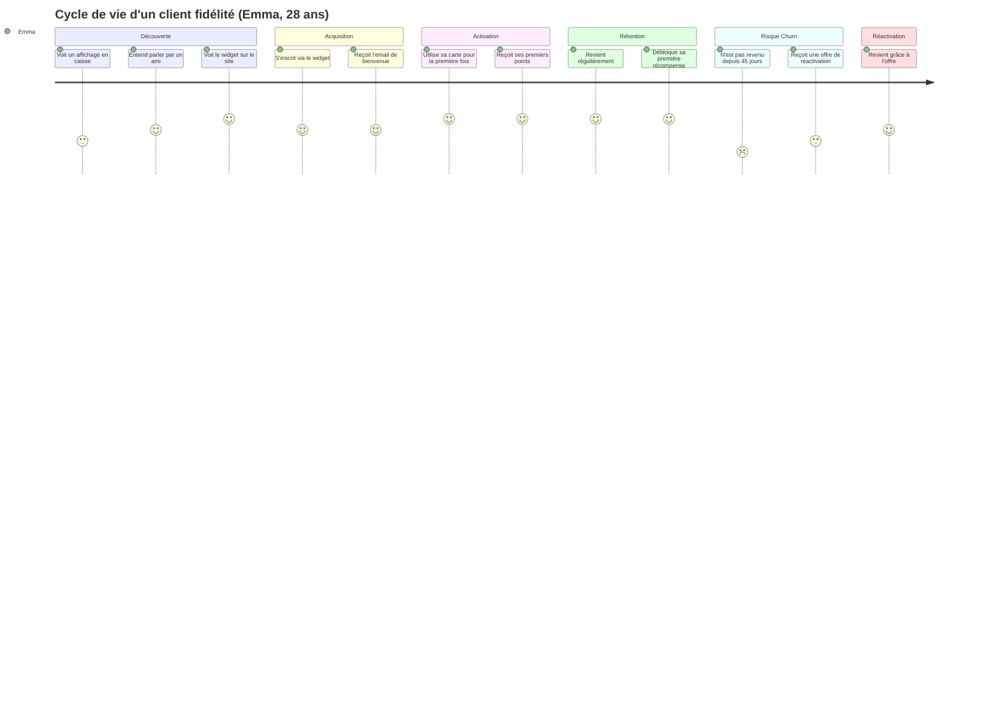
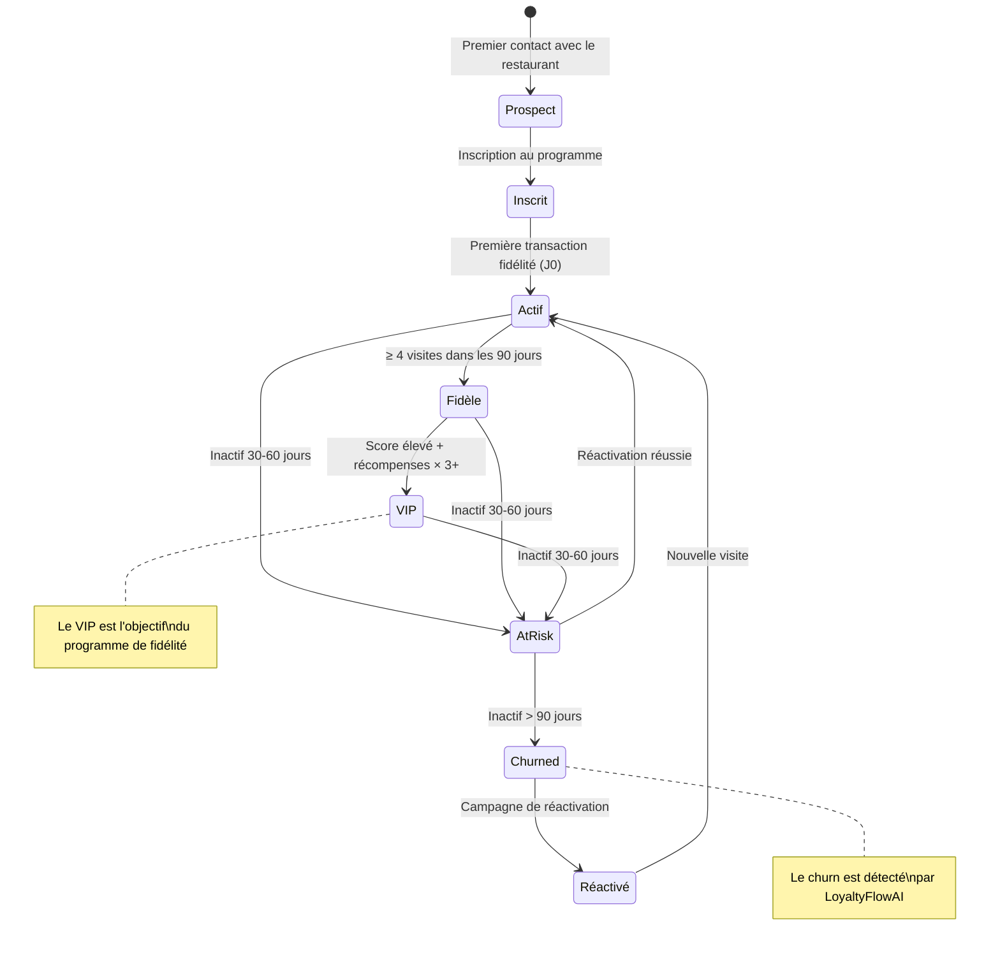
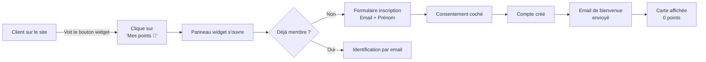
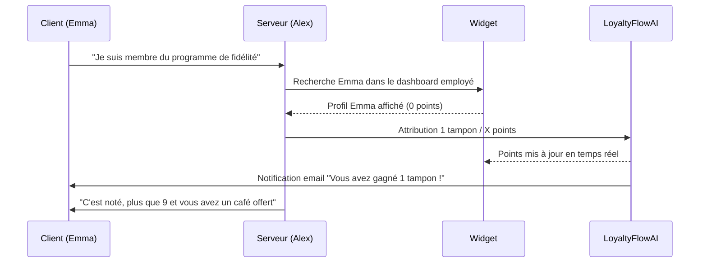
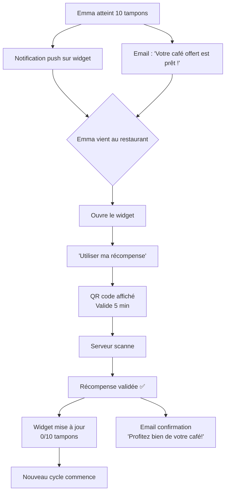
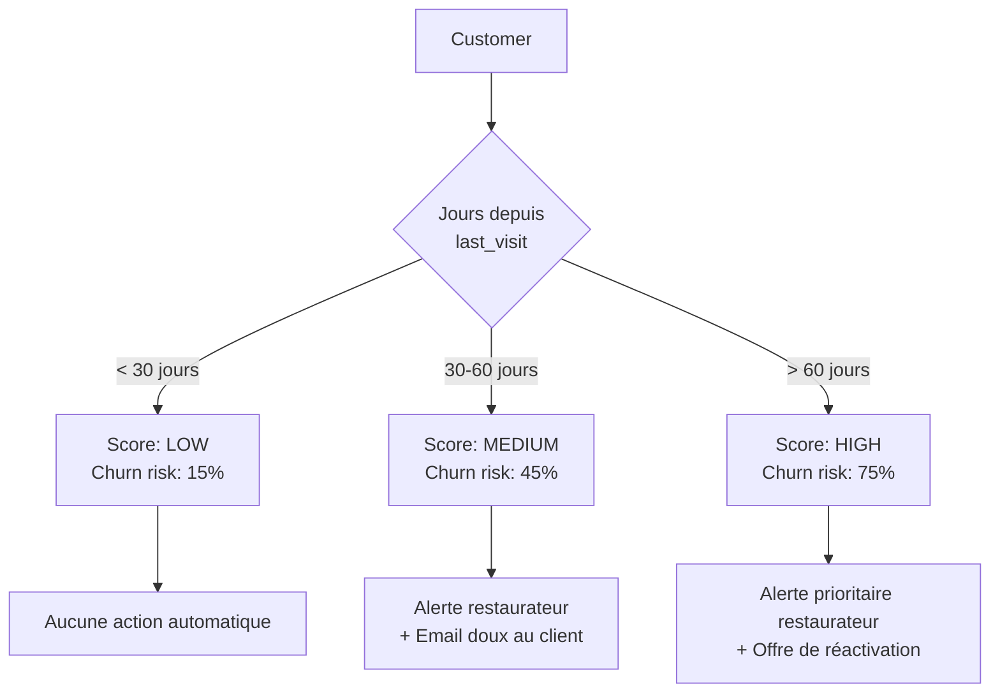
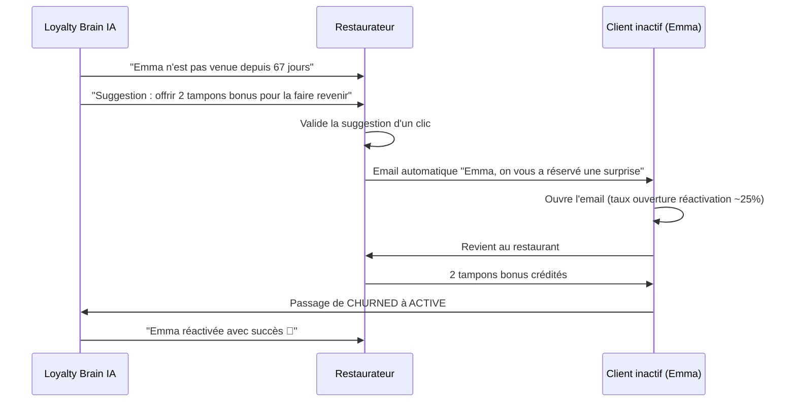

# CUSTOMER LIFECYCLE — LoyaltyFlowAI

> **Version :** 1.0.0 | **Date :** 2026-06-28
> **Scope :** Cycle de vie du client final (le convive) au sein du programme de fidélité d'un restaurant
> **Lié à :** [PRODUCT_BIBLE.md §7 Customer Journey](../product/PRODUCT_BIBLE.md) | [US-011 Widget](../product/user-stories/US-011-widget-client.md) | [METRICS.md](../business/METRICS.md)

---

## Table des matières

1. [Vue d'ensemble du cycle](#1-vue-densemble-du-cycle)
2. [Étape 1 — Découverte](#2-étape-1--découverte)
3. [Étape 2 — Acquisition](#3-étape-2--acquisition)
4. [Étape 3 — Activation](#4-étape-3--activation)
5. [Étape 4 — Première visite active](#5-étape-4--première-visite-active)
6. [Étape 5 — Première récompense](#6-étape-5--première-récompense)
7. [Étape 6 — Rétention](#7-étape-6--rétention)
8. [Étape 7 — Référence](#8-étape-7--référence)
9. [Étape 8 — Désengagement & Churn](#9-étape-8--désengagement--churn)
10. [Étape 9 — Réactivation](#10-étape-9--réactivation)
11. [Métriques par étape](#11-métriques-par-étape)
12. [Points de friction identifiés](#12-points-de-friction-identifiés)
13. [Séquences d'emails automatiques](#13-séquences-demails-automatiques)

---

## 1. Vue d'ensemble du cycle



---

## Diagramme d'états global



---

## 2. Étape 1 — Découverte

**Objectif :** Le client potentiel prend conscience de l'existence du programme de fidélité.

### Canaux de découverte

| Canal               | Description                                     | Efficacité estimée        |
| ------------------- | ----------------------------------------------- | ------------------------- |
| Affichage en caisse | QR code ou flyer "Rejoignez notre programme"    | Élevée — contexte d'achat |
| Widget sur le site  | Bouton flottant visible lors d'une visite web   | Élevée — digital-native   |
| Bouche-à-oreille    | "Un ami m'a dit qu'il avait eu un café gratuit" | Très élevée — confiance   |
| Réseaux sociaux     | Post restaurant mentionnant le programme        | Moyenne                   |
| Email (prospect)    | Newsletter restaurant avec mention fidélité     | Faible si non-client      |

### Moment clé

Le moment le plus efficace est **immédiatement après le paiement** : le client est satisfait, il a déjà payé, et la proposition d'un avantage futur est bienvenue.

```
Serveur : "Vous avez un site web ?"
Client : "Oui"
Serveur : "Vous pouvez vous inscrire là, vous aurez 10 % de réduction à la dixième visite."
```

---

## 3. Étape 2 — Acquisition

**Objectif :** Le client passe de prospect à membre inscrit.

### Flow d'inscription via widget



### Métriques de l'acquisition

| Métrique                                   | Cible MVP   |
| ------------------------------------------ | ----------- |
| Taux de conversion visiteur → inscrit      | > 5 %       |
| Délai inscription (du clic au compte créé) | < 2 minutes |
| Taux d'email valide (pas de typo)          | > 90 %      |

### Friction principale

**L'email.** Demander une adresse email a un taux de friction de 40-60 % vs un réseau social. Mitigation :

- Formulaire minimal (email + prénom seulement)
- Bénéfice immédiatement visible ("10 % après 10 visites")
- Pas de mot de passe à créer

---

## 4. Étape 3 — Activation

**Objectif :** Le client effectue sa **première action concrète** avec sa carte de fidélité.

L'activation = **premier point attribué** (ou premier tampon scanné). C'est le Moment de Vérité #1.

### Scénarios d'activation

| Scénario                          | Description                                              | Probabilité |
| --------------------------------- | -------------------------------------------------------- | ----------- |
| Visite physique (J+0)             | S'inscrit puis mange le jour même → activation immédiate | 40 %        |
| Visite future (J+1 à J+14)        | S'inscrit en naviguant, revient manger                   | 35 %        |
| Activation différée (J+15 à J+30) | S'est inscrit mais n'est pas revenu                      | 15 %        |
| Jamais activé                     | Inscrit mais jamais venu avec sa carte                   | 10 %        |

### Email post-inscription (J+2 si pas activé)

```
Objet : Emma, votre carte de fidélité vous attend 🎁

Bonjour Emma !

Vous avez rejoint le programme de fidélité du Bistrot du Marché il y a 2 jours.
Il ne manque plus qu'une chose : votre première visite !

À votre prochaine venue, mentionnez simplement votre prénom à notre équipe
ou montrez ce email — nous ajouterons votre premier tampon.

[Voir ma carte de fidélité]

À très bientôt !
```

### KPI d'activation

**Métrique principale :** % de clients inscrits qui obtiennent leur **premier point dans les 30 jours**.
**Cible :** > 60 % d'activation dans les 30 jours.

---

## 5. Étape 4 — Première visite active

**Objectif :** La première vraie visite avec utilisation du programme.

### Ce qui se passe



### Expérience souhaitée pour le client

- **Fluidité :** < 10 secondes pour que le serveur trouve le profil et attribue les points
- **Feedback positif :** Le client doit _sentir_ la progression ("encore 9 tampons !")
- **Personnalisation :** Le serveur appelle le client par son prénom (affiché dans le dashboard)

### Ce qui peut mal se passer

| Problème                                        | Cause                                | Solution                                                    |
| ----------------------------------------------- | ------------------------------------ | ----------------------------------------------------------- |
| Serveur ne connaît pas le système               | Mauvaise formation                   | US-010 : onboarding employé simplifié                       |
| Le client ne se souvient plus qu'il est inscrit | Inscription lointaine                | Email de rappel pré-visite (futur : géolocalisation opt-in) |
| L'email est saisi différemment                  | "emma@gmail.com" vs "Emma@gmail.com" | Normalisation lowercase à l'inscription                     |

---

## 6. Étape 5 — Première récompense

**Objectif :** Le client atteint le premier seuil et reçoit/utilise sa récompense.

C'est le **Moment de Vérité #2** — le moment où le client comprend que le programme "marche vraiment".

### Flow de récompense



### Impact psychologique

La première récompense est **disproportionnellement importante** pour la rétention :

- Les clients qui ont utilisé **une récompense** ont 3x plus de chances de rester dans le programme
- L'effort perçu de 10 visites est "récompensé" — l'effet Ikea / effet investissement

---

## 7. Étape 6 — Rétention

**Objectif :** Le client revient régulièrement et l'habitude se forme.

### Segments de rétention

| Segment         | Critère                  | % estimé |
| --------------- | ------------------------ | -------- |
| **Ambassadeur** | ≥ 1 visite/semaine       | 5 %      |
| **Fidèle**      | 2-4 visites/mois         | 25 %     |
| **Occasionnel** | 1 visite/mois            | 40 %     |
| **À risque**    | 1 visite tous les 2 mois | 20 %     |
| **Inactif**     | > 90 jours sans visite   | 10 %     |

### Mécanismes de rétention dans le produit

| Mécanisme                   | Déclencheur                    | Action                         |
| --------------------------- | ------------------------------ | ------------------------------ |
| Email mensuel "Votre carte" | Automatique, 1x/mois           | Rappel des points en cours     |
| Alerte "Vous êtes proche !" | 80 % du seuil atteint          | Push widget + email            |
| Récompense anniversaire     | Anniversaire inscription       | Cadeau surprise = tampon bonus |
| Offre saison                | Configurée par le restaurateur | Campagne manuelle ciblée       |

---

## 8. Étape 7 — Référence

**Objectif :** Le client satisfait recommande le restaurant à son entourage.

### Programme de parrainage (Phase 2)

```
[ Phase 2 — Hors scope MVP ]

Emma partage un lien unique → son ami Jean s'inscrit →
Jean reçoit 2 tampons de bienvenue → Emma reçoit 1 tampon bonus
```

### Référence organique (MVP)

Même sans programme de parrainage formalisé, un client qui utilise régulièrement sa carte de fidélité **en parle naturellement** (effet bouche-à-oreille). Faciliter cette conversation :

- Le widget affiche un bouton "Inviter un ami" (partage par SMS/email avec lien)
- Texte pré-rempli : "Je collecte des tampons au Bistrot du Marché. Rejoins-moi !"

---

## 9. Étape 8 — Désengagement & Churn

**Objectif :** Détecter le risque de départ avant qu'il soit trop tard.

### Modèle de détection du churn (MVP heuristique)



### Signaux de désengagement

| Signal                              | Sévérité | Action LoyaltyFlowAI                     |
| ----------------------------------- | -------- | ---------------------------------------- |
| Ouverture d'emails = 0 (3 derniers) | Moyen    | Changer heure d'envoi                    |
| Visite du widget sans transaction   | Moyen    | Email "Besoin d'aide ?"                  |
| Inactif 30-60 jours                 | Élevé    | Alerte restaurateur + email client       |
| Inactif > 60 jours                  | Critique | Score HIGH + offre personnalisée         |
| Désabonnement email                 | Critique | Stopper tous les emails, marquer opt-out |

---

## 10. Étape 9 — Réactivation

**Objectif :** Récupérer un client considéré perdu.

### Campagne de réactivation (Phase 2)



### Templates de réactivation (exemples)

**Email léger (45 jours) :**

```
Objet : Emma, il nous manque quelque chose 👋

Bonjour Emma,

Ça fait un moment qu'on ne vous a pas vu au Bistrot du Marché.
Vos 7 tampons vous attendent toujours — il n'en manque plus que 3 !

[Réserver une table]
```

**Email avec offre (75 jours) :**

```
Objet : Un cadeau vous attend, Emma 🎁

Nous vous avons gardé une petite surprise pour votre prochaine visite.
Mentionnez simplement cet email et recevez 2 tampons offerts.

Valable jusqu'au [date + 30 jours]

[Afficher mon offre]
```

---

## 11. Métriques par étape

| Étape                | Métrique principale                         | Cible MVP               | Cible Phase 2 |
| -------------------- | ------------------------------------------- | ----------------------- | ------------- |
| Découverte           | Visiteurs widget / total visiteurs site     | > 30 % voient le bouton | —             |
| Acquisition          | Conversion visiteur → inscrit               | > 5 %                   | > 8 %         |
| Activation           | Inscrits avec ≥ 1 point dans les 30 jours   | > 60 %                  | > 70 %        |
| 1ère visite active   | Temps médian inscription → 1er point        | < 14 jours              | < 10 jours    |
| 1ère récompense      | % clients qui atteignent la 1ère récompense | > 30 %                  | > 45 %        |
| Rétention à 90 jours | Clients actifs 90 jours après inscription   | > 40 %                  | > 55 %        |
| Référence            | NPS programme de fidélité                   | > 40                    | > 50          |
| Churn                | Taux churn mensuel client final             | < 8 %                   | < 5 %         |
| Réactivation         | % clients réactivés sur CHURNED             | > 15 %                  | > 25 %        |

---

## 12. Points de friction identifiés

### Friction haute — À éliminer en MVP

| Friction | Description                                     | Solution                                  |
| -------- | ----------------------------------------------- | ----------------------------------------- |
| **F-01** | Formulaire d'inscription trop long              | 2 champs max (email + prénom)             |
| **F-02** | Obligation de créer un compte avec mot de passe | Magic link uniquement                     |
| **F-03** | Le serveur ne sait pas utiliser le système      | Formation 10 min + mode employé simplifié |
| **F-04** | Le widget ne charge pas (lenteur)               | < 30KB gzip, async, graceful degradation  |

### Friction moyenne — À monitorer

| Friction | Description                     | Solution envisagée                                  |
| -------- | ------------------------------- | --------------------------------------------------- |
| **F-05** | Email perdu dans les spams      | SPF/DKIM configurés, Resend qualité délivrabilité   |
| **F-06** | Client oublie son email utilisé | Recherche par prénom + téléphone en secours         |
| **F-07** | QR de récompense expiré (5 min) | Rallonger à 15 min ou code alphanumérique permanent |

### Friction basse — Phase 2

| Friction | Description                              | Solution future                 |
| -------- | ---------------------------------------- | ------------------------------- |
| **F-08** | Pas d'app → oubli entre les visites      | Integration Apple/Google Wallet |
| **F-09** | Impossible de voir ses points hors-ligne | Mode cache dans le widget       |

---

## 13. Séquences d'emails automatiques

### Séquence 1 : Nouvelle inscription

| Délai | Email                                   | Objectif                 |
| ----- | --------------------------------------- | ------------------------ |
| J+0   | Bienvenue + carte de fidélité           | Confirmer l'inscription  |
| J+2   | "Votre première visite" (si pas activé) | Pousser à l'activation   |
| J+7   | "Comment ça marche ?"                   | Éduquer sur le programme |
| J+30  | "Votre carte de fidélité ce mois-ci"    | Rappel mensuel           |

### Séquence 2 : Approche de la récompense

| Déclencheur           | Email                           | Objectif              |
| --------------------- | ------------------------------- | --------------------- |
| 80 % du seuil atteint | "Plus que 2 tampons !"          | Urgence positive      |
| Seuil atteint         | "Votre récompense est prête !"  | Conversion récompense |
| Récompense utilisée   | "Merci + rechargement compteur" | Cycle suivant         |

### Séquence 3 : Réactivation

| Délai depuis last_visit | Email                        | Objectif                   |
| ----------------------- | ---------------------------- | -------------------------- |
| 45 jours                | "Il nous manque" (ton léger) | Rappel doux                |
| 60 jours                | "Votre carte expire bientôt" | Urgence (FOMO)             |
| 75 jours                | "Un cadeau vous attend"      | Offre incitative           |
| 90 jours                | Email final de réactivation  | Dernier essai              |
| > 90 jours              | STOP — marqué CHURNED        | Préserver la délivrabilité |

---

_LoyaltyFlowAI — Document confidentiel — © 2026_
