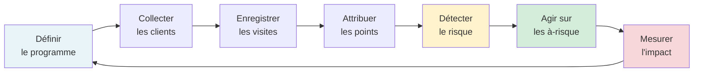
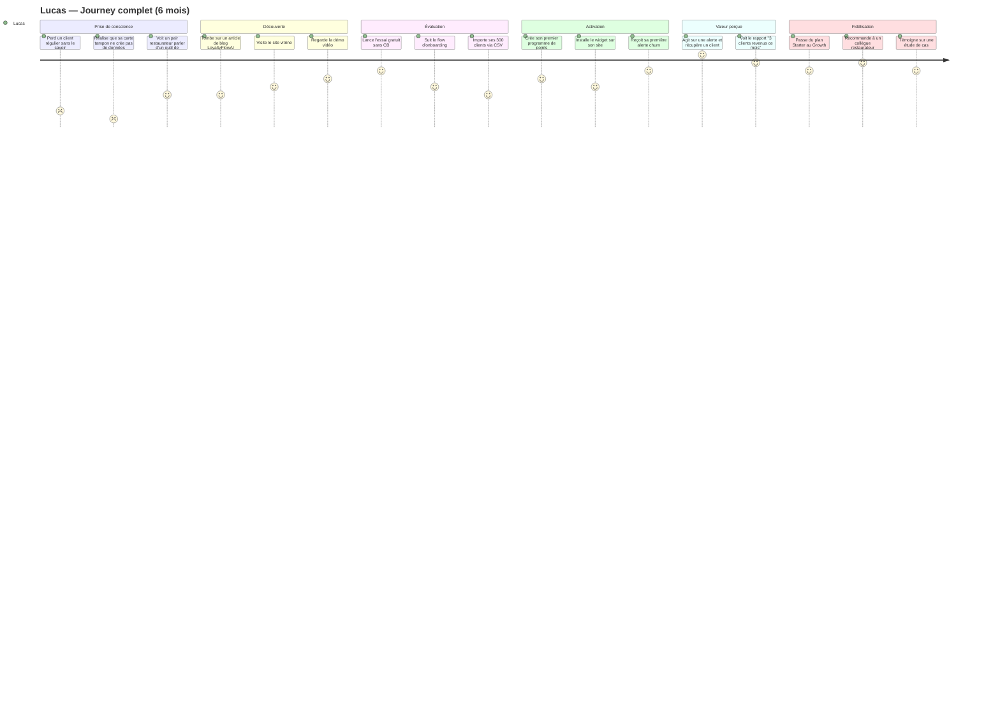
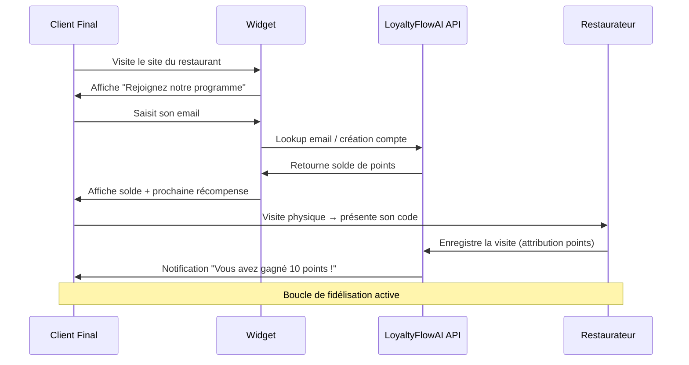
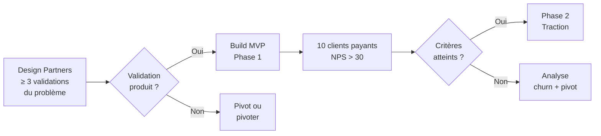
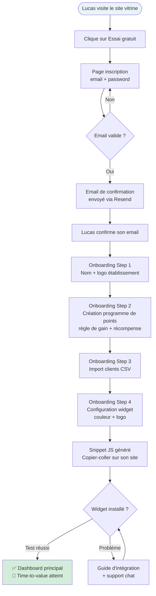
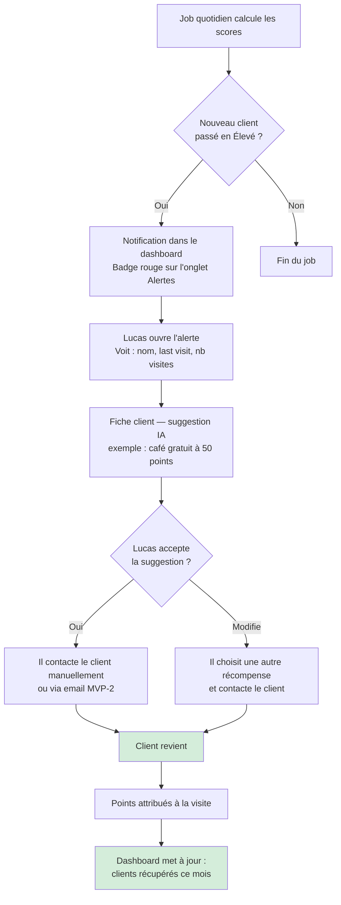
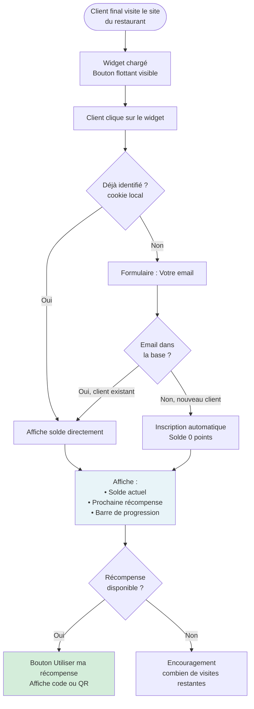
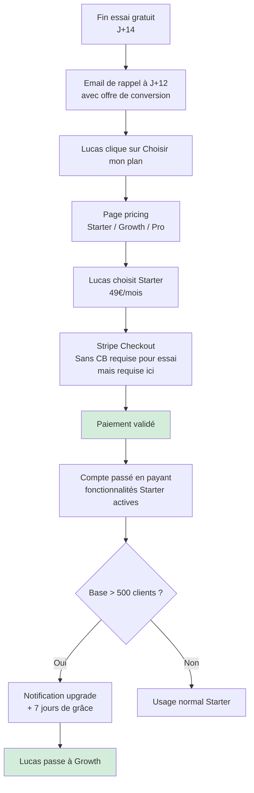
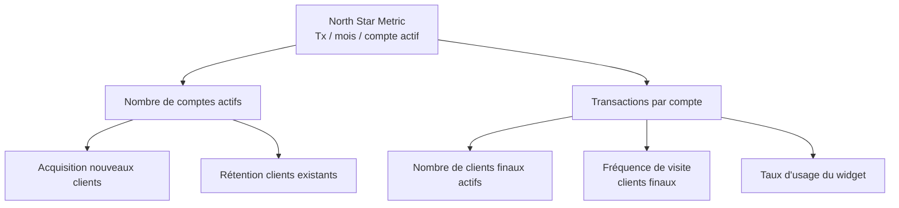
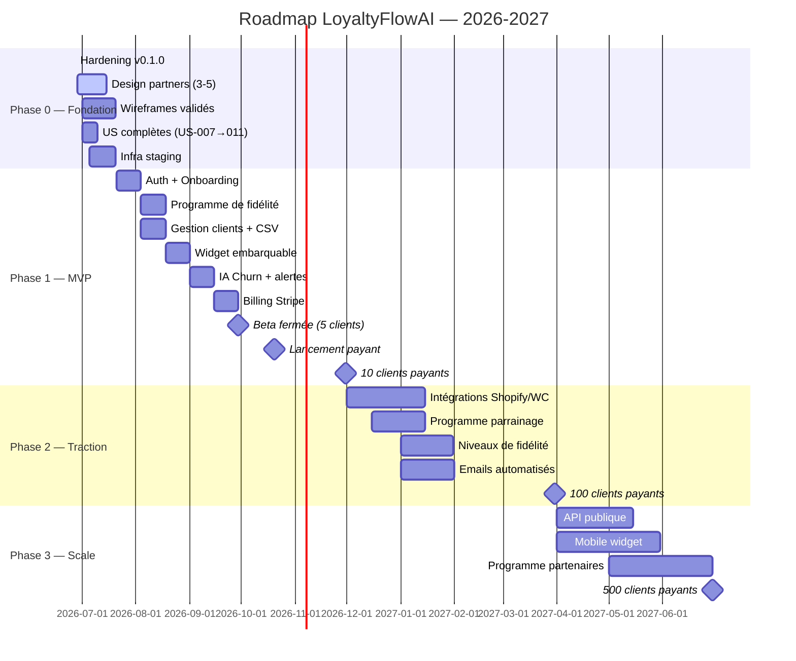

# PRODUCT BIBLE — LoyaltyFlowAI

> **Document :** Product Bible — Source de vérité produit
> **Version :** 1.0.0
> **Statut :** Actif — Phase 0
> **Dernière mise à jour :** 2026-06-28
> **Auteur :** Fondateur / Product Strategy Session
> **Confidentialité :** Strictement confidentiel

---

> Ce document est la **source de vérité produit** de LoyaltyFlowAI.
> Il complète `MASTER_PLAN.md` (source de vérité générale) en approfondissant les dimensions produit, marché et stratégie business.
> En cas de contradiction avec un autre document, ce document prévaut pour les décisions produit.

---

## Table des matières

**Partie I — Fondations**

1. [Vision enrichie](#1-vision-enrichie)
2. [Mission opérationnelle](#2-mission-opérationnelle)
3. [Valeurs — Mise en pratique](#3-valeurs--mise-en-pratique)
4. [Principes Produit — Arbitrages](#4-principes-produit--arbitrages)

**Partie II — Marché & Utilisateurs** 5. [Analyse de marché (TAM/SAM/SOM)](#5-analyse-de-marché-tamsomsom) 6. [Jobs To Be Done (JTBD)](#6-jobs-to-be-done-jtbd) 7. [Personas enrichis & Empathy Maps](#7-personas-enrichis--empathy-maps) 8. [Customer Journey](#8-customer-journey)

**Partie III — Produit** 9. [Proposition de valeur par persona](#9-proposition-de-valeur-par-persona) 10. [Feature Map complet](#10-feature-map-complet) 11. [MVP — Périmètre exact et critères de succès](#11-mvp--périmètre-exact-et-critères-de-succès) 12. [V2 — Phase Traction (Q1 2027)](#12-v2--phase-traction-q1-2027) 13. [V3 — Phase Scale (Q2 2027)](#13-v3--phase-scale-q2-2027) 14. [User Flows principaux](#14-user-flows-principaux) 15. [User Stories — Synthèse et manquantes](#15-user-stories--synthèse-et-manquantes)

**Partie IV — Business** 16. [Business Goals & Success Metrics](#16-business-goals--success-metrics) 17. [North Star Metric & KPIs](#17-north-star-metric--kpis) 18. [Roadmap consolidée](#18-roadmap-consolidée) 19. [Business Model Canvas](#19-business-model-canvas) 20. [Lean Canvas](#20-lean-canvas)

**Partie V — Analyse stratégique** 21. [SWOT](#21-swot) 22. [Analyse concurrentielle](#22-analyse-concurrentielle) 23. [Risques & Mitigation](#23-risques--mitigation) 24. [Hypothèses à valider](#24-hypothèses-à-valider) 25. [Questions ouvertes](#25-questions-ouvertes)

**Partie VI — Référence** 26. [Glossaire étendu](#26-glossaire-étendu)

---

## ⚠️ Incohérences identifiées et résolues

> Audit réalisé le 2026-06-28. Ces résolutions sont définitives et font autorité.

| #         | Incohérence                                                             | Document A              | Document B          | Résolution                                                                                                                                                      |
| --------- | ----------------------------------------------------------------------- | ----------------------- | ------------------- | --------------------------------------------------------------------------------------------------------------------------------------------------------------- |
| **IC-01** | Le widget embarquable est listé en **Phase 3** ("hors MVP")             | MASTER_PLAN §13         | PRD §5.4 + QO-007   | **Le widget est MVP.** QO-007 est la décision actée : "Canal client final MVP → Widget web embarquable". MASTER_PLAN §13 contient une erreur à corriger.        |
| **IC-02** | Le widget n'apparaît pas dans la liste des fonctionnalités MVP          | MASTER_PLAN §12         | PRD §5.4            | **À corriger dans MASTER_PLAN §12.** Le widget est une feature MVP confirmée.                                                                                   |
| **IC-03** | Churn Rate cible 12 mois : 3 % vs Phase 1 : 5 %                         | MASTER_PLAN §5          | METRICS.md + GTM.md | **Cohérent** — 5 % est la tolérance Phase 1 (Q4 2026), 3 % est la cible stabilisée à 12 mois (fin Phase 2). Aucun conflit réel.                                 |
| **IC-04** | Mécanisme de mise à jour du widget : "polling ou websocket (à décider)" | US-002 notes techniques | —                   | **Question ouverte** — voir §25. Décision requise avant développement du widget.                                                                                |
| **IC-05** | MRR cible 12 mois : 10 000 € vs projections Phase 2 : 15 000 €          | MASTER_PLAN §5          | METRICS.md          | **10 000 € est la cible conservatrice à 12 mois** (entre Phases 1 et 2). 15 000 € est la cible fin Phase 2. Objectif 12 mois = point intermédiaire. Acceptable. |

---

## Partie I — Fondations

---

## 1. Vision enrichie

> _L'étoile du nord. Ce que le monde devient grâce à LoyaltyFlowAI._

### Vision

**LoyaltyFlowAI aspire à devenir la plateforme de référence pour la fidélisation intelligente des commerces de proximité — un monde où chaque restaurateur, commerçant, artisan peut offrir une expérience de fidélisation aussi sophistiquée que Starbucks ou Sephora, sans équipe data, sans budget exorbitant, en 30 minutes de setup.**

### Pourquoi cette vision est juste

Les grandes enseignes ont transformé la fidélisation en avantage concurrentiel systémique. Starbucks génère 40 % de ses revenus via son programme de fidélité. Sephora a 25 millions de membres Beauty Insider. Ces entreprises ont des équipes de 50+ personnes dédiées.

Les indépendants — qui représentent **85 % des commerces en France** — sont exclus de cette révolution. Leur seul outil : la carte tampon en papier. Résultat : ils perdent des clients sans le savoir, sans pouvoir agir, sans mesurer.

LoyaltyFlowAI nivelle le terrain de jeu. C'est la thèse fondamentale.

### Ce que la vision n'est pas

- Ce n'est pas "construire un outil de points de fidélité". Les outils de points existent depuis 30 ans.
- Ce n'est pas "digitaliser la carte tampon". C'est une ambition trop petite.
- Ce n'est pas "faire un CRM pour restaurateurs". Trop générique, trop encombré.

La vision est précise : **intelligence prédictive + simplicité maximale + accessibilité économique.**

---

## 2. Mission opérationnelle

> _Pourquoi nous existons. Ce que nous faisons concrètement._

### Mission

**Donner aux commerces de proximité les outils d'intelligence artificielle pour transformer leurs données clients en relations durables — de manière automatisée, personnalisée et mesurable.**

### Décomposition opérationnelle

| Élément                    | Ce que ça signifie concrètement                                                          |
| -------------------------- | ---------------------------------------------------------------------------------------- |
| **Commerces de proximité** | Restaurants, cafés, boutiques, artisans — Phase 1 : restauration uniquement              |
| **Outils d'IA**            | Scoring de churn, suggestions de récompenses, détection de patterns comportementaux      |
| **Données clients**        | Visites, achats, points, inactivité — données que le client génère naturellement         |
| **Relations durables**     | Augmenter la fréquence de visite, réduire le taux d'attrition, augmenter le panier moyen |
| **Automatisé**             | Sans intervention quotidienne du restaurateur                                            |
| **Personnalisé**           | Par client, pas par segment générique                                                    |
| **Mesurable**              | ROI visible, métriques claires, attribution directe                                      |

### Ce que nous ne faisons pas (Mission boundary)

- Nous ne gérons pas les caisses enregistreuses (POS)
- Nous ne faisons pas de publicité payante pour nos clients
- Nous ne gérons pas les réservations
- Nous ne créons pas de réseaux sociaux entre clients

Ces exclusions sont délibérées. La mission est précise pour que l'exécution le soit aussi.

---

## 3. Valeurs — Mise en pratique

> _Les valeurs ne valent que si elles guident les vrais arbitrages difficiles._

### Valeur 1 — Clarté avant complexité

**Définition :** La sophistication technologique doit être invisible. L'utilisateur voit le résultat, pas la mécanique.

**En pratique :** Quand un ingénieur veut ajouter un paramètre avancé "pour les power users", on refuse si 80 % des utilisateurs ne l'utiliseront jamais. Quand le design présente deux options d'affichage, on choisit celle que Lucas (Persona 0) comprend sans explication.

**L'arbitrage qu'elle résout :** Feature complète vs feature simple → toujours choisir simple et livrable.

---

### Valeur 2 — Données au service du client — pas l'inverse

**Définition :** Les données appartiennent aux entreprises qui nous font confiance. Modèle économique = valeur créée, pas données collectées.

**En pratique :** Pas de revente de données. Pas d'utilisation des données d'un tenant pour entraîner des modèles qui bénéficient à d'autres tenants sans consentement. Export complet des données à tout moment. Droit à l'oubli implémenté.

**L'arbitrage qu'elle résout :** Court terme (monétiser les données) vs long terme (confiance client) → toujours choisir la confiance.

---

### Valeur 3 — Impact mesurable

**Définition :** Chaque fonctionnalité doit avoir un impact mesurable sur un KPI client.

**En pratique :** Avant chaque feature, on définit : "Quel KPI cette feature déplace-t-elle ? Comment le mesurons-nous ?" Si on ne peut pas répondre, on ne construit pas la feature.

**L'arbitrage qu'elle résout :** Feature "cool" vs feature utile → toujours choisir l'utilité mesurable.

---

### Valeur 4 — Obsession de la fiabilité

**Définition :** La fiabilité est une fonctionnalité de premier rang.

**En pratique :** Un programme de fidélité qui tombe en panne le soir d'une Saint-Valentin pour un restaurant = catastrophe client. On investit dans la résilience avant d'investir dans de nouvelles features.

**L'arbitrage qu'elle résout :** Nouvelle feature vs stabilité → toujours corriger avant d'ajouter.

---

### Valeur 5 — Itération honnête

**Définition :** La vitesse d'apprentissage est plus précieuse que la certitude.

**En pratique :** On shippe une version imparfaite à 5 clients pour apprendre, plutôt qu'une version "parfaite" 3 mois plus tard. On documente ce qu'on croyait vrai et ce qui s'est avéré faux.

**L'arbitrage qu'elle résout :** Attendre la perfection vs livrer et apprendre → toujours livrer.

---

### Valeur 6 — Long terme

**Définition :** Les décisions qui sacrifient la qualité à long terme pour une croissance à court terme sont contraires à nos valeurs.

**En pratique :** Pas de hacks de croissance qui créent de la dette technique. Pas de dark patterns dans l'UX pour forcer les upgrades. Pas de pricing trompeur.

---

## 4. Principes Produit — Arbitrages

> _Les règles qui gouvernent ce que nous construisons — et surtout ce que nous ne construisons pas._

| Principe                            | Formulation                                                                                 | Arbitrage type                                                              |
| ----------------------------------- | ------------------------------------------------------------------------------------------- | --------------------------------------------------------------------------- |
| **P1 — Un seul problème**           | Chaque release résout un problème pour un persona défini                                    | "Feature pour tous les personas" → Non. "Feature pour Lucas d'abord" → Oui. |
| **P2 — Valeur avant élégance**      | Un produit qui délivre de la valeur imparfaitement > un produit parfait qui ne délivre rien | Score de churn heuristique MVP > attendre un modèle ML Phase 2              |
| **P3 — Zéro friction onboarding**   | Time-to-value < 30 minutes                                                                  | Si le setup dépasse 30 min, on simplifie avant de livrer                    |
| **P4 — Tout est mesurable**         | Chaque feature a une définition de succès avant développement                               | Pas de feature sans métrique associée                                       |
| **P5 — Le produit s'explique seul** | Si une feature nécessite > 1 écran de doc, elle est trop complexe                           | Documentation = signal d'échec UX                                           |
| **P6 — Mobile-first**               | Expérience mobile conçue en premier                                                         | Le dashboard est utilisable sur un téléphone en salle de restaurant         |
| **P7 — Sécurité by design**         | Sécurité intégrée dès la conception                                                         | RGPD validé avant code, pas après                                           |

---

## Partie II — Marché & Utilisateurs

---

## 5. Analyse de marché (TAM/SAM/SOM)

### Le marché de la fidélisation client

Le marché mondial de la gestion de la fidélisation client était estimé à **6,5 milliards $ en 2023**, avec une croissance annuelle (CAGR) de ~14 % jusqu'en 2030. En France, le marché SaaS de la fidélisation pour PME est fragmenté et sous-équipé.

### Sizing du marché France — Restauration

```
TAM — Marché total adressable (France)
────────────────────────────────────────
• 180 000 restaurants en France
• Dont 75 % indépendants (hors chaînes) = 135 000 établissements
• Potentiel à 49€/mois moyen = 135 000 × 49 × 12 = 79 M€/an

SAM — Marché adressable avec notre offre actuelle (Phase 1)
────────────────────────────────────────────────────────────
• Critères : site web + base de clients + usage digital
• ~20 % des restaurants indépendants = 27 000 établissements
• En grandes villes (Paris, Lyon, Marseille, Bordeaux, Toulouse, Nice) : 40 % = 10 800
• SAM Phase 1 ≈ 10 800 × 49 × 12 = 6,3 M€/an

SOM — Part de marché atteignable à 3 ans
──────────────────────────────────────────
• Objectif Phase 3 : 500 clients payants
• Part de marché SAM : 500 / 10 800 = 4,6 %
• SOM 3 ans = 500 × 149 × 12 (mix plans) ≈ 894 K€ ARR
```

### Expansion future (Phase 2+)

En intégrant les autres commerces de proximité (cafés, boulangeries, boutiques) et en étendant géographiquement (Belgique, Suisse, Canada francophone) :

- Marché étendu France (all segments) : ~3 M entreprises × filtres = ~300 000 prospects
- Europe francophone : ×3 à ×5 du marché France

### Pourquoi commencer par la restauration

| Critère               | Restauration             | E-commerce            | Retail physique |
| --------------------- | ------------------------ | --------------------- | --------------- |
| Fréquence de visite   | Élevée (hebdomadaire)    | Faible (mensuelle)    | Moyenne         |
| Douleur fidélisation  | Critique (mémoire carte) | Forte (panier moyen)  | Forte           |
| Disponibilité données | Faible (carte papier)    | Forte (Shopify)       | Moyenne         |
| Willingness to pay    | Moyenne (budget serré)   | Élevée                | Moyenne         |
| Densité du réseau     | Forte (bouche-à-oreille) | Faible                | Faible          |
| Facilité d'onboarding | Haute (1 établissement)  | Faible (intégrations) | Faible          |

**Verdict : La restauration est le segment avec le meilleur ratio douleur/accessibilité pour un MVP.**

---

## 6. Jobs To Be Done (JTBD)

> _Les JTBD capturent la vraie motivation derrière l'achat — indépendamment de la solution._
> _Format : "Quand [situation], je veux [motivation], afin de [outcome attendu]."_

### JTBD Primaires — Lucas (Persona 0 — Restaurateur)

**JTBD-01 — Reconnaissance des réguliers**

> Quand un client entre dans mon restaurant pour la 3ème fois ce mois-ci, je veux qu'il se sente reconnu et récompensé, afin qu'il revienne la semaine prochaine plutôt que d'aller chez le concurrent.

**JTBD-02 — Détection du signal de départ**

> Quand un client habituel n'est pas venu depuis 3 semaines, je veux être alerté avant qu'il soit trop tard, afin d'agir proactivement plutôt que de constater sa perte après coup.

**JTBD-03 — Mesure du ROI marketing**

> Quand je dépense 200 €/mois sur Instagram, je veux savoir combien de clients reviennent grâce à mes actions, afin de décider si je continue ou si j'investis ailleurs.

**JTBD-04 — Gestion simplifiée**

> Quand j'ai 15 minutes entre deux services, je veux comprendre l'état de ma base de clients en un coup d'œil, afin de prendre des décisions sans être submergé de données.

**JTBD-05 — Reconquête des perdus**

> Quand je sais qu'un client n'est pas revenu depuis 45 jours, je veux savoir exactement quoi lui offrir pour le faire revenir, afin de maximiser mes chances de succès sans gaspiller mes marges.

---

### JTBD Secondaires — Marie (Persona 1 — E-commerce)

**JTBD-06 — Réactivation de la base dormante**

> Quand 40 % de ma base email n'a pas commandé depuis 3 mois, je veux segmenter automatiquement ces clients et leur envoyer la bonne offre, afin d'augmenter mon revenu sans augmenter mon budget pub.

**JTBD-07 — Différenciation par l'expérience**

> Quand mes clients ont le choix entre 10 boutiques similaires, je veux que mon programme de fidélité soit une raison de rester, afin de réduire ma dépendance aux promotions.

---

### JTBD Tertiaires — Thomas (Persona 2 — CRM PME)

**JTBD-08 — Centralisation des données**

> Quand je dois agréger des données de 3 outils différents pour créer un rapport, je veux une source unique de vérité sur mes clients, afin de passer moins de temps en Excel et plus en stratégie.

**JTBD-09 — Justification budget**

> Quand la direction me demande le ROI de la fidélisation, je veux un tableau de bord avec des métriques claires et des attributions directes, afin de défendre mon budget en comité de direction.

---

### Job Map — Lucas (flux complet)



**Étape critique :** Les étapes E (Détecter) et F (Agir) sont celles pour lesquelles **aucune solution accessible n'existe aujourd'hui** pour les restaurateurs indépendants. C'est notre avantage concurrentiel principal.

---

## 7. Personas enrichis & Empathy Maps

---

### Persona 0 — Lucas, le restaurateur indépendant

> **Priorité MVP — Tout le produit est conçu pour lui en premier.**

**Profil**

| Dimension                   | Détail                                              |
| --------------------------- | --------------------------------------------------- |
| **Rôle**                    | Propriétaire-gérant de restaurant(s) indépendant(s) |
| **Nombre d'établissements** | 1 à 3                                               |
| **Couverts/mois**           | 500 à 3 000                                         |
| **Clients actifs estimés**  | 200 à 2 000                                         |
| **Âge**                     | 28 à 52 ans                                         |
| **Niveau tech**             | Faible à intermédiaire                              |
| **Budget digital**          | 50 à 500 €/mois (total)                             |
| **Outil actuel**            | Carte tampon papier, parfois Mailchimp              |
| **Décision d'achat**        | Seul, moins de 7 jours de réflexion si ROI visible  |

**Empathy Map**

| Ce qu'il **Pense & Ressent**                                                               | Ce qu'il **Entend**                                              |
| ------------------------------------------------------------------------------------------ | ---------------------------------------------------------------- |
| "Je sais que certains clients ne sont pas revenus mais je ne sais pas pourquoi."           | "Il faut être sur Instagram pour fidéliser." (collègues)         |
| "Mon programme de points en papier ne sert à rien — personne ne revient pour les timbres." | "Les grandes chaînes nous écrasent." (presse)                    |
| "J'aimerais connaître mes meilleurs clients par leur prénom."                              | "La fidélisation c'est trop cher pour nous." (pair restaurateur) |
| "Je n'ai pas le temps d'apprendre un nouvel outil."                                        | "Il existe des apps pour ça." (fournisseur)                      |

| Ce qu'il **Voit**                            | Ce qu'il **Dit & Fait**                                            |
| -------------------------------------------- | ------------------------------------------------------------------ |
| Ses concurrents avec des programmes digitaux | "Je n'ai pas le temps." (souvent)                                  |
| Des clients qui ne reviennent qu'une fois    | Continue d'utiliser la carte tampon par défaut                     |
| Des piles de cartes tampons jamais réclamées | Donne des réductions au feeling, sans données                      |
| Des avis Google qu'il ne sait pas exploiter  | Parle de fidélisation à ses collègues lors des réunions syndicales |

| **Douleurs**                                                              | **Gains recherchés**                              |
| ------------------------------------------------------------------------- | ------------------------------------------------- |
| Ne sait pas quels clients sont sur le point de partir                     | Voir en temps réel "qui manque à l'appel"         |
| Ne peut pas mesurer l'efficacité de ses actions marketing                 | Avoir une preuve chiffrée que ça marche           |
| Le setup des outils existants prend des jours                             | Setup en 30 minutes, résultat visible en 30 jours |
| Il ne peut pas se permettre de payer pour quelque chose qui ne marche pas | Essai sans risque (pas de CB requise)             |

**Scénario d'usage type**

> _Mardi soir, 23h. Lucas vient de fermer. Il ouvre l'app sur son téléphone. Il voit une notification : "3 clients habituels n'ont pas visité depuis 35 jours." Il clique. Sophie, Michel, Clara. Il voit leurs habitudes. L'IA lui suggère : "Offrez-leur un dessert gratuit." Il envoie. Jeudi, Clara revient. Lucas ne sait pas que c'est grâce à LoyaltyFlowAI — il sait juste que ça marche._

---

### Persona 1 — Marie, la fondatrice e-commerce

| Dimension            | Détail                                                 |
| -------------------- | ------------------------------------------------------ |
| **Rôle**             | Fondatrice boutique en ligne (mode, beauté, lifestyle) |
| **Volume**           | 500 à 5 000 commandes/mois                             |
| **Équipe**           | 2 à 10 personnes                                       |
| **Âge**              | 28 à 42 ans                                            |
| **Niveau tech**      | Intermédiaire (Shopify, Mailchimp — pas développeuse)  |
| **Budget SaaS**      | 200 à 2 000 €/mois                                     |
| **Décision d'achat** | 2 à 4 semaines, souvent après une demo                 |

**Douleurs principales**

- 60 % de sa base n'a pas commandé depuis > 90 jours → "base dormante"
- Son programme de fidélité Shopify a 3 % d'activation → gaspillage
- Elle ne sait pas quel client est rentable vs coûteux (acquisition répétée via pub)

**Gains recherchés**

- Campagnes de reconquête automatiques (pas manuelles)
- Segmentation comportementale sans exporter des CSV
- Preuve du ROI de la fidélisation pour se désengager progressivement de la pub payante

**Phase de ciblage :** Phase 2+ (post-MVP)

---

### Persona 2 — Thomas, le responsable CRM

| Dimension            | Détail                                          |
| -------------------- | ----------------------------------------------- |
| **Rôle**             | Responsable CRM / Marketing Automation          |
| **Entreprise**       | PME 50 à 200 employés                           |
| **Base clients**     | 10 000 à 100 000 contacts                       |
| **Âge**              | 30 à 45 ans                                     |
| **Niveau tech**      | Avancé (HubSpot, Klaviyo, SQL basique)          |
| **Budget SaaS**      | 1 000 à 10 000 €/mois                           |
| **Décision d'achat** | 4 à 12 semaines, comité (lui + DSI + direction) |

**Douleur principale :** "Mes outils ne se parlent pas. Je passe mes journées à exporter des CSV."

**Phase de ciblage :** Phase 2-3

---

### Persona 3 — Sarah, la directrice d'agence digitale

| Dimension            | Détail                                           |
| -------------------- | ------------------------------------------------ |
| **Rôle**             | Directrice de compte / agence web & digitale     |
| **Agence**           | 10 à 50 personnes, 20+ clients actifs            |
| **Âge**              | 32 à 48 ans                                      |
| **Niveau tech**      | Avancé                                           |
| **Besoin principal** | White-labeling + multi-tenant + marge de revente |

**Phase de ciblage :** Phase 4 (white-label)

---

### Persona 4 (NEW) — Le client final du restaurateur

> _Ce persona est souvent oublié. C'est pourtant lui qui utilise le widget quotidiennement._

| Dimension                  | Détail                                                       |
| -------------------------- | ------------------------------------------------------------ |
| **Rôle**                   | Client habituel du restaurant utilisant le widget            |
| **Âge**                    | 22 à 65 ans (large)                                          |
| **Niveau tech**            | Variable                                                     |
| **Motivation**             | Récompenses concrètes, sentiment de reconnaissance           |
| **Frustrations actuelles** | Points qui expirent, récompenses non pertinentes, complexité |

**JTBD du client final**

> "Quand je reviens régulièrement dans mon restaurant préféré, je veux être reconnu et récompensé sans friction, afin de sentir que ma fidélité a de la valeur."

**Implication produit :** Le widget doit être aussi simple à utiliser pour une personne de 65 ans que pour un digital native. L'identification (email) doit être en 1 clic. Le solde doit être visible immédiatement.

---

## 8. Customer Journey

### Journey de Lucas — De la carte tampon à LoyaltyFlowAI



### Moments of Truth (MoT)

| Moment                          | Description                                                                      | Émotion cible            | Notre action                                    |
| ------------------------------- | -------------------------------------------------------------------------------- | ------------------------ | ----------------------------------------------- |
| **MoT 1 — Le déclencheur**      | Lucas perd un client habituel et réalise qu'il n'a aucun moyen de le reconquérir | Frustration → Motivation | Blog SEO "5 signes qu'un client vous quitte"    |
| **MoT 2 — L'essai**             | Lucas s'inscrit en < 2 minutes sans CB                                           | Soulagement              | Onboarding zero-friction, pas de CB requise     |
| **MoT 3 — Le premier setup**    | Lucas crée son programme en < 30 minutes                                         | Satisfaction → Confiance | Onboarding guidé, templates pré-remplis         |
| **MoT 4 — La première alerte**  | Lucas reçoit "3 clients n'ont pas visité depuis 35 jours"                        | Surprise positive        | Alerte claire avec noms, historique, suggestion |
| **MoT 5 — Le premier retour**   | Un client alerté revient                                                         | Validation émotionnelle  | Email automatique "Votre action a fonctionné !" |
| **MoT 6 — Le rapport 30 jours** | Lucas voit un ROI chiffré                                                        | Conviction               | Dashboard avec attribution claire               |

### Journey du client final (utilisateur du widget)



---

## Partie III — Produit

---

## 9. Proposition de valeur par persona

### Pour Lucas (Restaurateur — MVP)

**Value Proposition Canvas**

| Produit                  | Valeur créée                                                                             |
| ------------------------ | ---------------------------------------------------------------------------------------- |
| Score de churn quotidien | "Je sais exactement qui est sur le point de partir — avant qu'il parte"                  |
| Alerte + suggestion IA   | "Je sais quoi faire pour le faire revenir — sans réfléchir"                              |
| Widget en 5 min          | "Mes clients peuvent s'inscrire dès aujourd'hui, sans que j'aie besoin d'un développeur" |
| Dashboard simplifié      | "J'ai mes chiffres clés en 30 secondes entre deux services"                              |
| Essai 14 jours sans CB   | "Je teste sans risque — si ça ne marche pas, je ne paie rien"                            |

**Quantification de la valeur**

- Un restaurant avec 500 clients actifs perdant 5 % par mois = 25 clients/mois perdus
- Panier moyen : 35 €, fréquence mensuelle : 2 visites
- Valeur d'un client "récupéré" : 35 × 2 × 12 = **840 €/an**
- LoyaltyFlowAI récupère 10 % des clients à risque = 2,5 clients/mois = **2 100 €/mois de CA récupéré**
- ROI : **43× le prix du plan Starter (49 €)**

---

### Pour Marie (E-commerce — Phase 2)

**Message clé :** "Votre base email est votre actif le plus précieux. LoyaltyFlowAI la fait travailler pour vous, automatiquement."

**Valeur quantifiable :** +15 à +25 % de taux de réachat sur la base dormante.

---

## 10. Feature Map complet

> _Toutes les fonctionnalités envisagées, priorisées selon MoSCoW, mappées sur les phases et les JTBD._

### Légende

- **M** — Must Have (MVP obligatoire)
- **S** — Should Have (important, Phase 2)
- **C** — Could Have (utile, Phase 3+)
- **W** — Won't Have (hors scope défini)

### Module Auth & Comptes

| Feature                                   | Priorité | Phase   | JTBD    | Décision restante      |
| ----------------------------------------- | -------- | ------- | ------- | ---------------------- |
| Inscription email + password              | M        | MVP     | —       | —                      |
| Connexion sécurisée JWT                   | M        | MVP     | —       | —                      |
| Récupération mot de passe                 | M        | MVP     | —       | —                      |
| Gestion profil établissement              | M        | MVP     | JTBD-04 | —                      |
| OAuth Google / GitHub                     | S        | Phase 2 | —       | À décider              |
| MFA (2FA)                                 | S        | Phase 2 | —       | Obligatoire en Phase 2 |
| SSO entreprise                            | C        | Phase 4 | JTBD-08 | —                      |
| Comptes multi-utilisateurs (Admin/Membre) | M        | MVP     | —       | —                      |

### Module Programme de Fidélité

| Feature                                  | Priorité | Phase   | JTBD        | Décision restante |
| ---------------------------------------- | -------- | ------- | ----------- | ----------------- |
| Création programme de points             | M        | MVP     | JTBD-01     | —                 |
| Règle : points par visite                | M        | MVP     | JTBD-01     | —                 |
| Règle : points par montant (€)           | M        | MVP     | JTBD-01     | —                 |
| Configuration récompenses (seuils)       | M        | MVP     | JTBD-01, 05 | —                 |
| Activation / désactivation programme     | M        | MVP     | —           | —                 |
| Niveaux de fidélité (Bronze/Silver/Gold) | S        | Phase 2 | JTBD-01     | —                 |
| Programme de parrainage (referral)       | S        | Phase 2 | —           | —                 |
| Programme multi-établissements           | C        | Phase 3 | —           | —                 |
| Gamification (défis, badges)             | C        | Phase 3 | JTBD-01     | —                 |
| Points d'expiration configurables        | S        | Phase 2 | —           | —                 |

### Module Clients & Données

| Feature                                 | Priorité | Phase     | JTBD    | Décision restante        |
| --------------------------------------- | -------- | --------- | ------- | ------------------------ |
| Import CSV clients                      | M        | MVP       | —       | Champs minimum à définir |
| Fiche client individuelle               | M        | MVP       | JTBD-04 | —                        |
| Attribution manuelle de points          | M        | MVP       | —       | —                        |
| Historique de transactions              | M        | MVP       | JTBD-03 | —                        |
| Suppression client (RGPD)               | M        | MVP       | —       | Obligatoire              |
| Export données client (RGPD)            | M        | MVP       | —       | Obligatoire              |
| Sync Shopify                            | S        | Phase 2   | —       | Via webhook Shopify      |
| Sync WooCommerce                        | S        | Phase 2   | —       | Via plugin WP            |
| Sync caisse (Lightspeed, Zelty)         | S        | Phase 2-3 | —       | Partenariat requis       |
| API client pour intégrations custom     | C        | Phase 3   | JTBD-08 | —                        |
| Enrichissement données (email → profil) | C        | Phase 3   | —       | RGPD à vérifier          |

### Module Widget

| Feature                                  | Priorité | Phase   | JTBD        | Décision restante        |
| ---------------------------------------- | -------- | ------- | ----------- | ------------------------ |
| Snippet JS embarquable                   | **M**    | **MVP** | JTBD-01     | ✅ Décidé (IC-01 résolu) |
| Identification client par email          | M        | MVP     | JTBD-01     | —                        |
| Affichage solde de points                | M        | MVP     | JTBD-01     | —                        |
| Affichage récompenses disponibles        | M        | MVP     | JTBD-01, 05 | —                        |
| Personnalisation couleur / logo          | M        | MVP     | —           | —                        |
| Barre de progression vers récompense     | M        | MVP     | JTBD-01     | —                        |
| Mécanisme update (polling vs WS)         | M        | MVP     | —           | ⚠️ À décider (IC-04)     |
| Identification par QR code               | S        | Phase 2 | JTBD-01     | —                        |
| Identification par téléphone (SMS)       | S        | Phase 2 | —           | —                        |
| Widget mode sombre                       | C        | Phase 2 | —           | —                        |
| Widget multi-langue                      | C        | Phase 3 | —           | —                        |
| Application mobile native (client final) | C        | Phase 3 | —           | —                        |

### Module IA & Intelligence

| Feature                                 | Priorité | Phase   | JTBD    | Décision restante           |
| --------------------------------------- | -------- | ------- | ------- | --------------------------- |
| Score de churn (heuristique inactivité) | M        | MVP     | JTBD-02 | ✅ Règles définies          |
| Alerte dashboard clients à risque       | M        | MVP     | JTBD-02 | —                           |
| Suggestion récompense IA (Claude)       | M        | MVP     | JTBD-05 | Prompt engineering requis   |
| Seuil d'inactivité configurable         | M        | MVP     | JTBD-02 | Défaut : 30 jours           |
| Score churn ML (modèle entraîné)        | S        | Phase 2 | JTBD-02 | Scikit-learn ou HuggingFace |
| Segmentation comportementale auto       | S        | Phase 2 | JTBD-08 | —                           |
| Prédiction LTV client                   | C        | Phase 3 | JTBD-03 | —                           |
| Next Best Offer (NBA)                   | C        | Phase 4 | JTBD-05 | —                           |
| Analyse sentiment (avis, feedback)      | W        | —       | —       | Hors scope                  |

### Module Reporting

| Feature                                  | Priorité | Phase   | JTBD        | Décision restante   |
| ---------------------------------------- | -------- | ------- | ----------- | ------------------- |
| Dashboard métriques clés                 | M        | MVP     | JTBD-03, 04 | —                   |
| Clients actifs, points émis, récompenses | M        | MVP     | JTBD-03     | —                   |
| Export CSV basique                       | M        | MVP     | —           | —                   |
| Graphiques évolution dans le temps       | S        | Phase 2 | JTBD-03     | —                   |
| Rapport ROI calculé (€ récupérés)        | S        | Phase 2 | JTBD-03, 09 | Formule à définir   |
| Analytics produit avancé                 | S        | Phase 2 | —           | Posthog ou Mixpanel |
| Rapport personnalisable                  | C        | Phase 3 | JTBD-09     | —                   |
| Export PDF automatique                   | C        | Phase 3 | —           | —                   |

### Module Administration & Opérations

| Feature                       | Priorité | Phase   | JTBD    | Décision restante     |
| ----------------------------- | -------- | ------- | ------- | --------------------- |
| Gestion équipe (Admin/Membre) | M        | MVP     | —       | —                     |
| Paramètres plateforme         | M        | MVP     | —       | —                     |
| Billing / Stripe subscription | M        | Phase 1 | —       | Stripe Billing        |
| Page statut (status page)     | S        | Phase 1 | —       | Statuspage.io         |
| API publique (REST)           | S        | Phase 3 | JTBD-08 | Documentation OpenAPI |
| Webhooks sortants             | S        | Phase 3 | —       | —                     |
| White-labeling                | C        | Phase 4 | —       | —                     |
| Multi-tenant (agences)        | C        | Phase 4 | —       | —                     |

---

## 11. MVP — Périmètre exact et critères de succès

> **Principe fondateur :** Le MVP n'est pas un produit simplifié. C'est le produit le plus petit possible qui démontre la valeur fondamentale et génère le premier paiement.

### Périmètre validé du MVP

**IN SCOPE**

1. Auth & Comptes (inscription, connexion, récupération, multi-utilisateurs)
2. Programme de fidélité (création, règles de gain ×2, récompenses, activation)
3. Gestion clients (import CSV, fiche individuelle, attribution manuelle, RGPD)
4. **Widget embarquable** ✅ (snippet JS, identification email, solde, récompenses, personnalisation)
5. IA churn (score heuristique, alertes dashboard, suggestions, seuil configurable)
6. Reporting (dashboard clés, export CSV)
7. Administration (équipe, paramètres, billing Stripe)

**OUT OF SCOPE MVP**

| Feature                                     | Raison d'exclusion                                       | Phase cible |
| ------------------------------------------- | -------------------------------------------------------- | ----------- |
| Intégrations natives (Shopify, WooCommerce) | Complexité + pas nécessaire si import CSV suffit (H5)    | Phase 2     |
| Programme de parrainage                     | Nécessite base établie + tracking                        | Phase 2     |
| Niveaux de fidélité (tiers)                 | Complexifie l'UX sans valeur prouvée en Phase 1          | Phase 2     |
| Emails automatisés                          | Requiert IP sending reputation + conformité RGPD avancée | Phase 2     |
| Application mobile native                   | Investissement élevé, validez le web d'abord             | Phase 3     |
| API publique                                | Pas de demande prouvée en Phase 1                        | Phase 3     |
| White-labeling                              | Segment agences non validé                               | Phase 4     |
| ML churn scoring                            | Heuristiques MVP suffisent pour démontrer la valeur      | Phase 2     |

### Critères de succès du MVP

| Critère                           | Cible    | Mesure                                                            |
| --------------------------------- | -------- | ----------------------------------------------------------------- |
| **Clients payants actifs**        | ≥ 10     | Comptes Stripe actifs                                             |
| **NPS**                           | > 30     | Enquête mensuelle                                                 |
| **Rétention à 60 jours**          | > 80 %   | % clients MVP encore actifs                                       |
| **Time-to-Value**                 | < 30 min | Temps inscription → programme actif + widget installé             |
| **Zéro incident sécurité majeur** | 0        | Monitoring Sentry                                                 |
| **Témoignages documentés**        | ≥ 3      | Avec métriques chiffrées (fréquence de visite, clients récupérés) |

### Décision de go/no-go MVP



---

## 12. V2 — Phase Traction (Q1 2027)

### Objectif

Passer de 10 à 100 clients payants. Automatiser le canal d'acquisition. Valider le product-market fit sur le segment restauration.

### Features V2

| Feature                                | Justification                                | Dépendance             |
| -------------------------------------- | -------------------------------------------- | ---------------------- |
| **Intégration Shopify**                | Ouvre segment e-commerce (Marie, Persona 1)  | App Shopify review     |
| **Intégration WooCommerce**            | 30 % du e-commerce France sur WP             | Plugin WordPress       |
| **Programme de parrainage (referral)** | Canal d'acquisition à faible CAC             | Base ≥ 100 clients     |
| **Niveaux de fidélité (tiers)**        | Augmente engagement long terme               | Programme stable       |
| **Emails automatisés**                 | Toucher les clients à risque hors du widget  | Resend + IP warm-up    |
| **Onboarding self-serve complet**      | Réduire le temps de support (scalabilité)    | Produit stable Phase 1 |
| **Analytics avancé (Posthog)**         | Comprendre les comportements pour itérer     | —                      |
| **Dashboard ROI calculé**              | Justifier le churn et faciliter la rétention | Données 3 mois         |
| **Score churn ML (v1)**                | Améliorer la précision des alertes           | ≥ 1000 transactions    |

### Critères de sortie V2

- 100 clients payants actifs
- Churn mensuel < 3 %
- 50 % des nouveaux clients via canal non-direct (bouche-à-oreille, SEO, partenaires)
- NPS > 50

---

## 13. V3 — Phase Scale (Q2 2027)

### Objectif

Atteindre 500 clients payants. Ouvrir de nouveaux canaux (API, mobile, partenaires). Préparer l'internationalisation.

### Features V3

| Feature                                     | Justification                                | Impact                    |
| ------------------------------------------- | -------------------------------------------- | ------------------------- |
| **API publique REST**                       | Intégrations custom + écosystème partenaires | Nouveau canal B2B         |
| **Widget → Application mobile**             | Expérience client final plus riche           | Engagement +30 %          |
| **Intégration caisses (Lightspeed, Zelty)** | Identification automatique sans email        | Friction élimination      |
| **Programme partenaires agences**           | Réseau de revente, acquisition indirecte     | CAC ÷ 3                   |
| **Multi-devise, multi-langue**              | Belgique, Suisse, Canada                     | Expansion géographique    |
| **Prédiction LTV**                          | Segmentation avancée pour Thomas (Persona 2) | Upsell vers Pro           |
| **Webhooks sortants**                       | Intégration CRM existants                    | Réduction friction Thomas |

### Critères de sortie V3

- 500 clients payants actifs
- MRR 100 000 €
- API utilisée par ≥ 20 partenaires externes
- Présent sur ≥ 2 marchés géographiques

---

## 14. User Flows principaux

### Flow 1 — Onboarding Lucas (première valeur en < 30 min)



---

### Flow 2 — Action sur une alerte churn



---

### Flow 3 — Expérience client final (widget)



---

### Flow 4 — Gestion du billing (Stripe)



---

## 15. User Stories — Synthèse et manquantes

### Existantes (Phase 1)

| ID                                                 | Module    | Titre                                      | Statut    |
| -------------------------------------------------- | --------- | ------------------------------------------ | --------- |
| [US-001](./user-stories/US-001-auth.md)            | Auth      | Inscription et connexion sécurisée         | À affiner |
| [US-002](./user-stories/US-002-loyalty-program.md) | Programme | Création et gestion du programme de points | À affiner |
| [US-003](./user-stories/US-003-customers.md)       | Clients   | Import et gestion des clients              | À affiner |
| [US-004](./user-stories/US-004-widget.md)          | Widget    | Widget de fidélité embarquable             | À affiner |
| [US-005](./user-stories/US-005-ai-churn.md)        | IA        | Score de churn et alertes                  | À affiner |
| [US-006](./user-stories/US-006-reporting.md)       | Reporting | Dashboard et exports                       | À affiner |

### Manquantes identifiées

| ID         | Module         | Titre                                            | Priorité | Phase   |
| ---------- | -------------- | ------------------------------------------------ | -------- | ------- |
| **US-007** | Billing        | Souscription et gestion d'abonnement (Stripe)    | M        | MVP     |
| **US-008** | RGPD           | Suppression de compte et export de données       | M        | MVP     |
| **US-009** | Onboarding     | Flow d'onboarding guidé (4 étapes)               | M        | MVP     |
| **US-010** | Administration | Gestion des membres de l'équipe                  | M        | MVP     |
| **US-011** | Widget         | Expérience client final (identification + solde) | M        | MVP     |
| **US-012** | Notifications  | Alertes email pour clients à risque              | S        | Phase 2 |
| **US-013** | Partenariats   | Programme de parrainage restaurateur             | S        | Phase 2 |

> **Action requise :** Créer les US-007 à US-011 avant le début de Phase 1.

---

## Partie IV — Business

---

## 16. Business Goals & Success Metrics

### OKRs par Phase

**Phase 0 (Q3 2026) — Fondation**

| Objectif                  | Key Results                                                |
| ------------------------- | ---------------------------------------------------------- |
| Valider le problème       | ≥ 3 design partners engagés, ≥ 10 interviews restaurateurs |
| Préparer l'infrastructure | CI/CD opérationnel, staging configuré, auth fonctionnelle  |
| Préparer le produit       | Wireframes validés avec design partners, US complètes      |

---

**Phase 1 (Q4 2026) — MVP**

| Objectif                 | Key Results                                     |
| ------------------------ | ----------------------------------------------- |
| Première valeur délivrée | 10 clients payants actifs                       |
| Qualité produit          | NPS > 30, churn Phase 1 < 5 %                   |
| Opérations               | 0 incident sécurité critique, uptime > 99,9 %   |
| Evidence                 | 3 témoignages documentés avec données chiffrées |

---

**Phase 2 (Q1 2027) — Traction**

| Objectif   | Key Results                                |
| ---------- | ------------------------------------------ |
| Croissance | 100 clients payants, MRR 15 000 €          |
| Retention  | Churn mensuel < 3 %, NRR > 100 %           |
| Canaux     | 50 % nouveaux clients via canal non-direct |
| Produit    | Onboarding completion rate > 70 %          |

---

**Phase 3 (Q2 2027) — Scale**

| Objectif    | Key Results                        |
| ----------- | ---------------------------------- |
| Volume      | 500 clients payants, MRR 100 000 € |
| Partenaires | API utilisée par ≥ 20 partenaires  |
| Géographie  | ≥ 2 marchés actifs                 |
| Équipe      | 3 à 5 personnes recrutées          |

---

### Projection financière

| Phase       | Durée   | Clients                      | MRR Estimé | ARR Estimé |
| ----------- | ------- | ---------------------------- | ---------- | ---------- |
| Phase 0     | 6 sem.  | 0 (design partners gratuits) | 0 €        | 0 €        |
| Phase 1 fin | Q4 2026 | 10                           | ~500 €     | ~6 000 €   |
| 12 mois     | Q3 2027 | ~75-100                      | ~7 500 €   | ~90 000 €  |
| Phase 2 fin | Q1 2027 | 100                          | ~15 000 €  | ~180 000 € |
| Phase 3 fin | Q2 2027 | 500                          | ~100 000 € | ~1,2 M€    |

_Mix plans supposé : 60 % Starter, 30 % Growth, 10 % Pro → MRR moyen par client ≈ 140 €_

---

## 17. North Star Metric & KPIs

### North Star Metric

```
╔══════════════════════════════════════════════════════════════╗
║                                                              ║
║   Transactions de fidélité traitées / mois                   ║
║   sur des comptes actifs (≥ 1 tx dans les 30 derniers jours) ║
║                                                              ║
║   Seuil de santé : > 10 tx / mois / compte actif            ║
║                                                              ║
╚══════════════════════════════════════════════════════════════╝
```

**Pourquoi cette métrique capture tout :**

- Un compte inactif ne contribue pas → filtre les inscriptions fantômes
- Chaque transaction = valeur réelle délivrée au restaurateur ET à son client final
- Corrélée directement au churn (si les tx baissent, le churn augmente)
- Difficile à manipuler

**Composantes de la NSM**



### Dashboard KPIs hebdomadaire (solo fondateur)

| Dimension   | Métrique                  | Cible Phase 1 | Fréquence |
| ----------- | ------------------------- | ------------- | --------- |
| **Growth**  | Nouveaux essais           | +3/semaine    | Hebdo     |
| **Growth**  | Conversion essai → payant | > 25 %        | Hebdo     |
| **Revenue** | MRR                       | +500 € cumulé | Hebdo     |
| **Health**  | Churn Rate                | < 5 %         | Mensuel   |
| **Product** | NSM (tx/mois/compte)      | > 10          | Hebdo     |
| **Product** | Onboarding Completion     | > 70 %        | Hebdo     |
| **Product** | Widget adoption           | > 80 %        | Mensuel   |
| **Ops**     | Uptime                    | > 99,9 %      | Continu   |
| **Ops**     | p95 API                   | < 300 ms      | Continu   |

---

## 18. Roadmap consolidée



### Milestones critiques

| Milestone                 | Date cible    | Critères                                    |
| ------------------------- | ------------- | ------------------------------------------- |
| **M0 — Hardening**        | ✅ 2026-06-27 | type-check + lint + test verts              |
| **M1 — Design Partners**  | 2026-07-15    | 3 restaurants engagés, problème validé      |
| **M2 — Beta fermée**      | 2026-09-29    | 5 clients en production (gratuit ou payant) |
| **M3 — Lancement payant** | 2026-10-20    | Billing Stripe actif, 1er paiement reçu     |
| **M4 — PMF signal**       | 2026-11-30    | 10 clients payants, NPS > 30                |
| **M5 — Traction**         | 2027-03-31    | 100 clients payants, MRR 15 000 €           |
| **M6 — Scale**            | 2027-06-30    | 500 clients payants, MRR 100 000 €          |

---

## 19. Business Model Canvas

> _Les 9 blocs qui décrivent comment LoyaltyFlowAI crée, délivre et capture de la valeur._

### Bloc 1 — Segments de clientèle

**Primaire (MVP) :** Restaurants indépendants en France (1 à 3 établissements, 200 à 2 000 clients)

**Secondaires (Phase 2+) :** E-commerçants Shopify/WooCommerce, PME avec base clients, agences digitales (revendeurs)

**Caractéristiques communes :** Budget limité, pas d'équipe data, veulent un ROI mesurable, décision d'achat rapide

---

### Bloc 2 — Propositions de valeur

| Pour qui     | Valeur clé                                                                       |
| ------------ | -------------------------------------------------------------------------------- |
| Restaurateur | "Sachez exactement quels clients vont partir — et que faire pour les garder."    |
| E-commerçant | "Réactivez votre base dormante automatiquement, sans budget pub supplémentaire." |
| CRM Manager  | "Un tableau de bord unique qui pilote la fidélisation et démontre le ROI."       |
| Agence       | "Proposez la fidélisation IA à vos clients avec votre marque dessus."            |

---

### Bloc 3 — Canaux

| Phase     | Canal                                   | Rôle                       |
| --------- | --------------------------------------- | -------------------------- |
| Phase 0-1 | Design partners (réseau direct)         | Validation + 1ers clients  |
| Phase 1   | Cold outreach LinkedIn                  | Acquisition directe        |
| Phase 1   | Groupes Facebook restaurateurs          | Communauté                 |
| Phase 2   | SEO (blog fidélisation restauration)    | Acquisition organique      |
| Phase 2   | Programme parrainage                    | Bouche-à-oreille structuré |
| Phase 3   | API publique + partenaires intégrateurs | Écosystème                 |
| Phase 3   | Partenariats logiciels de caisse        | Canal indirect             |

---

### Bloc 4 — Relations clients

| Type                         | Description                            | Phase   |
| ---------------------------- | -------------------------------------- | ------- |
| **Onboarding guidé**         | Flow 4 étapes, < 30 min                | MVP     |
| **Support email**            | Réponse < 24h                          | MVP     |
| **Success client proactif**  | Appels J+7, J+30 pour nouveaux payants | Phase 1 |
| **Base de connaissances**    | FAQ + guides                           | Phase 1 |
| **Communauté restaurateurs** | Forum ou Slack partagé                 | Phase 2 |
| **Support chat**             | Plan Pro uniquement                    | Phase 2 |

---

### Bloc 5 — Flux de revenus

| Source          | Modèle                          | Prix       | Phase   |
| --------------- | ------------------------------- | ---------- | ------- |
| **Starter**     | Abonnement mensuel              | 49 €/mois  | MVP     |
| **Growth**      | Abonnement mensuel              | 149 €/mois | MVP     |
| **Pro**         | Abonnement mensuel              | 299 €/mois | MVP     |
| **Annuel**      | Remise -20 % sur mensuel        | -          | Phase 1 |
| **White-label** | Frais de setup + mensuel majoré | À définir  | Phase 4 |
| **API Usage**   | Pay-per-call au-delà d'un quota | À définir  | Phase 3 |

---

### Bloc 6 — Ressources clés

| Type              | Ressource                                  | Importance |
| ----------------- | ------------------------------------------ | ---------- |
| **Humain**        | Fondateur (produit + tech + ventes)        | Critique   |
| **Technologique** | Codebase Next.js / Supabase / Claude API   | Critique   |
| **Data**          | Données comportementales clients fidélisés | Élevée     |
| **Marque**        | Confiance = "IA accessible"                | Élevée     |
| **Réseau**        | Design partners + bouche-à-oreille         | Élevée     |

---

### Bloc 7 — Activités clés

| Catégorie   | Activité                                              |
| ----------- | ----------------------------------------------------- |
| **Produit** | Développement des features, maintenance, sécurité     |
| **IA**      | Entraînement et amélioration du moteur de scoring     |
| **Sales**   | Prospection, demos, closing (solo founder en Phase 1) |
| **Success** | Onboarding, support, rétention                        |
| **Data**    | Collecte, analyse, amélioration continue              |

---

### Bloc 8 — Partenaires clés

| Partenaire                 | Type                 | Valeur apportée           | Phase     |
| -------------------------- | -------------------- | ------------------------- | --------- |
| **Anthropic (Claude API)** | Fournisseur IA       | Intelligence, suggestions | MVP       |
| **Supabase**               | Fournisseur BDD/Auth | Infrastructure            | MVP       |
| **Vercel**                 | Hosting              | Déploiement sans DevOps   | MVP       |
| **Stripe**                 | Paiements            | Billing abonnements       | Phase 1   |
| **Lightspeed / Zelty**     | Logiciels de caisse  | Canal distribution        | Phase 2-3 |
| **TheFork / Zenchef**      | Réservations         | Canal distribution        | Phase 3   |
| **Agences digitales**      | Revendeurs           | Canal indirect            | Phase 4   |

---

### Bloc 9 — Structure de coûts

| Coût                       | Estimé/mois (Phase 1) | Variable/Fixe   |
| -------------------------- | --------------------- | --------------- |
| Vercel Pro                 | ~20 €                 | Fixe            |
| Supabase Pro               | ~25 €                 | Fixe + variable |
| Upstash                    | ~10 €                 | Variable        |
| Anthropic API              | ~50 € (estimé)        | Variable        |
| Resend                     | ~10 €                 | Variable        |
| Sentry                     | ~26 €                 | Fixe            |
| GitHub Actions             | ~0 €                  | Fixe            |
| **Total infra Phase 1**    | **~141 €/mois**       | —               |
| Outils SaaS (Linear, etc.) | ~50 €/mois            | Fixe            |
| **Total opex Phase 1**     | **~191 €/mois**       | —               |

_Seuil de rentabilité MVP : ~4 clients Starter (196 €/mois) — atteignable dès le mois 1 des clients payants._

---

## 20. Lean Canvas

> _Format Ash Maurya — Adapté au contexte startup bootstrappée._

```
┌─────────────────────────────────────────────────────────────────────────┐
│                     LEAN CANVAS — LoyaltyFlowAI                        │
│                           Version 1.0.0                                 │
└─────────────────────────────────────────────────────────────────────────┘

┌──────────────────┬──────────────────┬──────────────────────────────────┐
│   PROBLÈME       │   SOLUTION       │      PROPOSITION DE VALEUR       │
│                  │                  │           UNIQUE (UVP)            │
│ 1. Les clients   │ 1. Score de      │                                  │
│ partent sans     │ churn IA basé    │  "Sachez exactement qui va        │
│ prévenir         │ sur l'inactivité │  partir de votre restaurant —    │
│                  │                  │  et agissez avant qu'il soit      │
│ 2. La carte      │ 2. Widget        │  trop tard. En 30 minutes."      │
│ tampon ne crée   │ embarquable      │                                  │
│ aucune donnée    │ plug-and-play    │                                  │
│                  │                  │                                  │
│ 3. Aucun outil   │ 3. Dashboard     │                                  │
│ de fidélisation  │ simplifié +      │                                  │
│ accessible aux   │ suggestions IA   │                                  │
│ indépendants     │ actionnables     │                                  │
├──────────────────┴──────────────────┤                                  │
│   ALTERNATIVES EXISTANTES           │                                  │
│                                     │                                  │
│ • Carte tampon papier (gratuit)     │                                  │
│ • Loopy Loyalty (29-99€, pas IA)   │                                  │
│ • Freebees (France, simple)         │                                  │
│ • LoyaltyLion (359€+, e-commerce)  │                                  │
└─────────────────────────────────────┴──────────────────────────────────┘

┌──────────────────────────────────┬───────────────────────────────────┐
│   AVANTAGE INJUSTE               │   SEGMENTS DE CLIENTÈLE           │
│                                  │                                   │
│ • IA (Claude API) accessible     │ MVP : Restaurants indépendants    │
│   sans infrastructure ML         │ France, 1-3 établissements,       │
│                                  │ 200-2 000 clients actifs          │
│ • Focus restauration France      │                                   │
│   vs outils génériques mondaux   │ Phase 2 : E-commerçants           │
│                                  │ Shopify/WooCommerce               │
│ • Données comportementales       │                                   │
│   accumulées = avantage data     │ Phase 3+ : PME, agences           │
│   à terme (moat)                 │                                   │
│                                  │ Early Adopters :                  │
│ • Bouche-à-oreille dense         │ 3-5 design partners               │
│   dans la restauration           │ (réseau fondateur)                │
├──────────────────────────────────┴───────────────────────────────────┤
│   MÉTRIQUES CLÉS                 │   CANAUX                          │
│                                  │                                   │
│ NSM : Transactions fidélité/mois │ Phase 1 : Design partners,        │
│ MRR : 500 € (P1) → 100K € (P3)  │ cold outreach LinkedIn,           │
│ Churn : < 5 % (P1) < 3 % (P2)   │ groupes Facebook restaurateurs    │
│ NPS : > 30 (P1) > 50 (P2)       │                                   │
│ CAC : < 200 € (P1) < 100 € (P2) │ Phase 2 : SEO, parrainage,        │
│ LTV:CAC : > 5:1                  │ partenariats logiciels caisse     │
├──────────────────────────────────┴───────────────────────────────────┤
│   STRUCTURE DE COÛTS             │   FLUX DE REVENUS                 │
│                                  │                                   │
│ Infra : ~141 €/mois              │ Starter : 49 €/mois (≤500 clients)│
│ Outils : ~50 €/mois              │ Growth : 149 €/mois (≤5K clients) │
│ Fondateur : 0 € (bootstrappé)    │ Pro : 299 €/mois (illimité + IA+) │
│ Break-even : 4 clients Starter   │ Annuel : -20 % (Phase 1)          │
│                                  │ Essai : 14 jours sans CB          │
└──────────────────────────────────┴───────────────────────────────────┘
```

---

## Partie V — Analyse stratégique

---

## 21. SWOT

```
                    ┌─────────────────────────────────────────┐
                    │              SWOT ANALYSIS              │
                    │           LoyaltyFlowAI v1.0            │
                    ├─────────────────┬───────────────────────┤
                    │   FORCES        │   FAIBLESSES          │
                    │   (Internes)    │   (Internes)          │
                    ├─────────────────┼───────────────────────┤
                    │ OPPORTUNITÉS    │   MENACES             │
                    │   (Externes)    │   (Externes)          │
                    └─────────────────┴───────────────────────┘
```

### Forces (Strengths)

| Force                    | Détail                                                                             | Impact                    |
| ------------------------ | ---------------------------------------------------------------------------------- | ------------------------- |
| **IA accessible**        | Claude API intégrée dès le MVP — fonctionnalité premium sans infrastructure ML     | Différenciation forte     |
| **Onboarding < 30 min**  | Barrière à l'entrée quasi-nulle vs concurrents (3-6 mois d'intégration enterprise) | Avantage compétitif       |
| **Focus niche**          | Restauration France uniquement → messages et features hyper-pertinents             | Réduction du bruit        |
| **Stack moderne**        | Next.js / Supabase / Vercel → déploiement rapide, coûts maîtrisés                  | Vélocité de développement |
| **Pricing accessible**   | 49 € vs 359 €+ (LoyaltyLion) — accessible à la restauration indépendante           | Adoption facilitée        |
| **Widget plug-and-play** | Intégration en 5 min (snippet JS) vs semaines d'intégration API                    | Réduction friction        |

### Faiblesses (Weaknesses)

| Faiblesse                    | Détail                                                  | Mitigation                                       |
| ---------------------------- | ------------------------------------------------------- | ------------------------------------------------ |
| **Fondateur solo**           | Risque de burnout, goulot d'étranglement sur tout       | Priorisation stricte, pas de scope creep         |
| **Notoriété zéro**           | Marque inconnue vs acteurs établis                      | Design partners → témoignages → social proof     |
| **Pas d'intégration caisse** | Identification client manuelle vs systèmes automatiques | CSV MVP → intégrations Phase 2-3                 |
| **Runway limité**            | 6-12 mois → pression sur la vitesse d'exécution         | Seuil de rentabilité à 4 clients                 |
| **Pas d'équipe support**     | Un seul point de contact pour tout                      | Self-serve + documentation                       |
| **Heuristiques vs ML**       | Score de churn Phase 1 moins précis qu'un vrai modèle   | Communication transparente, itération en Phase 2 |

### Opportunités (Opportunities)

| Opportunité                   | Détail                                                                       | Exploitabilité        |
| ----------------------------- | ---------------------------------------------------------------------------- | --------------------- |
| **Marché sous-équipé**        | 135K restaurants indépendants, < 5 % avec solution digitale de fidélisation  | Élevée                |
| **Post-COVID digital shift**  | Restaurateurs cherchent à collecter des données clients qu'ils n'avaient pas | Élevée                |
| **IA démocratisée**           | Claude API rend l'IA accessible sans ML engineer                             | Actuelle (maintenant) |
| **Concurrence fragmentée**    | Pas de leader clair sur la niche restauration France avec IA                 | Fenêtre de 18-24 mois |
| **Partenariats distribution** | Lightspeed, Zelty, Sunday → accès à des milliers de restaurants              | Phase 2-3             |
| **Expansion Europe franco.**  | Belgique, Suisse, Canada → même langue, même cuisine, même problème          | Phase 3               |
| **Effet données**             | Plus de données = meilleur modèle IA = meilleure rétention = moat            | Long terme            |

### Menaces (Threats)

| Menace                                              | Probabilité | Impact   | Mitigation                                         |
| --------------------------------------------------- | ----------- | -------- | -------------------------------------------------- |
| **Copie par un acteur établi**                      | Moyenne     | Élevé    | Vitesse + focus niche + données propriétaires      |
| **Lightspeed / Zelty lancent leur propre solution** | Faible      | Critique | Devenir leur partenaire avant qu'ils construisent  |
| **Churn élevé si valeur non prouvée**               | Moyenne     | Élevé    | Design partners, onboarding intensif, NPS tracking |
| **Dépendance API Claude (coûts ou disruption)**     | Faible      | Moyen    | Abstraction, budget de fallback                    |
| **Durcissement RGPD (données clients tiers)**       | Faible      | Moyen    | RGPD by design dès MVP                             |
| **Burnout fondateur**                               | Moyenne     | Critique | Limitation des sprints, pauses planifiées          |
| **Récession économique → restaurants ferment**      | Faible      | Élevé    | Diversification segments en Phase 2                |

---

## 22. Analyse concurrentielle

### Tableau comparatif

| Concurrent        | Cible               | Prix       | IA        | Setup    | France   | Score global     |
| ----------------- | ------------------- | ---------- | --------- | -------- | -------- | ---------------- |
| **LoyaltyFlowAI** | PME / Restauration  | 49-299 €/m | ✅ Claude | < 30 min | ✅ Focus | ⭐⭐⭐⭐⭐       |
| Loopy Loyalty     | Retail / Restaurant | 29-99 €/m  | ❌        | < 1h     | ❌       | ⭐⭐⭐           |
| Freebees          | Restaurant (France) | 49-149 €/m | ❌        | 1-2h     | ✅       | ⭐⭐⭐           |
| LoyaltyLion       | E-commerce          | 359-$+/m   | Partiel   | Semaines | ❌ Focus | ⭐⭐             |
| Smile.io          | E-commerce          | 49-$+/m    | ❌        | Jours    | ❌       | ⭐⭐             |
| Comarch Loyalty   | Enterprise          | Sur devis  | Partiel   | 3-6 mois | ✅       | ⭐ (notre cible) |
| Annex Cloud       | Enterprise          | Sur devis  | Partiel   | 3-6 mois | ❌       | ⭐ (notre cible) |
| Yotpo Loyalty     | E-commerce          | Sur devis  | Partiel   | Semaines | ❌       | ⭐⭐             |

### Positionnement différencié

```
                    Complexité du Setup
                           │
                 Élevée    │
                           │   LoyaltyLion
         Comarch    ●      │   ●
         Annex Cloud       │      Yotpo
                           │
    Prix ──────────────────┼──────────────── Prix
    Bas                    │                 Élevé
                           │   LoyaltyFlowAI ★
              Loopy ●      │      (cible)
              Freebees ●   │
                           │
                 Faible    │
                           │
```

### Avantage compétitif défendable

1. **Aujourd'hui :** Focus restauration France + onboarding le plus simple du marché + IA accessible
2. **Dans 12 mois :** Données comportementales propriétaires (transactions de fidélité) → meilleur modèle prédictif
3. **Dans 24 mois :** Réseau de restaurateurs interconnecté (bouche-à-oreille structuré) → moat de distribution
4. **Dans 36 mois :** Marketplace d'intégrations + API publique → plateforme difficile à déloger

---

## 23. Risques & Mitigation

| #    | Risque                                      | Prob.       | Impact   | Mitigation                                             | Indicateur d'alerte             |
| ---- | ------------------------------------------- | ----------- | -------- | ------------------------------------------------------ | ------------------------------- |
| R-01 | Mauvaise définition du persona              | Élevée      | Critique | 10+ interviews avant code, 3 design partners           | 0 client payant après Phase 1   |
| R-02 | Churn élevé post-MVP                        | Moyenne     | Élevée   | J+7 et J+30 success calls, NPS mensuel                 | Churn > 5 % / mois              |
| R-03 | Fondateur burnout                           | Moyenne     | Critique | Sprints ≤ 3 semaines, pauses planifiées                | Dérive planning > 2 semaines    |
| R-04 | Dépendance Claude API                       | Faible      | Moyenne  | Abstraction du provider IA, budget fallback            | Hausse coût > 50 %              |
| R-05 | Fuite de données client                     | Très faible | Critique | RGPD by design, pen test avant prod                    | Tout incident sécurité          |
| R-06 | Pas d'intégration caisse → adoption bloquée | Moyenne     | Élevée   | Valider avec design partners que CSV suffit en Phase 1 | < 50 % clients utilisent widget |
| R-07 | Concurrent lance même solution              | Faible      | Élevée   | Accélérer, focus niche, données propriétaires          | News concurrents                |
| R-08 | Budget infra dépassé                        | Faible      | Moyenne  | Monitoring coûts cloud dès J1, alertes budget          | Coût > 300 €/mois Phase 1       |
| R-09 | Problèmes RGPD                              | Très faible | Critique | Consultation juridique Phase 0, RGPD by design         | Toute plainte client            |
| R-10 | Runway épuisé avant PMF                     | Moyenne     | Critique | Break-even à 4 clients, seuil de survie défini         | Runway < 3 mois                 |

### Seuil de survie

> Si à la fin de Phase 1 (fin Q4 2026) : MRR < 200 € ET churn > 10 % → **Décision de pivot formelle requise avant tout investissement Phase 2.**

---

## 24. Hypothèses à valider

> _Une hypothèse est une supposition sur laquelle repose une décision. Si elle est fausse, la décision doit changer._

| ID      | Hypothèse                                                                    | Type       | Méthode de validation                             | Délai     | Statut    |
| ------- | ---------------------------------------------------------------------------- | ---------- | ------------------------------------------------- | --------- | --------- |
| **H1**  | Les restaurateurs paient 49€/mois si ROI visible en 30 jours                 | Marché     | Conversations design partners + 1ère conversion   | Phase 0-1 | À valider |
| **H2**  | Le principal frein est la complexité d'intégration, pas le prix              | Marché     | Interviews restaurateurs (10+)                    | Phase 0   | À valider |
| **H3**  | L'import CSV est suffisant en Phase 1 — pas d'intégration caisse nécessaire  | Produit    | Taux d'usage du widget après import CSV           | Phase 1   | À valider |
| **H4**  | Le score de churn heuristique délivre assez de valeur pour justifier 49€     | Produit    | NPS et retours qualitatifs design partners        | Phase 1   | À valider |
| **H5**  | Un setup < 30 min est réalisable pour un restaurateur peu technique          | Produit    | Test utilisateur avec 3 restaurateurs             | Phase 0   | À valider |
| **H6**  | Le bouche-à-oreille entre restaurateurs sera un canal d'acquisition efficace | Croissance | Mesurer la source des leads en Phase 1            | Phase 1   | À valider |
| **H7**  | PostgreSQL suffit pour les besoins analytiques jusqu'en Phase 3              | Technique  | Performance monitoring Phase 2                    | Phase 2   | À valider |
| **H8**  | L'essai sans CB augmente le taux de conversion final                         | Growth     | A/B test (avec CB vs sans CB)                     | Phase 1   | À tester  |
| **H9**  | Les clients finaux s'identifient par email sans friction                     | Produit    | Taux d'identification sur le widget               | Phase 1   | À valider |
| **H10** | La suggestion de récompense IA est perçue comme utile par le restaurateur    | Produit    | Taux d'acceptation des suggestions (cible > 50 %) | Phase 1   | À valider |

### Si H1 est fausse (restaurateurs ne paient pas 49€)

**Plan B :** Descendre à 29€/mois pour le segment restauration avec un plan tarifaire différencié.

### Si H3 est fausse (CSV insuffisant, intégration caisse requise)

**Plan B :** Accélérer le partenariat Lightspeed/Zelty en Phase 1 plutôt que Phase 2.

### Si H4 est fausse (churn score heuristique non perçu comme valeur)

**Plan B :** Remplacer par une feature différente pour la Phase 1 (ex. emailsautomatisés simples) et reporter le scoring à Phase 2 avec ML.

---

## 25. Questions ouvertes

> _Décisions qui n'ont pas encore été tranchées et qui bloquent ou conditionnent des développements._

| ID               | Question                                                                                                                              | Urgence     | Impact                | Responsable                 | Délai                      |
| ---------------- | ------------------------------------------------------------------------------------------------------------------------------------- | ----------- | --------------------- | --------------------------- | -------------------------- |
| **QO-MVP-01**    | Mécanisme de mise à jour du widget : **polling** (simple, MVP-friendly) vs **WebSocket** (temps réel, complexe) ?                     | 🔴 Critique | Architecture widget   | Fondateur                   | Avant développement widget |
| **QO-MVP-02**    | Mécanisme d'identification du client final : **email uniquement** (MVP) vs **email + QR code** (Phase 1+) ?                           | 🔴 Critique | UX widget + tracking  | Fondateur + Design partners | Phase 0                    |
| **QO-MVP-03**    | Unité de point MVP : **par visite** ou **par euro dépensé** — ou les deux configurables ?                                             | 🟠 Haute    | Programme de fidélité | Design partners             | Phase 0                    |
| **QO-MVP-04**    | Attribution des visites : comment le restaurateur prouve-t-il qu'un client a visité physiquement ? (manuel / QR / intégration caisse) | 🔴 Critique | Core du produit       | Design partners             | Phase 0 urgente            |
| **QO-PLAN-01**   | Stripe Billing : intégrer Stripe en MVP ou utiliser une solution plus simple (Lemon Squeezy) ?                                        | 🟡 Moyenne  | Time-to-market        | Fondateur                   | Avant Phase 1              |
| **QO-PLAN-02**   | Revue pricing annuel : quelle remise annuelle ? -15 %, -20 %, -25 % ?                                                                 | 🟡 Moyenne  | Revenue mix           | Fondateur                   | Phase 1                    |
| **QO-LEGAL-01**  | CGU et politique de confidentialité : rédiger soi-même ou consulter un juriste ?                                                      | 🟠 Haute    | Conformité RGPD       | Fondateur                   | Avant lancement payant     |
| **QO-GROWTH-01** | Comment inciter les restaurateurs à parler de LoyaltyFlowAI à leurs pairs ? Programme de parrainage dès Phase 1 ou attendre Phase 2 ? | 🟡 Moyenne  | CAC                   | Fondateur                   | Phase 1                    |

### Question la plus critique (QO-MVP-04)

La question de l'**attribution des visites physiques** est le cœur du produit pour les restaurants.

- **Option A — Manuel (MVP) :** Le restaurateur saisit manuellement qu'un client a visité (sur son téléphone ou PC). Simple mais friction élevée.
- **Option B — QR Code (MVP+) :** Le client présente un QR code sur le widget, le restaurateur le scanne. Plus fluide mais requiert un device dédié.
- **Option C — Intégration caisse (Phase 2) :** Automatique via Lightspeed/Zelty. Idéal mais partenariat requis.

**Recommandation :** Valider l'Option A ou B avec les design partners. L'Option C est le destination, mais pas pour le MVP.

---

## 26. Glossaire étendu

| Terme                 | Définition                                                                                      |
| --------------------- | ----------------------------------------------------------------------------------------------- |
| **ARR**               | Annual Recurring Revenue — Revenu récurrent annualisé (MRR × 12)                                |
| **Attribution**       | Mécanisme permettant de prouver qu'un client a effectué une visite/achat                        |
| **CAC**               | Customer Acquisition Cost — Coût moyen pour acquérir un nouveau client payant                   |
| **Churn**             | Attrition — % de clients qui annulent leur abonnement sur une période donnée                    |
| **CSAT**              | Customer Satisfaction Score — Note de satisfaction post-interaction                             |
| **Design Partner**    | Client précoce co-constructeur du produit en échange d'accès et/ou tarif préférentiel           |
| **DoD**               | Definition of Done — Critères objectifs définissant qu'une tâche est terminée                   |
| **Feature**           | Fonctionnalité apportant de la valeur mesurable à un persona                                    |
| **JTBD**              | Jobs To Be Done — Framework capturant la vraie motivation derrière l'achat                      |
| **ICP**               | Ideal Customer Profile — Profil du client idéal pour qui la valeur est maximale                 |
| **LTV**               | Lifetime Value — Valeur totale générée par un client sur sa durée de relation                   |
| **MoM**               | Month over Month — Variation mensuelle d'une métrique                                           |
| **MoSCoW**            | Must / Should / Could / Won't — Framework de priorisation des features                          |
| **MRR**               | Monthly Recurring Revenue — Revenu récurrent mensuel                                            |
| **MVP**               | Minimum Viable Product — Version minimale qui démontre la valeur et génère un premier paiement  |
| **North Star Metric** | La métrique unique qui capture la valeur créée pour les clients et prédit la croissance         |
| **NPS**               | Net Promoter Score — Indicateur de satisfaction et de recommandation (-100 à +100)              |
| **NRR**               | Net Revenue Retention — Rétention nette du revenu après expansion et churn                      |
| **OKR**               | Objectives and Key Results — Cadre de définition et de suivi des objectifs                      |
| **Onboarding**        | Processus d'accueil et d'activation d'un nouveau client ou utilisateur                          |
| **p95**               | 95e percentile — 95 % des requêtes traitées en-dessous de ce temps                              |
| **Payback Period**    | Nombre de mois pour récupérer le CAC via le revenu généré                                       |
| **Persona**           | Archétype d'utilisateur représentant un segment cible                                           |
| **PME**               | Petite et Moyenne Entreprise                                                                    |
| **PMF**               | Product-Market Fit — Adéquation entre le produit et les besoins du marché                       |
| **PRD**               | Product Requirements Document — Exigences fonctionnelles et non-fonctionnelles                  |
| **RBAC**              | Role-Based Access Control — Contrôle d'accès basé sur les rôles                                 |
| **RGPD**              | Règlement Général sur la Protection des Données                                                 |
| **ROI**               | Return on Investment — Retour sur investissement                                                |
| **SaaS**              | Software as a Service — Logiciel distribué en abonnement via le cloud                           |
| **SAM**               | Serviceable Addressable Market — Part du TAM adressable avec l'offre actuelle                   |
| **Scoring de churn**  | Algorithme calculant la probabilité qu'un client parte dans les prochains jours                 |
| **SLA**               | Service Level Agreement — Engagement de niveau de service contractualisé                        |
| **SOM**               | Serviceable Obtainable Market — Part de marché atteignable réalistement                         |
| **TAM**               | Total Addressable Market — Marché total adressable si 100 % de pénétration                      |
| **Tenant**            | Instance isolée d'un client dans une architecture multi-tenant                                  |
| **Time-to-Value**     | Temps entre l'inscription et le premier moment de valeur perçue                                 |
| **UVP**               | Unique Value Proposition — Ce qui rend l'offre unique et supérieure aux alternatives            |
| **WCAG**              | Web Content Accessibility Guidelines — Standards d'accessibilité web                            |
| **Widget**            | Composant JavaScript embarquable sur le site web du restaurateur, point de contact client final |

---

## Historique des versions

| Version | Date       | Auteur    | Changements                                                                                                                                                                                                                                                                                                                            |
| ------- | ---------- | --------- | -------------------------------------------------------------------------------------------------------------------------------------------------------------------------------------------------------------------------------------------------------------------------------------------------------------------------------------- |
| 1.0.0   | 2026-06-28 | Fondateur | Création complète — Vision, Mission, Valeurs, JTBD, Personas+Empathy Maps, Customer Journey, User Flows, Feature Map (MoSCoW), MVP/V2/V3, Roadmap Gantt, OKRs, NSM, Business Model Canvas, Lean Canvas, SWOT, Analyse concurrentielle, Risques, Hypothèses, Questions ouvertes, Glossaire. Résolution de 5 incohérences documentaires. |

---

_LoyaltyFlowAI — Confidentiel — © 2026_

_Ce document doit être relu et mis à jour après chaque milestone. La prochaine mise à jour est prévue après M1 (Design Partners engagés, cible : 2026-07-15)._
