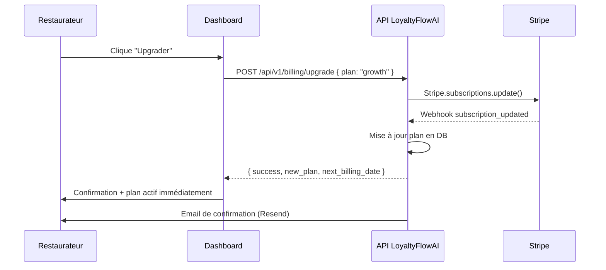
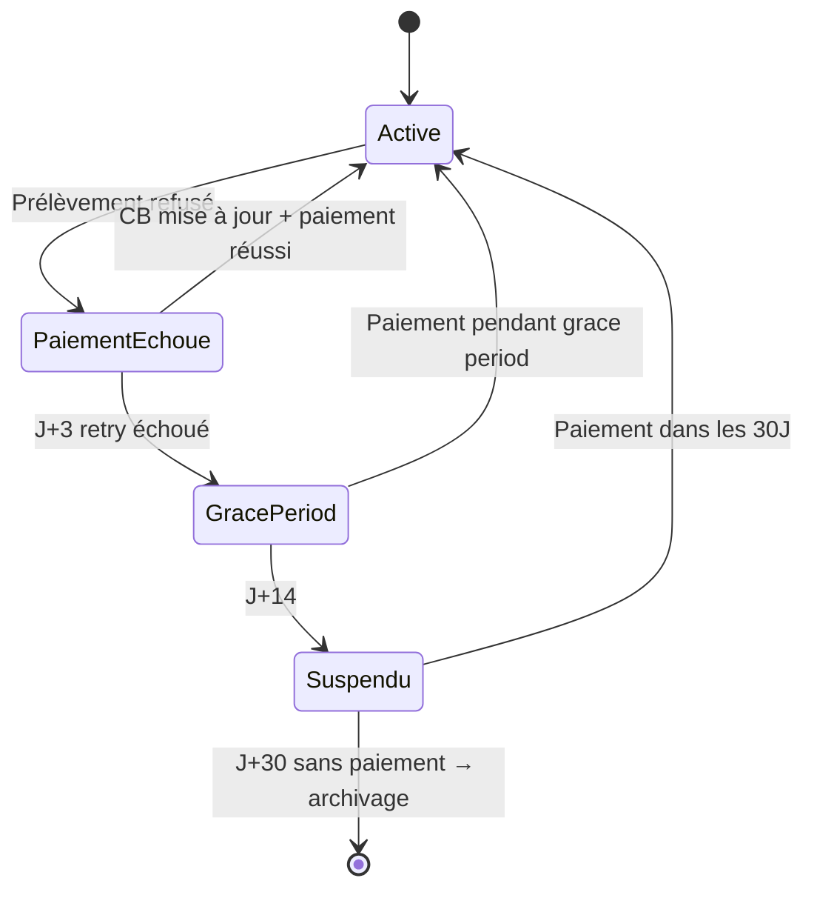

# US-007 — Gestion de l'abonnement (Billing)

> **Version :** 1.0.0 | **Date :** 2026-06-28
> **Phase :** MVP | **Priorité :** Must Have
> **JTBD lié :** JTBD-08 (Je veux maîtriser mes coûts sans surprise)
> **Persona :** Lucas Beaumont (Gérant indépendant)

---

## User Story

> **En tant que** gérant d'un restaurant indépendant,
> **je veux** gérer mon abonnement LoyaltyFlowAI (plan, paiement, factures)
> **afin de** contrôler mes dépenses et adapter mon plan à ma croissance.

---

## Contexte métier

L'abonnement est la relation commerciale fondamentale entre LoyaltyFlowAI et le restaurateur. Une mauvaise expérience de billing (facturation opaque, changement de plan difficile, annulation impossible en self-serve) est une des premières causes de churn SaaS.

**Enjeux :**

- **Confiance :** Le restaurateur doit pouvoir consulter ce qu'il paie sans friction
- **Flexibilité :** Monter/descendre de plan selon la saison (haute saison = plus de clients)
- **RGPD :** Droit à la résiliation + suppression des données sur demande
- **Rétention :** Un flow d'annulation bien conçu peut sauver 20-30 % des désabonnements

---

## Critères d'acceptation

### CA-007-01 — Consultation du plan actuel

```gherkin
Étant donné que je suis connecté à mon dashboard,
Quand je navigue vers "Mon abonnement",
Alors je vois :
  - Mon plan actuel (Starter / Growth / Pro)
  - Le prix mensuel
  - La date de prochain renouvellement
  - Le nombre de clients actuels / limite du plan
  - Un indicateur si je suis proche de la limite (> 80 %)
```

### CA-007-02 — Upgrade de plan

```gherkin
Étant donné que je suis sur le plan Starter (≤ 500 clients),
Quand j'ai atteint 480 clients (> 80 % de la limite),
Alors je vois une bannière non-intrusive : "Vous approchez de votre limite — Passer à Growth"

Et quand je clique sur "Upgrader",
Alors :
  - Je vois un récapitulatif : nouveau prix, différence pro-ratée, date d'effet
  - Je confirme en un clic (CB enregistrée)
  - Mon plan bascule immédiatement
  - Je reçois un email de confirmation
```

### CA-007-03 — Downgrade de plan

```gherkin
Étant donné que je suis sur Growth (≤ 5 000 clients) avec 300 clients actifs,
Quand je veux passer à Starter,
Alors :
  - LoyaltyFlowAI vérifie que je suis sous la limite Starter (≤ 500)
  - Si oui : downgrade effectif à la prochaine date de renouvellement (pas immédiat)
  - Si non : message explicatif "Vous avez X clients — archivez-en pour downgrader"
```

### CA-007-04 — Historique et téléchargement des factures

```gherkin
Étant donné que je suis sur "Mon abonnement",
Quand j'accède à "Historique de facturation",
Alors :
  - Je vois la liste de toutes mes factures (date, montant, statut)
  - Je peux télécharger chaque facture en PDF (format conforme TVA française)
  - Les factures incluent : SIRET LoyaltyFlowAI, SIRET restaurant, montant HT, TVA 20 %, montant TTC
```

### CA-007-05 — Annulation (flow anti-churn)

```gherkin
Étant donné que je veux annuler mon abonnement,
Quand je clique sur "Résilier mon abonnement",
Alors :
  - Étape 1 : Motif de résiliation (sélection parmi 6 raisons)
  - Étape 2 : Offre de rétention contextuelle selon le motif
    - Trop cher → Proposer downgrade Starter
    - Pas utile → Rappel des fonctionnalités non utilisées
    - Pause → Proposer pause 1 mois
    - Autre solution → Demander laquelle (champ texte)
  - Étape 3 : Confirmation finale avec date de fin d'accès

Et si je confirme l'annulation :
  - L'accès reste actif jusqu'à la fin de la période payée
  - Je reçois un email avec la date de fin et l'option d'export des données
  - Après la fin : compte en lecture seule 30 jours, puis suppression sur demande
```

### CA-007-06 — Paiement échoué

```gherkin
Étant donné que mon paiement mensuel échoue (CB expirée, fonds insuffisants),
Alors :
  - J+0 : Email "Problème de paiement — Mettez à jour votre moyen de paiement"
  - J+3 : Relance automatique de débit
  - J+7 : Email de rappel + bannière sur le dashboard
  - J+14 : Suspension d'accès (pas de suppression) — email explicatif
  - J+30 : Email final avant désactivation définitive

Et si je mets à jour ma CB pendant la période de grâce :
  - Le paiement est prélevé immédiatement
  - L'accès est restauré instantanément
```

---

## Flows techniques

### Flow upgrade



### Flow paiement échoué



---

## Maquette fonctionnelle (Dashboard Billing)

```
┌─────────────────────────────────────────────────────────┐
│ Mon Abonnement                                          │
├─────────────────────────────────────────────────────────┤
│                                                         │
│  Plan actuel  ┌──────────────────────┐                 │
│               │   GROWTH             │                 │
│               │   149 € / mois       │                 │
│               │   Renouvellement : 15 juil.            │
│               └──────────────────────┘                 │
│                                                         │
│  Utilisation  ████████████░░░  1 823 / 5 000 clients   │
│                                                         │
│  [ Upgrader vers Pro ]    [ Changer de plan ]           │
│                                                         │
├─────────────────────────────────────────────────────────┤
│ Moyen de paiement                                       │
│  Visa •••• 4242   Expire 03/28   [ Modifier ]          │
├─────────────────────────────────────────────────────────┤
│ Historique des factures                                 │
│  Juin 2026    149,00 € TTC  ✅ Payée   [PDF]           │
│  Mai 2026     149,00 € TTC  ✅ Payée   [PDF]           │
│  Avr. 2026     49,00 € TTC  ✅ Payée   [PDF]           │
├─────────────────────────────────────────────────────────┤
│  [ Résilier mon abonnement ]  (lien discret)           │
└─────────────────────────────────────────────────────────┘
```

---

## Questions ouvertes

| ID      | Question                                        | Impact      |
| ------- | ----------------------------------------------- | ----------- |
| QO-B-01 | Trial 14 jours ou pas ? Avec ou sans CB ?       | Acquisition |
| QO-B-02 | Pause d'abonnement (ex : fermeture août) ?      | Rétention   |
| QO-B-03 | Coupon de réduction pour les premiers clients ? | Acquisition |

---

## Dépendances

- **Stripe** : subscriptions, invoices, payment_intents, webhooks
- **Resend** : emails billing (confirmation, factures, relances)
- **RGPD** : flow suppression des données lié à l'annulation → voir US-008
- **Onboarding** : choix du plan initial → voir US-009
