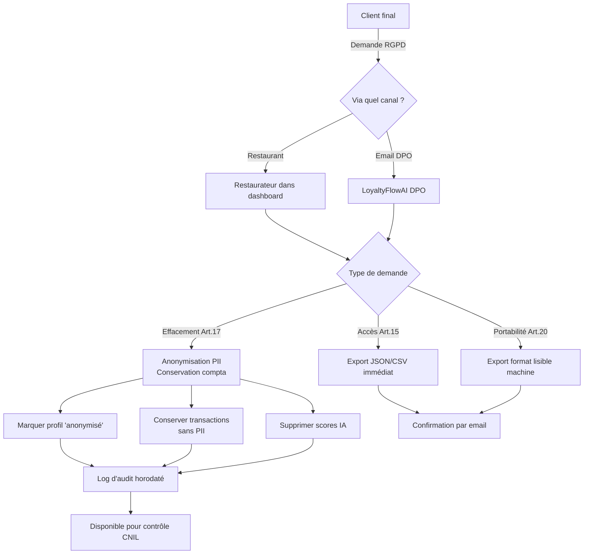

# US-008 — Conformité RGPD (Export & Suppression des données)

> **Version :** 1.0.0 | **Date :** 2026-06-28
> **Phase :** MVP | **Priorité :** Must Have (obligation légale)
> **JTBD lié :** JTBD-09 (Je veux être en règle sans devenir juriste)
> **Personas :** Lucas Beaumont (Gérant) + Sophia Delacroix (Restauratrice tech-savvy)

---

## User Story principale — Restaurant (Responsable de traitement)

> **En tant que** gérant d'un restaurant utilisant LoyaltyFlowAI,
> **je veux** pouvoir exporter ou supprimer les données de mes clients sur leur demande
> **afin de** respecter mes obligations RGPD en tant que responsable de traitement.

## User Story secondaire — Client final (Personne concernée)

> **En tant que** client final d'un restaurant utilisant LoyaltyFlowAI,
> **je veux** pouvoir accéder à mes données, les exporter ou demander leur suppression
> **afin d'** exercer mes droits sur mes données personnelles (RGPD Art. 15, 17, 20).

---

## Contexte juridique

LoyaltyFlowAI opère sous un **double régime RGPD** :

| Rôle                      | Entité           | Responsabilité                                  |
| ------------------------- | ---------------- | ----------------------------------------------- |
| Responsable de traitement | Le restaurant    | Gère les données de ses propres clients         |
| Sous-traitant             | LoyaltyFlowAI    | Traite les données pour le compte du restaurant |
| Sous-traitant ultérieur   | Supabase, Resend | Infrastructure hébergement/emails               |

**Conséquences pour le produit :**

1. Le restaurant doit pouvoir exercer le droit d'accès/suppression pour ses propres clients
2. LoyaltyFlowAI doit pouvoir traiter une demande RGPD de la part d'un client final qui contacte directement LoyaltyFlowAI
3. La DPA (Data Processing Agreement) doit être signée à l'inscription → US-009

**Délai légal :** 1 mois maximum pour répondre à une demande (RGPD Art. 12.3)

---

## Critères d'acceptation

### CA-008-01 — Export des données d'un client final (par le restaurateur)

```gherkin
Étant donné que je suis gérant et qu'un de mes clients demande ses données,
Quand je recherche ce client dans mon dashboard,
Alors je peux cliquer sur "Exporter les données de ce client"

Et l'export contient (format JSON + CSV) :
  - Données d'identification : prénom, nom, email, téléphone (si collecté)
  - Historique des points : toutes les transactions datées
  - Récompenses : liste des récompenses obtenues / utilisées
  - Scores IA : s'il en existe, les scores de churn (valeur numérique)
  - Date d'inscription et consentements horodatés

Et l'export est disponible en téléchargement immédiat (pas par email)
```

### CA-008-02 — Suppression des données d'un client final

```gherkin
Étant donné qu'un client me demande la suppression de ses données (droit à l'effacement),
Quand je clique sur "Supprimer définitivement ce client" dans son profil,
Alors :
  - Étape 1 : Confirmation explicite "Cette action est irréversible"
  - Étape 2 : Les données PII sont effacées (email, prénom, nom, téléphone)
  - Les transactions sont conservées de façon anonymisée (obligation comptable)
  - Les scores IA liés au profil sont supprimés
  - Le compte client est marqué "anonymisé" dans les analytics

Note : Les transactions financières anonymisées doivent être conservées 10 ans (Code de commerce L123-22)
```

### CA-008-03 — Export global des données du restaurant

```gherkin
Étant donné que je ferme mon établissement (ou résilie LoyaltyFlowAI),
Quand j'accède à "Exporter toutes mes données",
Alors :
  - Je reçois une archive ZIP contenant :
    - Tous les profils clients (CSV + JSON)
    - Tout l'historique de transactions
    - Les programmes de fidélité configurés
    - Les paramètres de l'organisation
  - L'export est disponible 48 heures (lien sécurisé)
  - Après résiliation, je dispose de 30 jours pour exporter avant suppression
```

### CA-008-04 — Demande directe au DPO LoyaltyFlowAI

```gherkin
Étant donné qu'un client final contacte directement LoyaltyFlowAI (via dpo@loyaltyflowai.fr),
Alors LoyaltyFlowAI :
  - Identifie le restaurant responsable (via l'email du client)
  - Notifie le restaurant de la demande
  - Si le restaurant ne répond pas sous 7 jours : LoyaltyFlowAI traite directement
  - Confirme le traitement au client dans les 30 jours réglementaires
```

### CA-008-05 — Consentement et base légale

```gherkin
Étant donné que le client final s'inscrit au programme de fidélité,
Alors le widget collecte et stocke :
  - La date/heure du consentement (ISO 8601)
  - L'IP anonymisée (3 premiers octets)
  - La version des CGU acceptées
  - La finalité du traitement ("participation au programme de fidélité de [Nom du restaurant]")

Et le restaurateur peut prouver ce consentement en cas de contrôle CNIL
```

### CA-008-06 — Registre des traitements (simplifié)

```gherkin
Étant donné que je suis gérant et que je dois tenir un registre des traitements RGPD,
Quand j'accède à "Conformité RGPD" dans mes paramètres,
Alors je peux télécharger un registre pré-rempli listant :
  - Le traitement effectué (fidélisation client)
  - Les catégories de données collectées
  - La base légale (consentement)
  - La durée de conservation
  - Les sous-traitants (Supabase, Resend, LoyaltyFlowAI)
  - Les mesures de sécurité mises en place
```

---

## Architecture RGPD



---

## Données collectées et leur statut RGPD

| Donnée                   | Catégorie                | Conservation             | Effaçable                  |
| ------------------------ | ------------------------ | ------------------------ | -------------------------- |
| Email                    | PII identifiante         | Durée relation + 3 ans   | ✅ Oui                     |
| Prénom, Nom              | PII identifiante         | Durée relation + 3 ans   | ✅ Oui                     |
| Téléphone                | PII identifiante         | Durée relation + 3 ans   | ✅ Oui                     |
| Historique de points     | Données comportementales | 5 ans                    | Anonymisable               |
| Transactions financières | Données comptables       | 10 ans                   | ❌ Non (obligation légale) |
| Score de churn           | Données dérivées IA      | Durée relation           | ✅ Oui                     |
| Consentements            | Preuves juridiques       | 5 ans après fin relation | ❌ Non (preuve)            |
| Logs d'audit             | Sécurité                 | 1 an                     | ❌ Non                     |

---

## Questions ouvertes

| ID         | Question                                                                 | Impact       |
| ---------- | ------------------------------------------------------------------------ | ------------ |
| QO-RGPD-01 | DPA individuelle par restaurant ou CGU intégrées ?                       | Juridique    |
| QO-RGPD-02 | Le widget doit-il afficher une bannière de consentement explicite ?      | UX           |
| QO-RGPD-03 | L'email DPO dpo@loyaltyflowai.fr est-il géré manuellement ou via outil ? | Opérationnel |

---

## Dépendances

- **US-007 (Billing)** : Flow d'annulation déclenche la procédure d'export + délai de suppression
- **US-009 (Onboarding)** : Signature de la DPA lors de l'inscription
- **US-011 (Widget client)** : Collecte du consentement lors de l'inscription au programme
- **DATABASE.md** : Champ `deleted_at` (soft delete) sur `Customer` — nécessite une colonne `anonymized_at`
