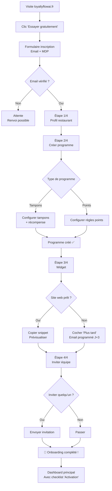

# US-009 — Onboarding guidé (Premier démarrage)

> **Version :** 1.0.0 | **Date :** 2026-06-28
> **Phase :** MVP | **Priorité :** Must Have
> **JTBD lié :** JTBD-01 (Je veux démarrer rapidement sans perdre de temps)
> **Persona :** Lucas Beaumont (Gérant indépendant) + Marie-Claude Perrin (peu à l'aise avec la tech)

---

## User Story

> **En tant que** nouveau gérant inscrit sur LoyaltyFlowAI,
> **je veux** être guidé pas à pas lors de mon premier démarrage
> **afin de** lancer mon premier programme de fidélité en moins de 30 minutes, seul, sans aide externe.

---

## Contexte produit

L'onboarding est le moment le plus critique du cycle de vie. C'est là que :

- Le restaurateur **valide ou invalide** sa décision d'essai
- **60-70 % du churn** SaaS early-stage se produit dans les 7 premiers jours
- L'utilisateur décide si l'outil est "pour lui" ou "trop compliqué"

**Benchmark :**

- Loopy Loyalty : onboarding en < 15 min (très simple, peu de configuration)
- LoyaltyFlowAI : vise < 30 min (plus riche mais guidé)

**Définition du succès de l'onboarding (Activation) :**

> Le restaurateur a créé 1 programme avec ≥ 1 règle + configuré son widget + enregistré son premier client fictif/réel

---

## Critères d'acceptation

### CA-009-01 — Inscription (hors scope UX de login)

```gherkin
Étant donné que je visite loyaltyflowai.fr et clique sur "Essayer gratuitement",
Alors :
  - Formulaire minimal : Email + Mot de passe (ou SSO Google)
  - Pas de CB demandée à l'inscription
  - Email de vérification envoyé immédiatement
  - Redirection vers l'onboarding après vérification
```

### CA-009-02 — Étape 1 : Profil du restaurant

```gherkin
Étant donné que je viens de vérifier mon email,
Quand l'onboarding démarre,
Alors l'étape 1 me demande (barre de progression 1/4) :
  - Nom du restaurant (pré-rempli si détecté via email)
  - Type de restauration (liste : Brasserie, Restaurant gastronomique, Fast-casual, Pizzeria, Autre)
  - Code postal (pour personnalisation locale future)
  - Nombre approximatif de clients/mois (fourchettes : <100 / 100-500 / 500+)

Et je peux passer l'étape avec "Je complèterai plus tard" (sauf nom restaurant)
```

### CA-009-03 — Étape 2 : Créer mon programme de fidélité

```gherkin
Étant donné que je suis à l'étape 2/4,
Alors je vois un éditeur simplifié de programme :

  Choix du type :
  ● Carte à tampons (simple, recommandé pour débuter)
  ○ Points (avancé)

  Si "Carte à tampons" :
    - Nombre de tampons pour une récompense : [  10  ] ▲▼
    - La récompense : [  Café offert        ] (texte libre)
    - Prévisualisation en temps réel d'une carte client

Et un CTA clair : "Créer mon programme"
```

### CA-009-04 — Étape 3 : Configurer le widget

```gherkin
Étant donné que j'ai créé mon programme,
Quand je suis à l'étape 3/4,
Alors :
  - Je vois le code snippet à copier (1 ligne HTML)
  - Un guide visuel "Où coller ce code" (3 options : WordPress, Wix, Site custom)
  - Un lien de prévisualisation du widget sur une page démo

Et je peux cocher "Mon site n'est pas encore prêt" pour passer à l'étape suivante
Et si je coche : un email est programmé dans 3 jours avec le snippet
```

### CA-009-05 — Étape 4 : Invitation de l'équipe

```gherkin
Étant donné que je suis à l'étape 4/4,
Alors :
  - Champ optionnel : "Inviter un collaborateur" (email)
  - Si rempli : email d'invitation envoyé avec rôle "Employé"
  - Si vide : bouton "Passer cette étape"
```

### CA-009-06 — Complétion de l'onboarding

```gherkin
Étant donné que j'ai complété les 4 étapes,
Alors :
  - Animation de célébration (confetti légère)
  - Message : "Votre programme est prêt ! Enregistrez votre premier client."
  - CTA principal : "Enregistrer un client test"
  - CTA secondaire : "Découvrir le dashboard"

Et dans les 24h, je reçois un email "Vous avez fait le premier pas" avec 3 tips d'activation
```

### CA-009-07 — Reprise de l'onboarding incomplet

```gherkin
Étant donné que j'ai commencé l'onboarding mais n'ai pas fini,
Quand je me reconnecte le lendemain,
Alors :
  - Une bannière "Reprendre l'installation" apparaît sur le dashboard
  - Elle indique l'étape restante : "Il reste 2 étapes à configurer"
  - Elle disparaît une fois l'onboarding complété
```

### CA-009-08 — Signature DPA (RGPD)

```gherkin
Étant donné que j'utilise LoyaltyFlowAI pour traiter des données clients,
Quand je complète l'inscription,
Alors :
  - Une case à cocher obligatoire : "J'accepte les CGU et la DPA (Accord de sous-traitance RGPD)"
  - La DPA est consultable via lien avant acceptation
  - La date et l'IP sont horodatées et conservées

Lié à : US-008 (RGPD)
```

---

## Flow complet de l'onboarding



---

## Checklist d'activation post-onboarding

Visible sur le dashboard les 7 premiers jours :

```
✅ Programme créé
□ Premier client enregistré
□ Widget installé sur votre site
□ Premier employé invité
□ 5 clients enregistrés (jalons de croissance)
```

---

## Métriques de succès

| Métrique                               | Cible MVP                        |
| -------------------------------------- | -------------------------------- |
| Taux de complétion onboarding          | > 70 %                           |
| Temps moyen de complétion              | < 30 min                         |
| Activation J+7 (≥ 1 client enregistré) | > 50 %                           |
| Dropout à l'étape 1                    | < 20 %                           |
| Dropout à l'étape widget (step 3)      | < 35 % (étape la plus difficile) |

---

## Questions ouvertes

| ID       | Question                                                    | Impact                 |
| -------- | ----------------------------------------------------------- | ---------------------- |
| QO-OB-01 | Essai gratuit 14 jours ou freemium limité ?                 | Activation/Acquisition |
| QO-OB-02 | Onboarding en vidéo (loom 2 min) ou purement textuel ?      | UX                     |
| QO-OB-03 | Appel de découverte proposé pour les prospects Growth/Pro ? | ACV                    |

---

## Dépendances

- **US-001 (Gestion programme)** : L'étape 2 crée un vrai LoyaltyProgram en base
- **US-007 (Billing)** : Choix du plan après essai ou lors de l'onboarding
- **US-008 (RGPD)** : Signature de la DPA obligatoire à l'étape 1
- **US-010 (Équipe)** : L'étape 4 initie un TeamMember invitation
