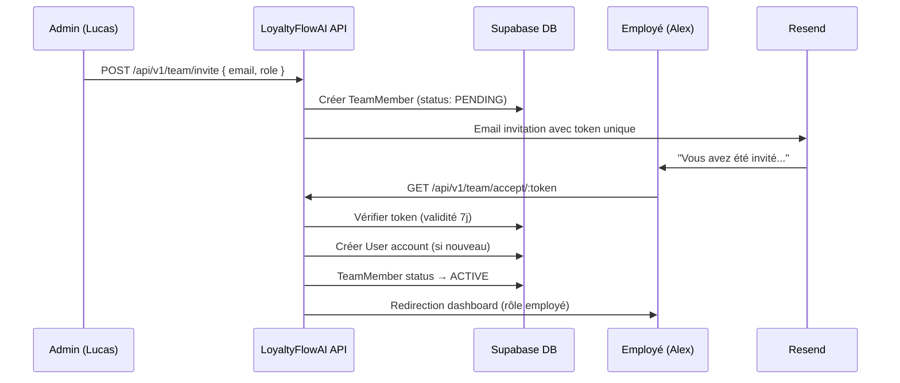

# US-010 — Gestion de l'équipe (Membres et rôles)

> **Version :** 1.0.0 | **Date :** 2026-06-28
> **Phase :** MVP | **Priorité :** Must Have
> **JTBD lié :** JTBD-06 (Je veux que mon équipe puisse utiliser l'outil sans que je sois là)
> **Personas :** Lucas Beaumont (Gérant) + Alex Petit (Serveur employé)

---

## User Story — Gérant (Admin)

> **En tant que** gérant du restaurant,
> **je veux** inviter mes employés à utiliser LoyaltyFlowAI avec des droits limités
> **afin de** qu'ils puissent enregistrer des clients et attribuer des points sans accéder aux données sensibles (revenus, analytics).

## User Story — Employé

> **En tant qu'** employé de restaurant,
> **je veux** accéder à un dashboard simplifié pour gérer les clients fidélité
> **afin de** faire mon travail rapidement pendant le service sans m'occuper des configurations.

---

## Contexte métier

Un restaurant indépendant moyen emploie **2 à 8 personnes**. Le déploiement du programme de fidélité dépend de l'adoption par l'équipe de salle. Si l'outil est compliqué ou effrayant pour les serveurs, il ne sera pas utilisé.

**Cas typiques :**

- Lucas (gérant) administre tout — il est le seul "Admin"
- Sarah et Thomas (serveurs) scannent les QR des clients au moment de payer — ils sont "Employés"
- Marie (responsable de salle) peut voir les analytics mais pas modifier les programmes — elle est "Manager"

---

## Rôles et permissions

| Permission                           | Admin | Manager | Employé |
| ------------------------------------ | ----- | ------- | ------- |
| Voir le dashboard complet            | ✅    | ✅      | ❌      |
| Voir les analytics (revenus estimés) | ✅    | ✅      | ❌      |
| Enregistrer un client                | ✅    | ✅      | ✅      |
| Attribuer des points manuellement    | ✅    | ✅      | ✅      |
| Voir le profil client complet        | ✅    | ✅      | ✅      |
| Modifier le programme de fidélité    | ✅    | ❌      | ❌      |
| Gérer les membres de l'équipe        | ✅    | ❌      | ❌      |
| Voir les réglages / billing          | ✅    | ❌      | ❌      |
| Exporter les données                 | ✅    | ✅      | ❌      |

---

## Critères d'acceptation

### CA-010-01 — Inviter un employé

```gherkin
Étant donné que je suis Admin dans mon organisation,
Quand j'accède à "Équipe" et clique sur "Inviter un membre",
Alors :
  - Je saisis l'email de l'employé
  - Je choisis son rôle : Manager ou Employé
  - Un email d'invitation est envoyé avec un lien valide 7 jours
  - L'invitation apparaît dans la liste avec le statut "En attente"
```

### CA-010-02 — Acceptation de l'invitation

```gherkin
Étant donné que j'ai reçu un email d'invitation,
Quand je clique sur le lien "Rejoindre le restaurant",
Alors :
  - Si j'ai déjà un compte : connexion → accès immédiat
  - Si je n'ai pas de compte : formulaire (prénom, nom, mot de passe)
  - Après acceptation : redirigé vers l'interface correspondant à mon rôle

Et si je suis Employé : je vois uniquement l'interface de gestion client (mode simple)
```

### CA-010-03 — Interface employé (vue simplifiée)

```gherkin
Étant donné que je suis connecté en tant qu'Employé,
Alors mon dashboard est simplifié :
  - Zone principale : recherche client (email ou QR scan)
  - Bouton "Nouveau client" (pour enregistrer quelqu'un de nouveau)
  - Bouton "Attribuer des points" (saisie manuelle de montant)
  - Bouton "Utiliser une récompense" (marquer une récompense comme utilisée)

Et je ne vois pas :
  - Les analytics
  - Les paramètres
  - Les données de billing
  - Les scores de churn
```

### CA-010-04 — Attribution de points par l'employé

```gherkin
Étant donné que je suis Employé et qu'un client vient de payer,
Quand je recherche le client (par email ou QR),
Alors :
  - Je vois son profil : prénom, points actuels, statut de la carte
  - Je saisis le montant de la commande (ex : 42,50 €)
  - L'outil calcule automatiquement les points selon les règles
  - Je confirme en un tap → points ajoutés instantanément
  - Animation de confirmation pour montrer au client (mode "affichage client")
```

### CA-010-05 — Retirer un membre de l'équipe

```gherkin
Étant donné que je suis Admin,
Quand un employé quitte le restaurant,
Alors :
  - Je clique sur "Révoquer l'accès" dans la liste des membres
  - Confirmation : "Cet employé ne pourra plus accéder au compte"
  - Révocation immédiate (son token JWT est invalidé)
  - Ses actions passées restent dans l'historique d'audit (avec son nom anonymisé si demandé)
```

### CA-010-06 — Multi-établissements (Version 2)

```gherkin
[HORS SCOPE MVP — Phase 2]
Étant donné que je possède plusieurs restaurants,
Alors un même employé peut avoir des rôles différents dans chaque établissement.
```

---

## Interface employé (maquette)

```
┌────────────────────────────────────────────────────┐
│  🍽️  Le Bistrot du Marché                          │
│  Bonjour, Alex !                    [Déconnexion]  │
├────────────────────────────────────────────────────┤
│                                                    │
│  [🔍 Rechercher un client...]                     │
│                                                    │
│  Ou scannez son QR code : [📷 Scanner]             │
│                                                    │
│  ──────────────────────────────────────────────── │
│                                                    │
│  [+ Nouveau client]   [💳 Valider une récompense]  │
│                                                    │
├────────────────────────────────────────────────────┤
│  Dernière action : Marie D. — +12 pts (13:42)      │
│  Dernière action : Jean P. — Récompense validée    │
└────────────────────────────────────────────────────┘
```

---

## Flux d'invitation



---

## Questions ouvertes

| ID         | Question                                                   | Impact   |
| ---------- | ---------------------------------------------------------- | -------- |
| QO-TEAM-01 | L'employé peut-il s'inscrire lui-même sans invitation ?    | Sécurité |
| QO-TEAM-02 | Nombre max de membres par plan (Starter: 3 ? Growth: 10 ?) | Pricing  |
| QO-TEAM-03 | Log d'activité des employés visible par le gérant ?        | Audit    |

---

## Dépendances

- **DATABASE.md** : Table `TeamMember` (role: OWNER, ADMIN, MANAGER, EMPLOYEE)
- **US-009 (Onboarding)** : L'étape 4 utilise le même flow d'invitation
- **US-001 à US-006** : Les actions (enregistrer client, attribuer points) sont les mêmes API, avec vérification de rôle
