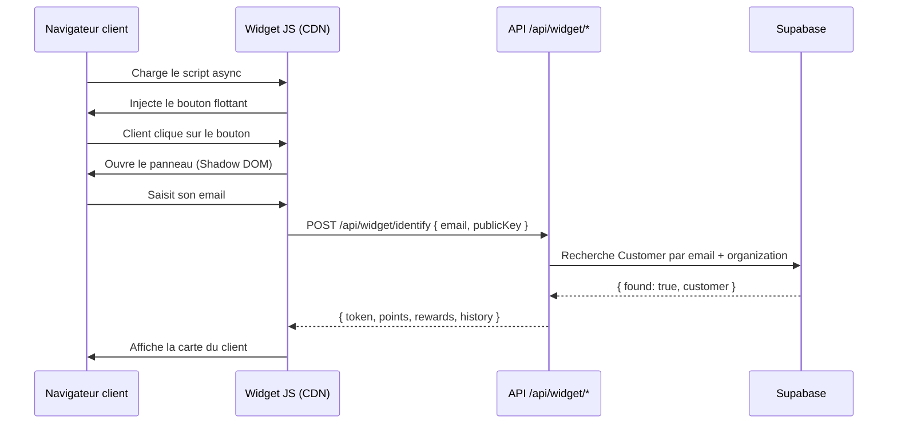

# US-011 — Expérience client final (Widget de fidélité)

> **Version :** 1.0.0 | **Date :** 2026-06-28
> **Phase :** MVP | **Priorité :** Must Have (CRITIQUE — cœur du produit)
> **JTBD lié :** JTBD-10 (Je veux fidéliser sans imposer d'app à mes clients)
> **Personas :** Emma Dupont (Cliente tech, 28 ans) + Georges Martin (Client senior, 65 ans)

---

## User Story

> **En tant que** client d'un restaurant utilisant LoyaltyFlowAI,
> **je veux** consulter mes points et mes récompenses directement sur le site du restaurant,
> **afin de** participer au programme de fidélité sans télécharger d'application.

---

## Contexte produit

Le widget est **le seul point de contact direct** entre LoyaltyFlowAI et le client final. Il doit fonctionner pour :

- **Emma (28 ans)** : ultra-digitale, sur mobile, s'attend à une expérience fluide de qualité Airbnb
- **Georges (65 ans)** : peu à l'aise avec la technologie, ne veut pas créer de compte complexe, utilise Chrome sur desktop

**Contraintes techniques prioritaires :**

- < 30 KB gzippé (ne doit pas ralentir le site du restaurant)
- Fonctionne sur tout navigateur depuis 2018 (Chrome, Safari, Firefox, Edge)
- Accessibilité AA (WCAG 2.1) — contrastes, navigation clavier, ARIA
- Mode mobile-first (70 %+ des utilisateurs seront sur mobile)

**Questions ouvertes liées :** QO-MVP-01 (polling vs WebSocket), QO-MVP-02 (identification email seul vs email+QR)

---

## Critères d'acceptation

### CA-011-01 — Affichage initial du widget

```gherkin
Étant donné que le restaurateur a installé le snippet sur son site,
Quand un visiteur charge la page,
Alors :
  - Un bouton flottant apparaît en bas à droite : "Mes points 🎁"
  - Le bouton est non-intrusif (ne couvre pas le contenu principal)
  - Le bouton respecte les couleurs du restaurant (configurables dans le dashboard)
  - Le chargement du widget n'affecte pas le temps de chargement de la page (async)
```

### CA-011-02 — Inscription au programme (nouveau client)

```gherkin
Étant donné que je suis un nouveau client et que je clique sur le bouton widget,
Alors un panneau s'ouvre avec :
  - Logo / nom du restaurant
  - Message de bienvenue personnalisé
  - Description du programme : "Gagnez 1 point pour chaque euro dépensé"
  - Formulaire minimal : Email + Prénom (obligatoires), Téléphone (optionnel)
  - Case à cocher consentement : "J'accepte de recevoir des communications de [Restaurant]"
  - Bouton "Rejoindre le programme"

Et après soumission :
  - Message de confirmation "Bienvenue Emma ! Votre carte est créée."
  - Affichage immédiat de la carte (0 points)
  - Email de bienvenue envoyé avec récapitulatif
```

### CA-011-03 — Connexion (client existant)

```gherkin
Étant donné que je suis déjà membre du programme,
Quand j'ouvre le widget et que je saisis mon email,
Alors :
  - Si reconnu : affichage immédiat de mes points sans mot de passe
    (via lien magique ou token de session persistant)
  - Si non reconnu : proposition de s'inscrire

Note : PAS de mot de passe — l'identification est par email uniquement (magic link ou token cookie)
```

### CA-011-04 — Consultation de la carte de fidélité

```gherkin
Étant donné que je suis identifié dans le widget,
Alors je vois ma carte de fidélité :
  - Prénom + nombre de points
  - Si programme "tampons" : visualisation de la carte (ex: 7/10 tampons)
  - Si programme "points" : total de points + seuil de récompense
  - Barre de progression visuelle vers la prochaine récompense
  - Récompenses disponibles (si seuil atteint) : bouton "Utiliser"
  - Historique compact des 5 dernières transactions
```

### CA-011-05 — Notification de récompense disponible

```gherkin
Étant donné que je viens de débloquer une récompense (ex: café offert),
Alors :
  - Notification visuelle dans le widget (badge rouge sur le bouton)
  - Si je reviens sur le site : animation sur le bouton widget
  - Email automatique envoyé : "Votre récompense est prête !"
  - Bouton "Afficher mon code" → QR code ou code alphanumérique à montrer au serveur
```

### CA-011-06 — Utilisation d'une récompense

```gherkin
Étant donné que j'ai une récompense disponible,
Quand je clique sur "Utiliser ma récompense",
Alors :
  - Affichage d'un QR code unique (valide 5 min) + code texte de secours
  - Je montre le QR code au serveur
  - Le serveur scanne via son dashboard d'employé → récompense marquée comme utilisée
  - Confirmation affichée dans mon widget : "Récompense utilisée ✅"
```

### CA-011-07 — Accessibilité senior (Georges, 65 ans)

```gherkin
Étant donné que je suis un utilisateur peu familier avec le digital,
Alors :
  - Taille de police : minimum 16px (pas de texte microscopique)
  - Boutons larges (minimum 48x48px — norme mobile)
  - Un seul champ à remplir à la fois (form progression)
  - Textes simples : "Vos points" et non "Solde de fidélité transactionnel"
  - Pas d'animations agressives
  - Contraste texte/fond : ratio ≥ 4.5:1 (WCAG AA)
```

### CA-011-08 — Mode hors-ligne / dégradé

```gherkin
Étant donné que le réseau est lent ou le widget ne charge pas,
Alors :
  - Le bouton widget ne s'affiche pas (graceful degradation)
  - Le site du restaurant fonctionne normalement
  - Aucun message d'erreur visible pour le visiteur

Note : LoyaltyFlowAI ne doit jamais casser le site du restaurant
```

---

## Expérience de la carte (maquette mobile)

```
┌──────────────────────────────┐
│  🍽️  Le Bistrot du Marché    │
│  Bonjour, Emma !             │
├──────────────────────────────┤
│                              │
│    Vos tampons               │
│    ●●●●●●●○○○               │
│    7 sur 10                  │
│                              │
│  ████████████░░░░  70 %      │
│  Plus que 3 tampons pour     │
│  votre café offert ☕         │
│                              │
├──────────────────────────────┤
│  Dernières visites           │
│  · 24 juin — +1 tampon       │
│  · 18 juin — +1 tampon       │
│  · 10 juin — +1 tampon       │
├──────────────────────────────┤
│  [ Partager avec un ami 🎁 ] │
└──────────────────────────────┘
```

---

## Architecture technique du widget



**Note sur Shadow DOM :**
Le widget utilise un Shadow DOM pour isoler ses styles CSS et éviter les conflits avec le site du restaurant. C'est une contrainte technique forte qui garantit l'affichage correct quel que soit le site.

---

## État des questions ouvertes critiques

| QO        | Question                                                               | Statut     | Impact                            |
| --------- | ---------------------------------------------------------------------- | ---------- | --------------------------------- |
| QO-MVP-01 | Polling ou WebSocket pour mise à jour temps réel des points ?          | **Ouvert** | Polling recommandé pour MVP (30s) |
| QO-MVP-02 | Identification : email seul (magic link) ou email + QR au restaurant ? | **Ouvert** | Email seul pour MVP               |
| QO-MVP-04 | Attribution des points : manuelle par employé ou automatique (POS) ?   | **Ouvert** | Manuelle pour MVP                 |

---

## Tests d'acceptance (User acceptance)

| Scénario                                      | Succès si…                                                                  |
| --------------------------------------------- | --------------------------------------------------------------------------- |
| Emma (mobile, Safari iOS) s'inscrit           | Carte affichée en < 5 sec, email reçu en < 30 sec                           |
| Georges (desktop, Chrome) consulte ses points | Aucun bug, texte lisible, pas de question sur "qu'est-ce que je dois faire" |
| Réseau 3G (throttling simulé)                 | Widget charge en < 3 sec                                                    |
| Restaurateur en mode sombre (CSS dark mode)   | Le widget s'adapte sans casser le rendu                                     |
| Client sans JavaScript activé                 | Le site du restaurant fonctionne normalement (widget absent, pas d'erreur)  |

---

## Dépendances

- **US-002 (Attribution de points)** : Le widget appelle les mêmes règles d'attribution
- **US-003 (Récompenses)** : Affichage et validation des récompenses
- **US-004 (Profil client)** : Identification et historique
- **US-008 (RGPD)** : Consentement collecté à l'inscription → stocké avec horodatage
- **API.md §Widget** : Endpoints /api/widget/identify, /api/widget/status, /api/widget/redeem
