# TECHNICAL DISCOVERY — LoyaltyFlowAI

> **Version :** 1.0.0 | **Date :** 2026-06-28
> **Scope :** Architecture complète, modules, services, API, base de données, scalabilité, sécurité, CI/CD
> **Lié à :** [ARCHITECTURE.md](./ARCHITECTURE.md) | [DATABASE.md](./DATABASE.md) | [API.md](./API.md) | [MASTER_PLAN.md](../../MASTER_PLAN.md)

---

## Table des matières

1. [Vue d'ensemble de l'architecture](#1-vue-densemble-de-larchitecture)
2. [Modules applicatifs](#2-modules-applicatifs)
3. [Services externes et intégrations](#3-services-externes-et-intégrations)
4. [Flux de données détaillés](#4-flux-de-données-détaillés)
5. [Base de données — Schéma évolutif](#5-base-de-données--schéma-évolutif)
6. [Sécurité — Threat model](#6-sécurité--threat-model)
7. [Scalabilité et limites](#7-scalabilité-et-limites)
8. [CI/CD et qualité](#8-cicd-et-qualité)
9. [Observabilité](#9-observabilité)
10. [Décisions architecturales en suspens](#10-décisions-architecturales-en-suspens)

---

## 1. Vue d'ensemble de l'architecture

### Architecture macroscopique

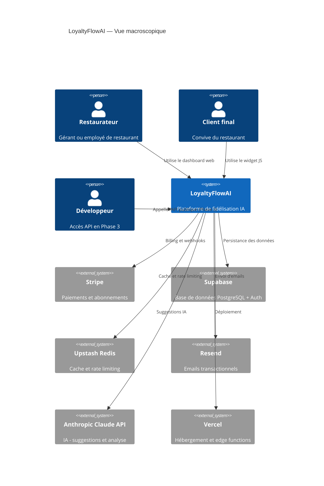

### Architecture Next.js détaillée

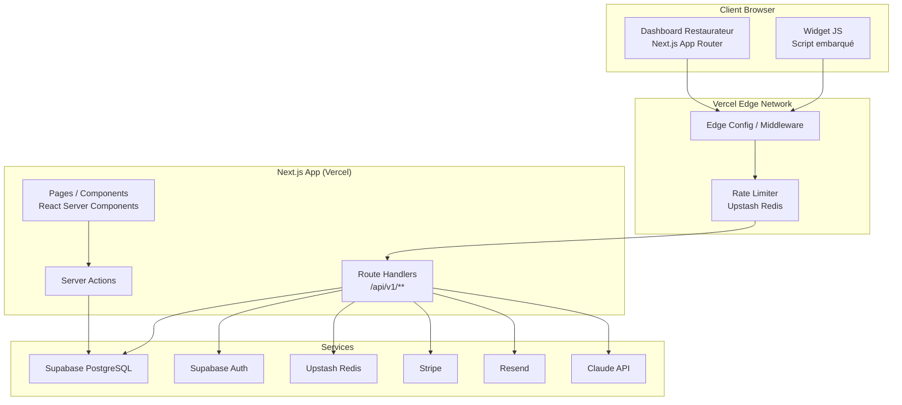

---

## 2. Modules applicatifs

### 2.1 Module Auth

**Responsabilité :** Authentification des restaurateurs et employés.

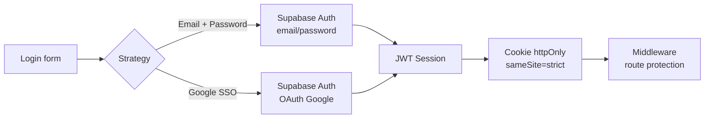

**Tables liées :** `auth.users` (Supabase), `public.organizations`, `public.team_members`

**Flux critique :** Invitation d'un employé

1. Admin génère un token d'invitation (UUID, TTL 7 jours, stocké en DB)
2. Email envoyé via Resend avec lien `/invite/:token`
3. Employé clique → vérification token → création compte Supabase
4. TeamMember status: PENDING → ACTIVE

---

### 2.2 Module Organisation

**Responsabilité :** Isolation multi-tenant. Chaque restaurant = 1 organization.

**Invariant critique :** Toute donnée a un `organization_id`. Les Row-Level Security (RLS) PostgreSQL garantissent que chaque requête ne retourne que les données de l'organisation courante.

```sql
-- Exemple de policy RLS
CREATE POLICY "org_isolation" ON "LoyaltyProgram"
  USING (organization_id = auth.jwt() ->> 'org_id');
```

**Vecteur d'attaque à protéger :** IDOR (Insecure Direct Object Reference)

- Un restaurateur ne doit **jamais** pouvoir lire les données d'un autre restaurant, même en manipulant les IDs d'API.
- Défense en profondeur : RLS en base + validation `organization_id` en middleware API.

---

### 2.3 Module Programme de fidélité

**Responsabilité :** CRUD des programmes, règles d'attribution, récompenses.

**Modèles de fidélité supportés (MVP) :**

| Modèle                    | Description               | Complexité |
| ------------------------- | ------------------------- | ---------- |
| Cartes à tampons (stamps) | N tampons = 1 récompense  | Simple     |
| Points sur montant        | X points par euro dépensé | Moyen      |

**Modèles futurs (Phase 2) :**

- Points avec multiplicateurs (happy hour, catégorie)
- Niveaux (Silver, Gold, Platinum)
- Cashback en euros

**Contraintes métier importantes :**

- Un seul programme actif par organisation (MVP)
- Un programme peut être suspendu (pause) sans perdre les données clients
- Les règles d'attribution ne sont pas rétroactives (changement = nouvelle règle)

---

### 2.4 Module Clients (CRM)

**Responsabilité :** Gestion du fichier client fidélité.

**Identification d'un client :**

- **Clé primaire** : email (normalisé en lowercase)
- **Clé de recherche** : prénom (pour le serveur) + email
- **Optionnel** : numéro de téléphone

**Contrainte de déduplication :**
Un client qui s'inscrit deux fois avec le même email → même profil (upsert, pas doublon).

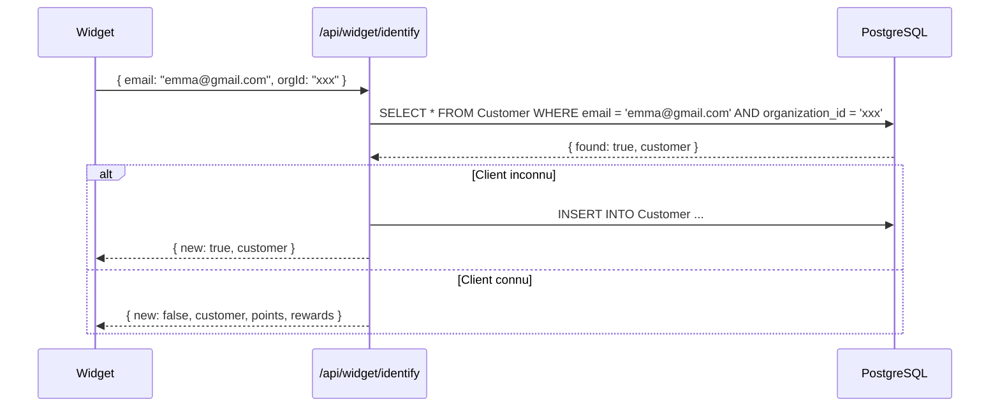

---

### 2.5 Module Points & Transactions

**Responsabilité :** Attribution, vérification et historique des points.

**Règle d'or :** Les points ne peuvent être **que attribués ou déduits** — jamais modifiés rétroactivement (intégrité comptable). En cas d'erreur : transaction de correction.

**Flow attribution (employé) :**

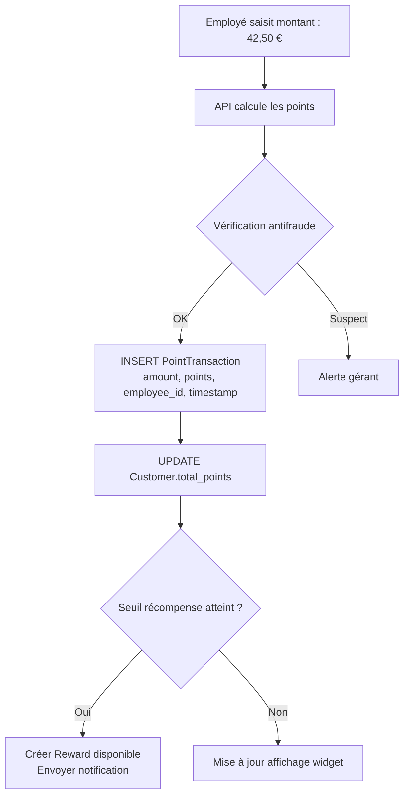

---

### 2.6 Module IA — Loyalty Brain

**Responsabilité :** Scoring de churn, suggestions, analyse.

**MVP (Phase 0-1) : Heuristique pure**

- Churn score basé sur `days_since_last_visit` → LOW / MEDIUM / HIGH
- Aucun ML, aucun appel API externe pour le scoring
- Simple, rapide, explicable

**Phase 2 : Suggestions IA via Claude**

- Prompt engineering pour générer des suggestions de campagnes
- Contexte envoyé : segment de clients, historique, programme actuel
- Réponse : suggestion textuelle affichée dans le dashboard

**Phase 3 : ML propriétaire**

- Entraînement sur les données agrégées anonymisées
- Modèle de churn prédictif (classification binaire)
- Déploiement sur Vercel AI SDK ou endpoint dédié

→ Documentation détaillée : [LOYALTY_BRAIN.md](../ai/LOYALTY_BRAIN.md)

---

### 2.7 Module Widget

**Responsabilité :** Interface client final embarquée sur le site du restaurant.

**Contraintes techniques absolues :**

- Bundle < 30 KB gzip
- Pas de dépendances externes (React, Vue...) — vanilla JS + CSS
- Shadow DOM pour l'isolation CSS
- Chargement asynchrone (ne bloque pas le rendu de la page hôte)
- Compatible Chrome 80+, Safari 14+, Firefox 90+, Edge 80+

**Architecture du widget :**

```
widget.js (< 30KB gzip)
├── loader.js        → détecte le snippet, initialise
├── api.js           → calls vers /api/widget/*
├── shadow-dom.js    → crée le shadow root isolé
├── ui/
│   ├── button.js    → bouton flottant
│   ├── panel.js     → panneau principal
│   ├── card.js      → affichage de la carte
│   └── form.js      → formulaire inscription
└── utils/
    ├── storage.js   → sessionStorage pour le token
    └── events.js    → analytics internes
```

**Sécurité du widget :**

- Authentification via `data-public-key` (clé publique, non-secrète)
- Toutes les opérations sensibles côté serveur uniquement
- Rate limiting strict : 60 req/min/clé via Upstash
- Pas d'accès possible aux données d'autres restaurants (RLS)

---

### 2.8 Module Billing

**Responsabilité :** Gestion des abonnements Stripe.

**Flux webhook (critique) :**

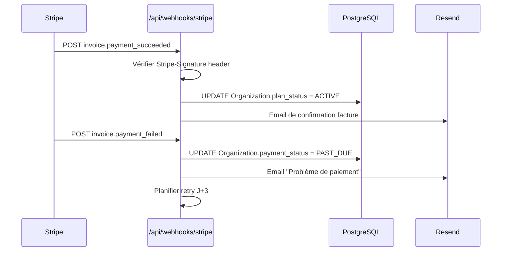

**Events Stripe à gérer (MVP) :**

- `customer.subscription.created`
- `customer.subscription.updated`
- `customer.subscription.deleted`
- `invoice.payment_succeeded`
- `invoice.payment_failed`
- `invoice.finalized` (pour archivage des factures)

---

## 3. Services externes et intégrations

| Service              | Usage                       | Région       | Coût estimé MVP             |
| -------------------- | --------------------------- | ------------ | --------------------------- |
| **Vercel**           | Hosting Next.js + Edge      | EU Frankfurt | ~20-50 €/mois               |
| **Supabase**         | PostgreSQL + Auth + Storage | EU Frankfurt | ~25-50 €/mois               |
| **Upstash Redis**    | Cache + rate limiting       | EU Frankfurt | ~0-10 €/mois                |
| **Stripe**           | Abonnements + facturation   | Global       | 0,4 % + 0,30 € /transaction |
| **Resend**           | Emails transactionnels      | EU           | ~0-20 €/mois                |
| **Anthropic Claude** | Suggestions IA              | US (API)     | ~10-50 €/mois selon usage   |
| **Sentry** (Phase 1) | Error tracking              | EU           | ~0-30 €/mois                |

**Total estimé MVP :** 55-210 €/mois en infrastructure pour les premiers clients

---

## 4. Flux de données détaillés

### Flux 1 — Attribution de points (employé)

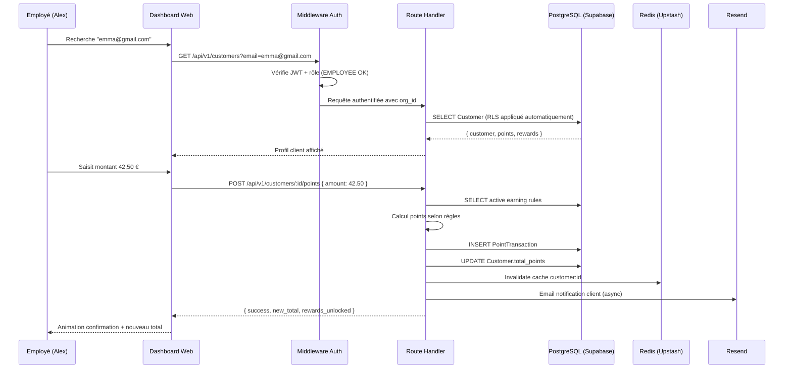

### Flux 2 — Consultation widget client final

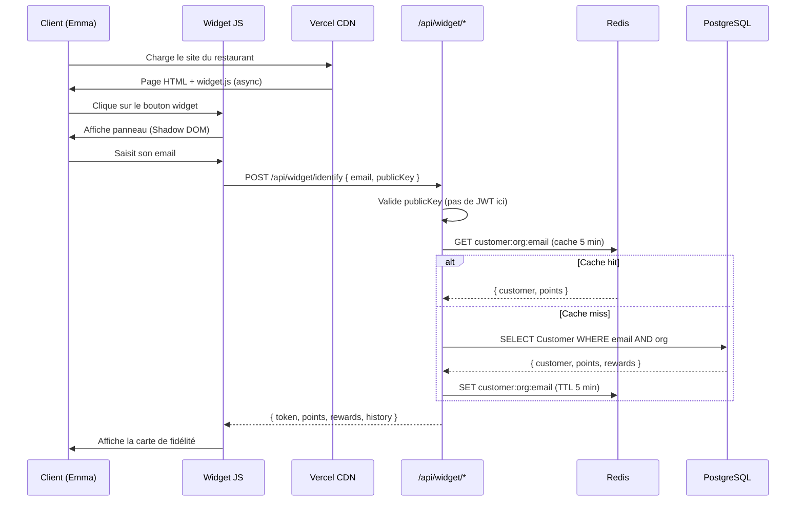

### Flux 3 — Score de churn et alerte

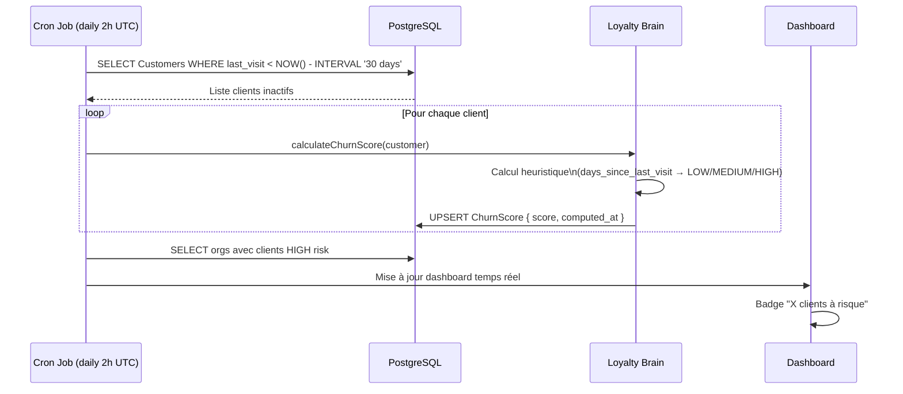

---

## 5. Base de données — Schéma évolutif

### Entités et relations (résumé)

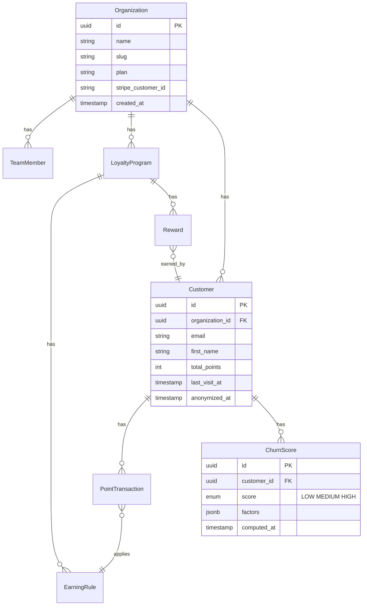

### Évolution du schéma par phase

| Phase   | Nouvelles entités / champs                    | Justification                  |
| ------- | --------------------------------------------- | ------------------------------ |
| MVP     | Schema complet ci-dessus                      | Fondation                      |
| Phase 2 | `Referral`, `Tier`, `EmailCampaign`, `ApiKey` | Parrainage, niveaux, campagnes |
| Phase 2 | `Widget.apple_wallet_pass_id`                 | Integration Wallet             |
| Phase 3 | `AiModel`, `TrainingRun`                      | ML propriétaire                |
| Phase 3 | TimescaleDB extension                         | Analytics time-series          |

### Stratégie de migrations

- Prisma Migrate pour toutes les migrations
- Migrations testées sur base de staging avant production
- Migrations réversibles uniquement (pas de DROP sauf avec backup vérifié)
- Règle : **jamais de migration qui bloque la table** (toujours ADD COLUMN nullable, puis backfill, puis NOT NULL en separate migration)

---

## 6. Sécurité — Threat model

### Menaces identifiées et mitigations

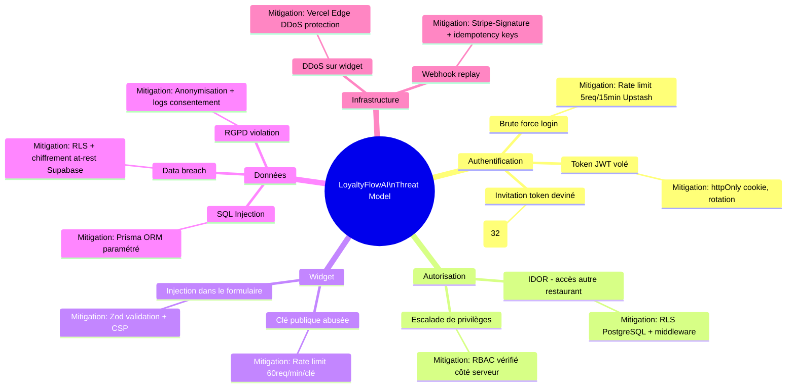

### Matrice de risque sécurité

| Risque                                | Probabilité | Impact   | Mitigation                           |
| ------------------------------------- | ----------- | -------- | ------------------------------------ |
| IDOR restaurateur → restaurateur      | Faible      | Critique | RLS + middleware double check        |
| Brute force login                     | Moyenne     | Élevé    | Rate limiting Upstash                |
| Widget spam (attribution frauduleuse) | Moyenne     | Moyen    | Rate limiting + validation employé   |
| Fuite de clé Stripe                   | Très faible | Critique | Env variables Vercel, jamais en code |
| XSS via widget                        | Faible      | Moyen    | Shadow DOM + CSP                     |

### Headers de sécurité (Next.js middleware)

```
Content-Security-Policy: default-src 'self'; script-src 'self' cdn.loyaltyflowai.fr
X-Frame-Options: DENY
X-Content-Type-Options: nosniff
Referrer-Policy: strict-origin-when-cross-origin
Permissions-Policy: geolocation=()
Strict-Transport-Security: max-age=31536000; includeSubDomains
```

---

## 7. Scalabilité et limites

### Limites par plan (usage produit)

| Plan          | Clients max | Transactions/mois | Emails/mois |
| ------------- | ----------- | ----------------- | ----------- |
| Starter (49€) | 500         | ~5 000            | ~2 000      |
| Growth (149€) | 5 000       | ~50 000           | ~20 000     |
| Pro (299€)    | Illimité    | Illimité          | ~200 000    |

### Limites techniques (infrastructure)

| Composant           | Limite actuelle                                 | Scaling                |
| ------------------- | ----------------------------------------------- | ---------------------- |
| Vercel Serverless   | 10s timeout, 1024MB RAM                         | Horizontal automatique |
| Supabase PostgreSQL | 500 MB (plan Free), 8 GB (Pro)                  | Upgrade plan           |
| Upstash Redis       | 10 000 req/jour (Free), 500 000 (Pay as you go) | Scale automatique      |
| Resend              | 3 000 emails/mois (Free), 50 000 (Pro)          | Upgrade plan           |

### Stratégie de scalabilité par phase

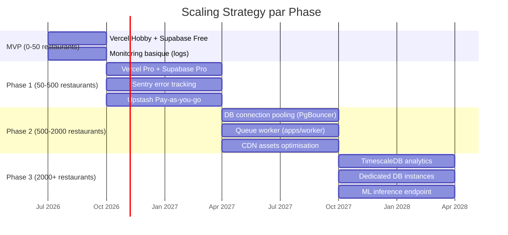

### Goulots d'étranglement identifiés

| N°  | Goulot                                  | Phase     | Mitigation                  |
| --- | --------------------------------------- | --------- | --------------------------- |
| 1   | DB connections saturées                 | Phase 1-2 | PgBouncer pooling           |
| 2   | Emails en masse (campagnes)             | Phase 2   | Queue worker + batch Resend |
| 3   | Calcul de churn sur grands datasets     | Phase 2   | Job async nightly           |
| 4   | Widget à fort trafic (restaurant viral) | Phase 1   | Cache Redis agressif        |

---

## 8. CI/CD et qualité

### Pipeline CI (GitHub Actions)

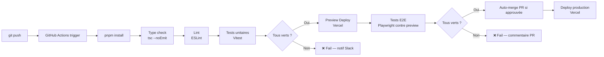

### Environments

| Env         | Branche    | Déclencheur        | URL                      |
| ----------- | ---------- | ------------------ | ------------------------ |
| Development | locale     | Manuel             | localhost:3000           |
| Preview     | feature/\* | PR ouverte         | pr-xxx.vercel.app        |
| Staging     | staging    | Merge vers staging | staging.loyaltyflowai.fr |
| Production  | main       | Merge vers main    | loyaltyflowai.fr         |

### Standards qualité

| Standard        | Outil                           | Seuil                  |
| --------------- | ------------------------------- | ---------------------- |
| Type safety     | TypeScript strict               | 0 erreur               |
| Linting         | ESLint (config packages/config) | 0 warning              |
| Tests unitaires | Vitest                          | Coverage > 70 %        |
| Tests E2E       | Playwright                      | Cas critiques couverts |
| Bundle size     | Vercel Analytics                | < 200 KB First Load JS |
| Performance     | Lighthouse                      | LCP < 2.5s             |

---

## 9. Observabilité

### Signaux à monitorer (Phase 1)

| Signal               | Source           | Alerte si…                   |
| -------------------- | ---------------- | ---------------------------- |
| Error rate           | Sentry           | > 1 % des requêtes en erreur |
| P99 latence API      | Vercel Analytics | > 2 000ms                    |
| DB query time        | Supabase         | > 500ms en median            |
| Email deliverability | Resend           | Bounce rate > 5 %            |
| Widget load time     | Browser (RUM)    | > 3 000ms                    |

### Logs structurés

Chaque log doit contenir :

```json
{
  "timestamp": "2026-06-28T14:30:00Z",
  "level": "error",
  "service": "api",
  "organization_id": "org_xxx",
  "trace_id": "trace_xxx",
  "message": "Failed to attribute points",
  "error": { "code": "DB_TIMEOUT", "detail": "..." }
}
```

→ Implémenté via `packages/logger` (créé lors de la phase hardening)

---

## 10. Décisions architecturales en suspens

| ID     | Question                                                  | Options                                    | Impact             | Priorité       |
| ------ | --------------------------------------------------------- | ------------------------------------------ | ------------------ | -------------- |
| ADR-08 | Widget : polling vs WebSocket pour mise à jour temps réel | Polling 30s (simple) vs WS (complexe)      | UX widget          | P1 — avant MVP |
| ADR-09 | Identification client : email seul vs email+téléphone     | Email seul (simple) vs email+tel (robuste) | Acquisition        | P1 — avant MVP |
| ADR-10 | Attribution physique : manuelle vs intégration POS        | Manuelle (MVP) vs POS (Phase 2)            | Expérience employé | P2             |
| ADR-11 | Multi-region : EU uniquement vs global                    | EU only (RGPD) vs global (expansion)       | Compliance + coût  | P3             |
| ADR-12 | ML propriétaire : quand et sur quelles données ?          | J+18 mois si > 1M transactions             | Différenciation    | P3             |

---

_Ce document est une vue complète de l'architecture technique au 2026-06-28. Les ADRs formels sont dans [ARCHITECTURE.md](./ARCHITECTURE.md)._
_LoyaltyFlowAI — Confidentiel — © 2026_
